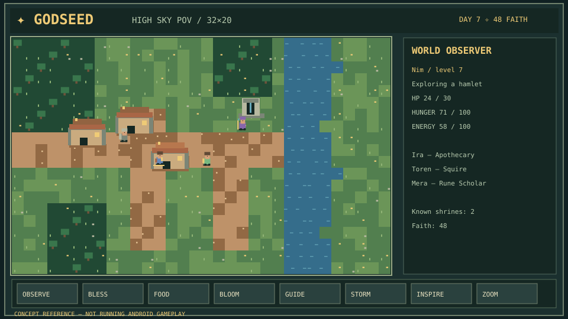
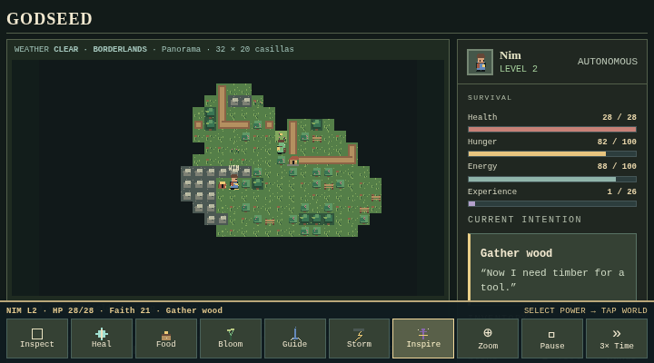
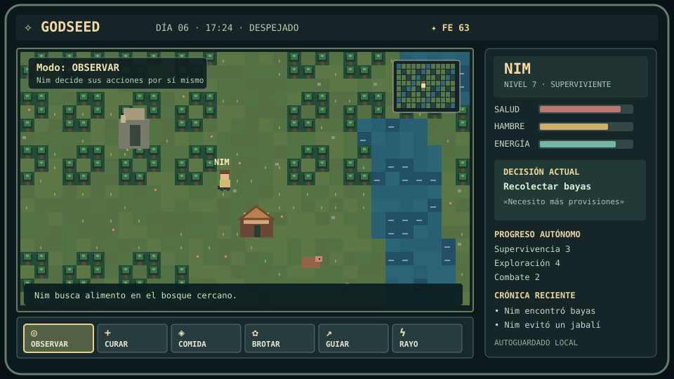
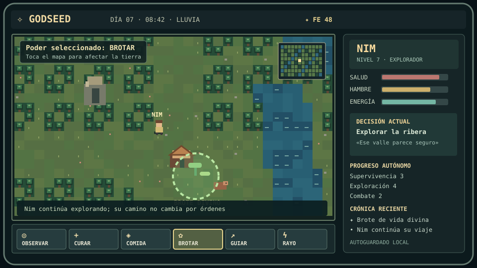

## Storage requirement — 1 GB core + up to 5 GB optional (future goal)

GODSEED's intended **core installed content is approximately 1 GB**, plus **up to 5 GB additional optional user-approved app-managed storage**, for a **nominal 6 GB total**. This is Android persistent **disk**, not RAM; it is not yet the actual APK size. Do **not** pad the prototype to 1 GB or preallocate optional storage. Offline core gameplay must work with zero expansion content and reserve free phone space.

[Storage policy](docs/STORAGE_BUDGET_AND_PACKS.md) · [Budget configuration](config/storage-budget.json) · [Five added storage tasks](work-items/storage-tasks.json) · [Codex handoff prompt](docs/CODEX_CLOUD_READY_PROMPT.md).

## GODSEED product architecture and final Codex handoff (2026-10-17)

**Canonical product and Android references:** [Intended game experience](docs/GODSEED_INTENDED_GAME.md) · [Why HTML inside the APK / Android host architecture](docs/ANDROID_HTML_APK_SPEC.md) · [Readiness gates P/I/R](docs/HANDOFF_READINESS.md) · [Final prompt to paste into Codex Cloud](docs/CODEX_CLOUD_READY_PROMPT.md).

This branch provides implementation documentation, original starter art and a tested preparation workflow; **the new renderer, production Android wrapper and physical-device tests are NOT complete**. Codex should begin from `prep/codex-skyworld-v0.5` and follow the final prompt rather than starting on `main`.

## Preparación para Codex Cloud — pixel medieval de vista elevada

**No es una nueva versión jugable.** La rama `prep/codex-skyworld-v0.5` reúne un paquete listo para implementar sin tocar el funcionamiento actual. El objetivo posterior es una vista cenital *más alta*, predeterminada **32×20 casillas**, con detalle de píxeles cuadrados, sprites 2D medievales, aldeas, caminos, santuarios, NPC autónomos e intervenciones divinas legibles.

**Documentación y punto de entrada:** [Prompt de implementación Codex Cloud](docs/CODEX_CLOUD_BUILD_PROMPT.md) · [Guía de estilo](docs/PIXEL_WORLD_STYLE_GUIDE.md) · [Plan de 25 tareas](docs/IMPLEMENTATION_SLICES.md) · [Manifiesto de assets](assets/asset-manifest.json) · [Handoff](docs/CODEX_HANDOFF.md).

**Recursos comprometidos:** 3 referencias SVG, 4 atlas PNG originales y reproducibles, paleta JSON, generador/validador de assets, 25 tareas por lotes de cinco y criterios de aceptación. Los atlas son **starter / no integrados** en el render actual. Los SVG son conceptos, **no capturas Android**. Ejecutar validación: `node scripts/validate_asset_manifest.mjs`.

**Vistas conceptuales del siguiente renderer (no gameplay):**

[](assets/concepts/godseed-skyworld-overview.svg)

[Close-up 2D character concept](assets/concepts/godseed-character-inspect.svg) · [Divine interaction concept](assets/concepts/godseed-divine-reaction.svg) · [Prepared Codex runbook](docs/CODEX_RUNBOOK.md) · [Asset generator](scripts/generate_starter_assets.mjs) · [Task ledger](work-items/codex-tasks.json).


# The Idle Open World Universe — GODSEED

**GODSEED v0.2** is an experimental build of an **offline Android god-observation RPG/simulation** for older phones. You are the god; **Nim** is an independently acting, rule-driven pixel-world inhabitant. You cannot control Nim directly. You can watch exploration, survival, crafting, wildlife encounters, leveling and memories, and change the world indirectly using Faith-powered divine actions.



## GODSEED v0.4 — Cámara cenital ampliada (experimental)

La nueva rama `feat/skyview-zoom-v0.4` incorpora una vista **top-down** sin ángulo 3D y cámara centrada en Nim. El zoom predeterminado muestra **24×15 casillas**; el botón táctil `Zoom` o la tecla **Z** alternan **Muy cerca (16×10)** y **Panorama (32×20)**. Nim y los viajeros aparecen como personajes 2D medievales mejor diferenciados, y el jugador sigue siendo un **dios observador**, no controla directamente a Nim.

Se probó el funcionamiento del zoom y el encaje de diez controles táctiles a 640×360, 720×400 y 960×540 en Chromium. Los controles siguen siendo offline. La rama experimental construye una **APK v0.4 de depuración** que requiere todavía pruebas en un teléfono Android real. [Ver alcance, pruebas y los siguientes cinco trabajos](docs/SKYVIEW_CAMERA_V04.md).

## GODSEED en español — el jugador es el dios

**Un mundo vivo. Un solo personaje. Tú observas e influyes.** GODSEED es un juego de simulación y aventura RPG de píxeles, pensado para Android antiguo, sin conexión a internet y con controles táctiles en horizontal.

Nim **vive por su cuenta**: explora el mundo, busca comida, construye refugios, descansa, evita amenazas, pelea con animales, encuentra ruinas, descubre rumores y sube de nivel. Aprende habilidades usándolas y acumula recuerdos. **No es una IA consciente ni necesita internet:** su comportamiento procede de un simulador ligero basado en reglas.

Tu función es la deidad. Puedes inspeccionar el terreno, usar Fe para curar, entregar comida, hacer brotar recursos, guiar o lanzar rayos y ajustar la velocidad del tiempo. **No controlas directamente el movimiento ni el combate de Nim.** El mundo solo se simula mientras la aplicación está abierta.

En la rama experimental v0.2 están implementados cinco sistemas adicionales inspirados en las **mecánicas generales** del video facilitado (no en su aspecto 3D): origen personal, cinco habilidades que mejoran por uso, defensa táctica automática, trampas en ruinas y pistas de rumores. Pueblos completos, NPC conversacionales y mazmorras propias son ideas posteriores.

### Cómo se propone que se vea en Android

> **Maquetas conceptuales (no capturas reales del APK):** muestran una posible evolución visual para móviles. La interfaz de la APK actual todavía es diferente y no se ha comprobado su arranque en un dispositivo físico.

**1. Nim explora solo**



**2. El dios usa Brotar para influir en el mundo**



[Ver las decisiones de diseño, pantallas y próximos cinco pasos](docs/ANDROID_UI_VISION.md). También hay [una captura real del navegador](assets/godseed-android-landscape-720x400.png) para comparar el estado actual con la propuesta.

## Download and play

- **[Download the Android APK (v0.2 debug prototype)](dist/GODSEED-v0.2-debug.apk)** — minimum Android 8.0/API 26; landscape; offline; no requested Android permissions. Install manually from a source you trust. Android may block unknown apps by default.
- **[Play the offline HTML preview](GODSEED-Play.html)** — downloads as one self-contained file. Browser storage and Android app storage are separate.
- [Project state and next five tasks](PROJECT_STATE.md) · [Full design batches](docs/DESIGN.md) · [Verification evidence](docs/QA_REPORT.md)

**Do not treat this as a production-ready APK.** The Android package's hand-generated Dalvik/bootstrap and WebView storage behavior have **not been verified on a physical Android device or emulator**. The APK is **JAR v1 debug signed** and targets Android API 28. It is not Play Store compliant by current standards. Back up gameplay data using the built-in text export before uninstalling, clearing app data, or changing signing identities.

## What exists

The procedural world uses a 64×48 tile grid rendered with 2D Canvas and minimal pixel styling. Nim independently chooses priorities from hunger, energy, danger, resources and discovery. It pathfinds across available land, gathers resources, levels up, attempts crafting and shelter, explores ruins, and records events. Faith buys Heal, Food, Bloom, Guide or Lightning interventions. The player can pause, step, and adjust game speed.

Nim is **not a sentient AI or LLM**. This is a small deterministic simulation with fixed, inspectable decision rules, designed to work offline on low-end Android hardware. Simulation runs **only while the app is open**; no background world evolution is implemented.

## Structure

- `src/sim.js`: game simulation, Nim's planner, persistence validator, progression, wildlife, and god powers.
- `src/ui.js`: rendering, mobile controls, chronicle, backups, speed, camera, and minimap.
- `index.template.html`, `build.py` → `GODSEED-Play.html`: standalone browser game.
- `android/`: Android reference manifest/activity and the experimental SDK-free APK builder.
- `dist/GODSEED-v0.2-debug.apk`: current experimental Android artifact; v0.1 remains for reference.
- `tests/`: Node simulation, browser/mobile smoke, and APK structure checks.
- `docs/`: roadmap and QA limits. `assets/`: real browser captures.

## Reproduce

Needs Python 3.11+, Node 20+; for APK rebuild requires Java JDK (`keytool`, `jarsigner`). The desktop browser tests additionally need Playwright and Chromium; those are not required to run the game.

```bash
python build.py
node --test tests/sim.test.js
python android/build_apk.py
python tests/test_android_package.py
# With Playwright + Chromium available:
python tests/browser_smoke.py
python tests/mobile_acceptance.py
```

The SDK-free builder creates a **new debug keystore** in `android/debug-only/` if none exists. This folder is gitignored and **must never be published or used for production signing**. CI signs with an ephemeral key; builds from different machines are **not update-compatible** without the original key. A supported Android SDK/Gradle build and protected signing identity are needed before distributing stable updates.

## Source of truth

This repository contains the code and project documentation. Work in verified batches of five tasks and update `PROJECT_STATE.md` whenever gameplay or packaging changes. Prioritize battery efficiency, reliability, save continuity, readable pixel UI and unattended Nim behavior over 3D graphics or large AI models.

## Status

- Baseline v0.1: 10/10 deterministic Node tests passed in the initial transfer; v0.2: 15/15 were reported passing in its feature implementation (not rerun for this documentation-only change).
- Offline browser smoke and mobile-size controls/backup tests passed in Chromium.
- APK ZIP, binary manifest, DEX structural checks and JAR-v1 signature checks passed.
- Physical Android installation, frame rate, battery and memory measurements: **not verified**.

## New v0.2 adventure depth (inspired by mechanics in a user-supplied gameplay clip)

Five deterministic origins; survival/scouting/combat/crafting/lore proficiencies learned through play; automated combat dodge/parry; traps in ruins; and rumors linking discoveries. These are autonomous simulation mechanics, not a visual recreation of WYLDHEART. See [video feature translation](docs/VIDEO_FEATURE_TRANSLATION.md).
