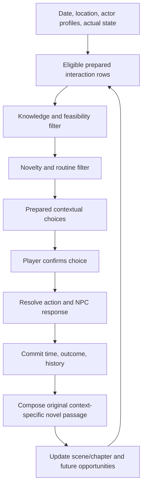

# GODSEED — Interaction row map and narrative preparation

Status: owner-approved direction (Q20, Q31–34); proposed technical design awaiting review. No live content engine is implemented. Preserve the approved vertical text-only interface, prepared choices, one shared clock, observation boundaries, and atomic Continue.

## Workflow

A row is a reusable action/scene definition, not a fixed speech line. It contains: stable interaction ID, semantic family, actor/target roles, location/time/stage prerequisites, actor knowledge and capability requirements, dialogue intent, alignment/trait/stat influences, eligible responses and consequences, duration, resource/domain effects, observation scope, novelty signature, cooldown and repetition category, narrative source references, and validation status. Result records link row, contextual variant, actor(s), date, state revisions, and actual committed outcome.

### Interaction row map (initial illustrative design, not canon)

| Family | Example prepared choices | Context/response differentiation |
|---|---|---|
| Home and routine | Wake, prepare breakfast, return home, sleep | Routine exception for opening/closing day; condition, weather, obligations alter prose. |
| Neighbor | Greet, ask for advice, help with a task, decline | Prior contact, needs, alignment, trust, available time and knowledge. |
| Shop | Buy, compare, inquire about work, offer help | Stock, prices, funds, seller condition, prior purchases. |
| School | Attend lesson, ask a question, practice, socialize | Age, institution, attendance, teacher, skill, curriculum. |
| Employment | Ask about vacancy, work shift, negotiate, resign | Actual opening, qualifications, employer funds, obligations, rare transitions. |
| Health | Seek help, rest, accept/refuse treatment | Symptoms, knowledge, actual provider, treatment efficacy and costs. |
| Travel | Choose route, board transport, approach destination | Actual access, distance, conditions, schedule and perceived hazards. |
| Society | Join activity, assist, respond to local event | Community history, relationships, personal goals, ongoing events. |
| Conflict | Withdraw, negotiate, defend, use known technique | Contextual combat, actual threat, conditions, observable risk. |
| News | Read relevant report, ask a known NPC about it | Date, available media, report provenance, NPC knowledge; no hidden truth. |
| Repair | Report damage, offer assistance, pay for repair | Ownership, resource budget, ability/skill, actual damage and time. |

### Non-repetition rules

Distinguish identical prose, same semantic interaction, and repeated necessary gameplay action. Do not offer cosmetic rewrites as new gameplay. Maintain per-actor, per-pair and scene history; suppress recently resolved non-routine semantic duplicates unless conditions/outcome materially differ or the player deliberately repeats an available action. Never force a new NPC objective or event just to create variety. NPCs can perform necessary repeated offscreen work, meals and movement; aggregate those activities rather than narrating the same exchange repeatedly. Start/end-of-day routines are explicit narrative exceptions, but vary detail when context differs. Preserve legitimate player access to necessary actions. If no distinct eligible interaction exists, acknowledge the situation and present valid travel/wait/other choices instead of fabricating events.

Proposed novelty metrics: exact normalized output duplicate check, semantic signature (action + roles + purpose + state/outcome change), cooldown/recent-history window, diversity of interaction families, repeated scene audit. Distinct NPC stats and alignment must change credible response selection, not just phrasing. Do not guarantee infinite uniqueness for finite content; require expanding prepared content and meaningful state changes. Chapter labels organize scenes/date transitions; do not make the player follow predetermined plot rails.

### Dialogue and novel composition

Prepare character voice profiles, vocabulary boundaries, known facts, personal history, alignment, traits, relationship values, current concerns, conversation intents, response alternatives, and consequence rules before launch. Select/compose replies from these authored ingredients at runtime rather than fix an entire conversation tree in advance. Knowledge provenance and conversation history gate every response. A given topic can produce refusal, answer, partial answer, advice or follow-up depending on actual NPC state. Do not make an NPC forget a prior conversation or misremember it to create variation. Persist facts and outcomes; prose is a projection of actual committed events. Long paragraphs when meaningful; do not pad uneventful activity or repeat previous descriptions. No free-text input. No external paid LLM dependency assumed; any future optional generator must not invent canonical facts or change game state.

### News preparation

Author date/stage-aware event families, news source profiles, report templates, fictional organizations/locations, relevance filters, claim provenance and audience rules. Actual world events produce current local reports; prepared historical/background news can establish setting before the opening date. Distant regions may have original off-map reports explicitly distinguished from playable areas. News can carry unverified claims or misinformation as attributed content, not objective world state or false NPC memories. Selection uses actual fictional calendar, event occurrence, relevance to local NPCs/characters, hero/villain status and stage; no announcement of future event as fact. Use a world-event ledger and separate report IDs. Avoid duplicate articles except materially new developments. Actual map coverage and opening calendar remain pending.

## QA gates

Verify eligible choices only; no hidden knowledge leakage; no repeated Continue; no identical non-routine dialogue in repeatable scenarios; meaningful response/outcome diversity under changed NPC profiles; preserved legitimate routine actions; no fabricated world events; source-linked chapter prose; date-correct news; save/rewind restores appropriate history and novelty state. Review a playable multi-day sample manually for prose quality and experience flow. No implementation, generated narrative corpus or tests completed in this document.
