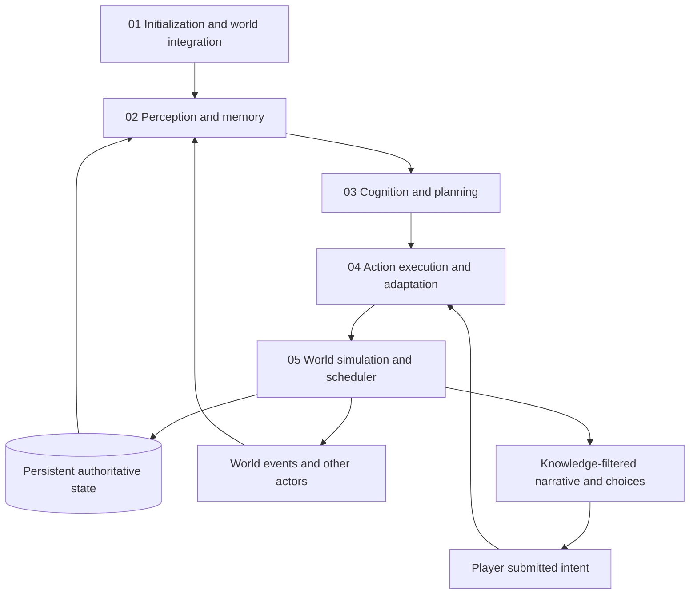
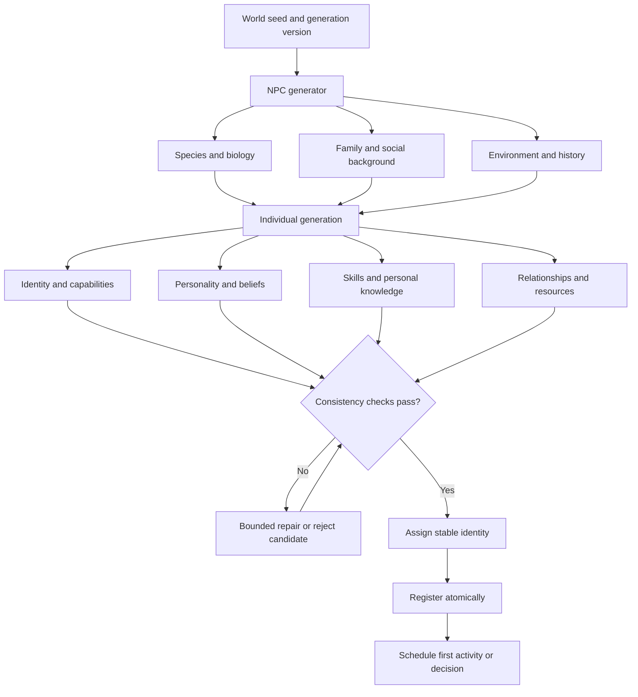
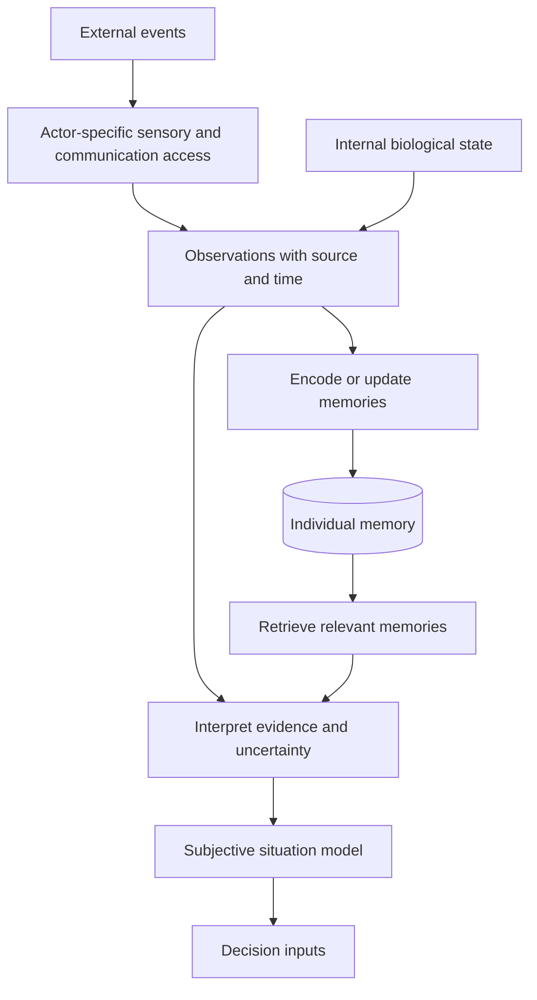
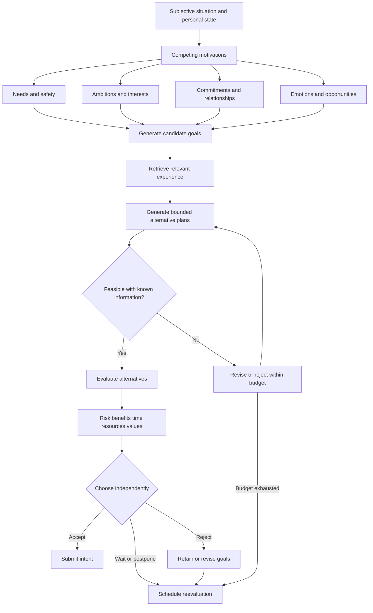
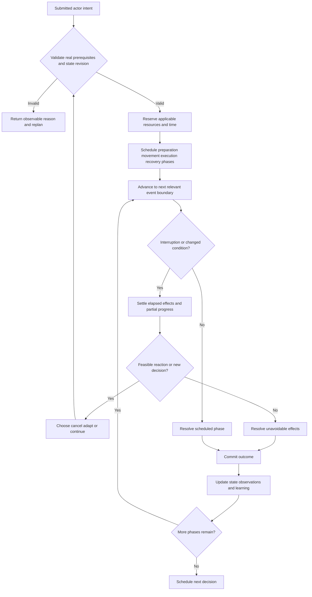
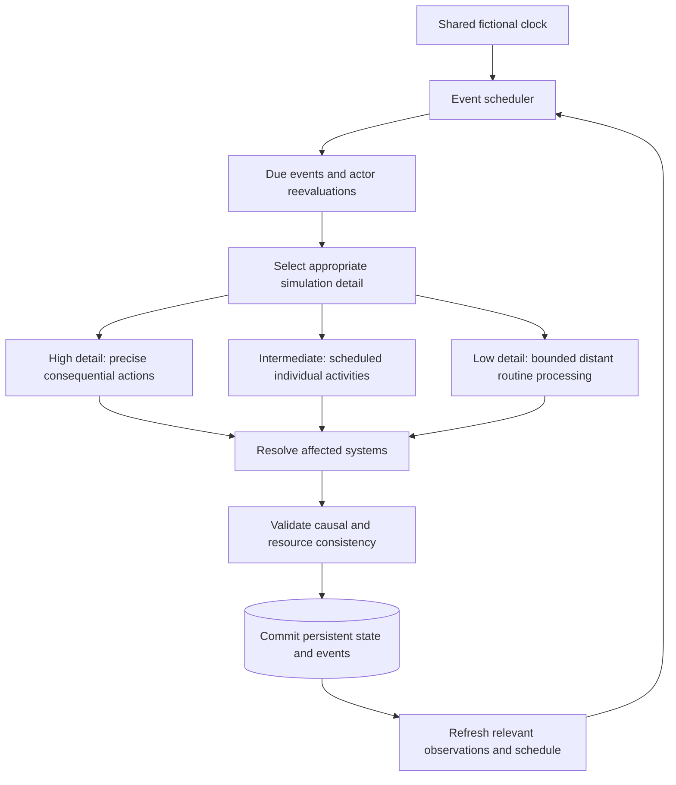

# GODSEED — Autonomous NPC architecture and workflow V2

Date: 2026-11-26 | Status: design proposal recorded at owner request; not a runtime implementation or blanket owner approval. Engine-independent, novel-style text RPG. Scope: five interconnected layers from NPC generation through independent world simulation.

## 1. Authority and constraints

Preserve the rules in [GAMEPLAY.md](GAMEPLAY.md), [TIME_AND_ACTIVITY.md](TIME_AND_ACTIVITY.md), [CHARACTER_CREATION.md](CHARACTER_CREATION.md), [ATTRIBUTES.md](ATTRIBUTES.md), [CHARACTER_STATUS.md](CHARACTER_STATUS.md), [WORLD.md](WORLD.md), [ECONOMY.md](ECONOMY.md), [LOCAL_LIFE.md](LOCAL_LIFE.md) and [POPULATION_AND_EMPLOYMENT.md](POPULATION_AND_EMPLOYMENT.md). Later owner decisions take priority over this proposal.

- One persistent world seed and timeline; character succession does not reset the universe. Save/rewind scope and reload judgement rules are governed by the latest gameplay decisions, not redefined here.
- Time pauses during reading, menu selection and character creation; NPCs act independently when fictional time advances, not during real-world waiting.
- NPCs have individual capabilities, knowledge, choices, resources, relationships and histories. No automatic player cooperation, universal knowledge or predetermined character destiny.
- Player and NPC actions use comparable feasibility, time, distance, environment, reflexes, injuries, progression and resource rules. One superhuman ability per eligible individual, not guaranteed at generation.
- Narrative is a projection of resolved state and available knowledge, never the simulation authority. Keep the main interface simple. No HTML or engine choice established.
- Existing NPC IDs and local roster remain intact. The first development slice is Apartment B2 and its documented surrounding anchors; no new geography or population records are created here.

## 2. Architecture overview

The blueprint defines structure and constraints, not a fixed sequence of life choices. The scheduler determines when actors need evaluation; it does not dictate which valid action they choose.

## 3. Layer 01 — Initialization and world integration

Proposed blueprint records:

| Record | Contents and responsibility |
|---|---|
| Species | Anatomy, vital functions, needs, life stages, potential and relevant constraints |
| Identity | Stable NPC ID, name, age/birth date, origin, residence, current location, life status |
| History | Actual or generated prehistory with dates, origins, evidence and linked events |
| Personality | Traits, values, beliefs, preferences, risk tolerance, adaptive emotional state |
| Capabilities | Base/effective attributes, field mastery, learned skills, ability and techniques if applicable |
| Biology | HP, injuries, functional limitations, needs and recovery |
| Social | Relationship edges, family, affiliations, commitments and individual social knowledge |
| Economy | Ownership, balances, provenance, occupation, agreements and liabilities |
| Goals | Current needs, ambitions, competing priorities, plans and deferred goals |
| Runtime | Activity phase, decision/event schedule, observations, random stream and revision |

Initialize coherent histories and relationships before activation. Do not assign impossible ages, jobs, knowledge, powers, assets or locations. Separate reusable definitions from individual mutable state. Generation errors must terminate with a bounded repair/rejection policy, not an endless loop. Seeded initial generation is reproducible for the same inputs/version as a design target; historical state must be saved separately. Existing authored characters are migrated or validated, not silently regenerated.

## 4. Layer 02 — Perception, knowledge and memory

Inputs include vision, hearing, distance, visibility, communication, accessible records, pain, fatigue, hunger and current physical/emotional condition where defined. A character may learn through experience, education, reports or interactions. Preserve the difference between authoritative fact, observation, rumor, inference, belief and unknown information. False beliefs and incomplete memories may influence choices without changing reality. Preserve evidence provenance and timestamps; revise beliefs only from actual accessible evidence. Memory retrieval can be bounded and relevance-based. Any forgetting/consolidation policy is an open proposal and must not silently destroy persistent identity, significant experiences or history. Other actors and the player cannot inspect hidden cognition merely by being nearby.

Suggested observation fields: observation ID, observer ID, event/source reference, perceived time and location, perceived content, confidence, access basis, interpretation and revision. Private world truth is not a decision input unless the actor is entitled to it.

## 5. Layer 03 — Cognition, goals and decisions

Proposed model: bounded goal-oriented planning plus subjective utility comparison. Candidate actions come from defined capabilities, accessible opportunities and learned methods. Do not equate perceived feasibility with real feasibility; the executor validates against authoritative state. Account for personality, experience, urgency, social obligations, opportunity cost, uncertainty and expected consequences. NPCs can make mistakes, reject offers, rest, abandon objectives or change priorities. No mandatory optimal choice or deterministic profession based on personality. Provide a valid wait/reevaluation outcome when no action is feasible; avoid zero-time retry loops.

Illustrative non-canon responses to a discovered rift: an ambitious NPC may enter, a cautious NPC may investigate, a protective NPC may return home, and an opportunistic NPC may seek profit. None is a guaranteed trait-to-action mapping or evidence of hidden rift objectives.

## 6. Layer 04 — Action execution and adaptation

An action is an intent with actor, target, method, time/phase requirements, prerequisites, resource/access conditions, interruption points, progress and stable event identity. Execution may succeed, partially succeed, fail or be abandoned. Revalidation must preserve previously completed phases and avoid charging resources twice. Concurrent actors share the same fictional interval; resolve contested resources, positions and effects through explicit causal rules. Timing depends on action duration, speed, environment and distance; reflexes influence feasible reactions, not guaranteed evasion. Apply injury and biological consequences, actual learning, economic transactions and relationship changes only as warranted. Observations are emitted to eligible actors, not broadcast as omniscient knowledge.

The scheduler returns control at meaningful player decision boundaries; NPC-only decisions can resolve within the submitted player interval. A player action is not a global turn. No fixed extra confirmation for ordinary Continue.

## 7. Layer 05 — World simulation, scheduling and scalability

| Candidate detail | Intended use | Preservation requirement |
|---|---|---|
| High | Combat, dangerous incidents, complex interactions and significant events | Fine timing, location, anatomy, observations and decisions |
| Intermediate | Employment, travel, training, relationships and ordinary scheduled activities | Individual actor, time, costs, commitments and outcomes |
| Low | Distant routine activities and population-level summaries | Stable individuals, significant actions and memories, obligations and causal history |

Use event-driven reevaluation, not a full-world per-frame scan. Detail may increase for consequential events anywhere, not only near the player. Promote before resolving events requiring finer timing; reconcile partially completed activities without restarting, duplicating or retroactively inventing outcomes. Reduce detail only at safe boundaries. Bound retries and computational budgets; use a fair due-event queue so nonurgent actors are not permanently starved. If processing cannot complete, preserve pending work and do not claim unprocessed events occurred. Exact fidelity policies and performance targets need testing; no percentage values are established.

Relevant world domains: economy, population, education, employment, politics, organizations, crime, rifts, environment, news/communication, healthcare and infrastructure. These are module boundaries for later development, not evidence of implemented subsystems.

## 8. Proposed integration contracts and persistence

| Contract | Input | Output / invariant |
|---|---|---|
| Generation | Seed, version, blueprint, established world constraints | Validated stable actor and scheduled first decision |
| Perception | Actor, event, accessible context | Actor-specific observations; no hidden-data leak |
| Cognition | Actor's subjective knowledge, state and opportunities | Intent, deferred goal or scheduled wait; no direct authoritative mutation |
| Execution | Intent, actual state/revision and time | Validated events, partial progress and actual consequences |
| Scheduler | Due event queue, clock and actor plans | Causally ordered event boundaries; fair reevaluation |
| Persistence | State revisions, committed events, seed and random state | Recoverable coherent snapshot/journal; no duplication |
| Narrative | Resolved events and player-accessible knowledge | Appended story, header and feasible choices |

Recommended separation: immutable definitions, mutable individual/world state, actor-specific knowledge, scheduled events and committed journal. Use stable identifiers and revision checks for conflict detection and idempotent effects. Preserve NPC memory, identity, injuries, locations, owned assets, employment, relationships, goals, activity phases and random state across save/load, detail transitions and character succession. Respect the approved three-slot UI and reload judgement constraints; do not settle unresolved rewind scope in this document. Technical crash recovery must not fabricate a fresh world or replay effects twice.

## 9. Verification plan — all pending runtime implementation

| ID | Scenario | Required result |
|---|---|---|
| NPC-01 | Same generation inputs and version | Reproducible initial candidate data; unique IDs and valid references |
| NPC-02 | Existing authored roster initialization | Preserve existing identities and plausible history; no duplicate actors |
| NPC-03 | Two actors witness different parts of an incident | Different evidence and beliefs; no hidden information leak |
| NPC-04 | Same opportunity, different values and resources | Independent feasible choices; refusal and delay possible |
| NPC-05 | False belief leads to invalid action | Actual state prevents impossible execution; actor learns only observable reason |
| NPC-06 | No feasible plan | Bounded wait/replanning; no infinite loop |
| NPC-07 | Concurrent work and travel | One actor cannot spend exclusive time twice or occupy incompatible locations |
| NPC-08 | Competing NPCs seek the same resource/job | Resolve actual availability without double allocation |
| NPC-09 | Interrupted action | Preserve elapsed time, costs and progress; no duplicate rewards |
| NPC-10 | Reflex response and leg injury | Physical movement constraint matters despite intact reaction capability |
| NPC-11 | Distant emergency | Appropriate detail promotion, independent action and no automatic player notification |
| NPC-12 | Detail promotion/demotion mid-activity | Same identities, resources, injuries and partial progress retained |
| NPC-13 | Scheduler under sustained urgent load | Nonurgent eligible actors receive eventual fair review |
| NPC-14 | Save/reload and crash recovery | Preserve coherent state and random stream; no duplicate effects |
| NPC-15 | Player death and successor creation | Existing NPC/world history persists, same seed, no automatic knowledge transfer |
| NPC-16 | Reading and menus | No fictional time advancement or NPC mutation |
| NPC-17 | Economic settlement | Funds and ownership reconcile; no phantom money or items |
| NPC-18 | Narrative projection | Only observed/valid known outcomes, no forced unselected action |
| NPC-19 | Long simulation and resource stress | Measure runtime, memory and queue delays against future agreed targets |

No runtime test has been run for this document. These are acceptance targets, not passing results.

## 10. Development order and handoff

1. Define schema and invariants for actor identity, species, history, attributes, knowledge and state. Validate existing 12-NPC roster and referenced locations.
2. Define observation/memory contracts and test evidence boundaries.
3. Define bounded decision inputs, goal/plan state and intent contracts; demonstrate varied, independent choices with synthetic fixtures.
4. Implement shared clock, event scheduler and action validation; verify parallel actor timelines, interruptions and partial effects.
5. Integrate authoritative persistence and transactional domain effects. Test recovery and succession, respecting outstanding save decisions.
6. Add and measure simulation detail policies, fairness, scale and narrative projection. Integrate remaining domains incrementally.

Open decisions: engine/language, schema serialization, actual actor needs, personality representation and adaptation, memory consolidation, planning weights and randomness, exact time unit and scheduler ordering, action definitions/durations, spatial representation, injury and progression formulas, low-detail fidelity and performance targets, and rewind/penalty enforcement. Do not implement arbitrary values as owner-approved constants.

Next recommended milestone: NPC blueprint schema and validation contract, before integrating a full NPC decision engine. The proposed module boundaries, bounded planning, detail promotion and verification cases are assistant design recommendations recorded for review. This document creates no runtime code, game data, generated NPCs or tests.
