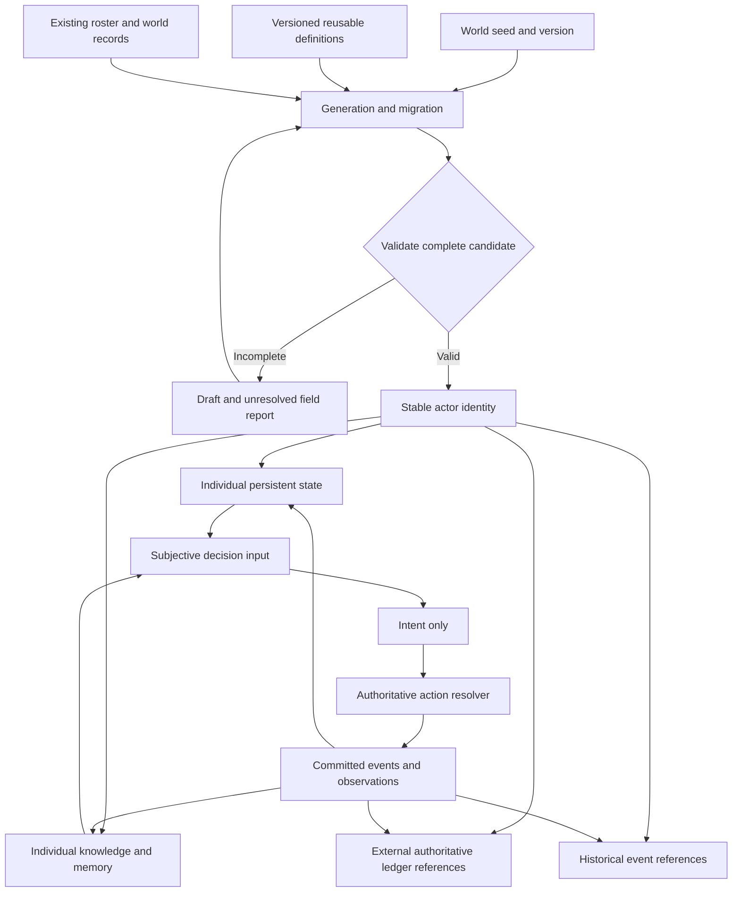
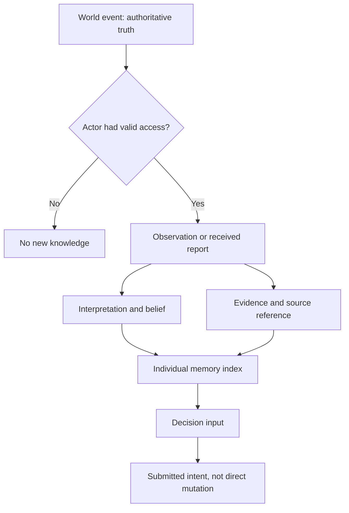
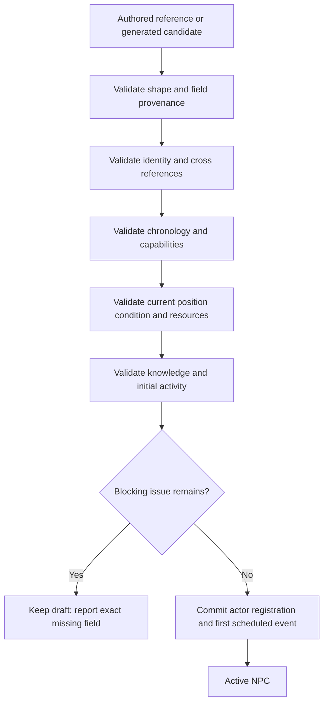

# GODSEED — NPC blueprint and data contract V1

Date: 2026-11-26 | Status: delegated design work; proposed technical specification. This completes the blueprint-design increment, not NPC implementation. Engine and language remain undecided. The existing NPC roster is not replaced.

## 1. Purpose and authority

Define the data required to create one coherent, independent character before integrating behavior. Each NPC has a life before the player meets them, and continues to have a life when the player leaves or dies. The blueprint defines what can be represented, not a fixed personality, occupation, schedule, or destiny.

Read [NPC_ARCHITECTURE.md](NPC_ARCHITECTURE.md), [GAMEPLAY.md](GAMEPLAY.md), [CHARACTER_CREATION.md](CHARACTER_CREATION.md), [CHARACTER_STATUS.md](CHARACTER_STATUS.md), [ATTRIBUTES.md](ATTRIBUTES.md), [TIME_AND_ACTIVITY.md](TIME_AND_ACTIVITY.md), [WORLD.md](WORLD.md), [POPULATION_AND_EMPLOYMENT.md](POPULATION_AND_EMPLOYMENT.md), [LOCAL_LIFE.md](LOCAL_LIFE.md) and [ECONOMY.md](ECONOMY.md). Latest owner decisions override candidate mechanics here. Preserve the single world seed, one active player-controlled character, shared paused fictional clock, independent NPC choices, individual knowledge, equivalent action feasibility, localized injuries, character progression, banking and save/load constraints. Do not assume an engine, real-time simulation, chapters, mandatory profession, or HTML implementation.

## 2. Data architecture



Use the same structural actor model for player and NPC where applicable, with distinct control policy. Creature species use compatible anatomy/cognition definitions rather than forcing human social roles. A registry owns stable identifiers. Definitions are immutable per version; individual state changes through resolved events. The blueprint is not a monolithic object that owns every domain. A character record references economy, geography, event and organization authorities rather than storing competing truths.

### 2.1 Record categories

| Category | Authority | Examples |
|---|---|---|
| Definitions | Versioned definition registry | Species, anatomy, attributes, ability, techniques, actions, need types |
| Identity and profile | Actor registry | Stable ID, birth information, personal traits, origin |
| Current actor state | Actor state store | Health, condition, location, current progression, goals |
| Knowledge and memory | Actor-specific knowledge store | Observations, beliefs, learned information, remembered events |
| Domain records | Economy, social, institutions, geography | Accounts, holdings, relationships, contracts, routes, access |
| Execution and history | Scheduler and committed event journal | Activity phases, event IDs, actual effects, revision |
| Derived views | Read-only projection | Age, effective stats, public assessment, status and narrative |

Never write to a derived view as if it were independent authoritative state. Display name is not identity. The same asset, obligation or relationship must not have two competing ownership records.

## 3. Core actor envelope

Field names are proposed serialization-neutral keys. Types below are logical, not language-specific. Each namespace may be stored separately and joined by actor_id. Unknown values are not defaults. A draft may omit unresolved data only when an explicit issue identifies it. An active actor must pass semantic validation and cannot be activated with missing required state.

| Field | Type | Meaning |
|---|---|---|
| schema_version | version | Version of the actor contract |
| world_id | stable ID | Owning persistent world; seed stays at world level |
| actor_id | stable ID | Permanent identity; preserve authored NPC IDs |
| revision | nonnegative integer | Increment on authoritative state commit |
| record_status | enum | draft, validated, active, archived; distinct from life status |
| definition_refs | versioned ID map | Applicable species, anatomy and capability rules |
| identity | record | Name, alias if any, birth/origin, identity history |
| control | record | NPC autonomous or player-controlled; one active player at a time |
| biography | record | Background, education, life events, prior learning |
| personality | record | Values, traits, preferences, risk and motivations |
| biology | record | Life status, HP, injuries, needs, condition |
| capabilities | record | Attributes, mastery, progression and ability profile |
| spatial | discriminated record | Current location or in-transit state, residence references |
| social | reference collections | Relationships, memberships, public assessments |
| economic | reference collections | Accounts, owned items, obligations, employment |
| knowledge | record | Private observation, memory and belief references |
| goals | record collection | Competing goals, commitments, plans and their status |
| execution | record | Active activity, decision schedule, RNG state and detail |
| history | record | Creation/event references, last committed event |
| unresolved | issue collection | Missing or conflicting fields, reasons and blocking status |

Nullable values must distinguish unknown, not applicable and confirmed absence (for example, an unknown power status is not a confirmed lack of a power). Recommended representation: a tagged value with state known, unknown, absent or not_applicable; only known carries a value. Empty arrays mean known empty, not uninitialized. Record-level unresolved issues use field path, reason, source reference and blocking flag. Do not disclose unresolved hidden facts to the player.

## 4. Identity, generation and life history

Identity fields: name and optional aliases; species definition reference; birth date or supported age reference with an as-of time; birthplace/origin; residence and household references; applicable social identity and documented titles. Calculate current age from the fictional calendar when defined; never store an independent ticking age counter. A generated age cannot establish an exact birth date until the calendar and initialization time are known. Record origin and history separately from current location.

Biography event fields: event_id, time or bounded interval, actor roles, location, event type, factual outcome, source/provenance, and links to experience, knowledge or relationship records where applicable. Generated prehistory has a distinct origin tag from simulated events; once established it persists and cannot be regenerated on every encounter. An NPC may not know every fact about their own past. Chronology must support education, qualifications, work, family and prior learning. Do not fabricate mandatory parents, exact family relationships, dates, education or superhuman awakening for the existing roster.

Generation inputs: world identity and seed, generation version, species and regional rules, existing population and available resources. Derive stable random streams from the single world seed (actor identity and purpose); save actual stream state after use. Avoid generation-order dependence where practical; exact PRNG algorithm and seed derivation remain open. Validate before registration; bounded repair only for invalid new candidate data, not silent correction of established characters. Allocation of an identity and resources is atomic. Birth, death and migration are actual world events, not regeneration shortcuts.

## 5. Personality, cognition and goals

| Record | Required meaning |
|---|---|
| Trait | Definition ID, individual value or category, provenance |
| Value/preference | Subject, relative importance, context, evidence of development |
| Belief | Subject/claim, confidence, observation references, last revision |
| Emotional state | Applicable condition and source events; not a permanent stereotype |
| Motivation | Need, ambition, interest, commitment or opportunity; source and context |
| Goal | Stable goal ID, desired state, owner, origin, priority inputs, status, review time |
| Plan | Goal ID, ordered or dependent steps, prerequisites, progress, revision |
| Decision | Reviewed options, subjective reasons, selected intent or wait, next evaluation |

Personality and preferences inform decisions; they do not dictate a fixed outcome. A cautious person can take risks; a worker can resign, decline, study, rest or change goals. Competing goals remain separately recorded. Candidate goal states: proposed, active, deferred, achieved, abandoned, blocked. A blocked goal can be reconsidered if circumstances change. Bounded planning, wait states and event-driven reevaluation are design safeguards, not artificial restrictions on available feasible actions. Exact trait scales, utility formulas, emotional adaptation and goal generation remain open. Private decision records are not automatically visible to the player or other NPCs.

## 6. Biology and current condition

Biology owns life status (candidate: alive, incapacitated, deceased; consciousness and functional ability are separate), current/max HP, anatomy reference, injury collection, recovery/treatment references and relevant need states. A zero HP value alone does not establish death. Fatality uses actual essential-function rules; the specific criteria remain undecided.

Injury fields: injury_id, causal event_id, anatomical region, laterality where relevant, type, acute severity (minor/moderate/severe/critical), independent permanence status, affected functions, onset time, treatment and recovery status. Preserve cumulative injuries, actual impairment and recovery history. No duplicate HP reduction for the same effect. Restored HP does not guarantee healed tissue. Temporary impairment modifies effective performance, not permanent mastery. Need candidates include hunger, thirst, sleep/rest and pain; define their actual scales and rules separately. No new stamina or mana resource.

Death: record time, actual cause under biological rules or applicable explicit system penalty, terminal event, asset/estate references and pending commitments. A deceased actor no longer selects normal living actions. Preserve their identity, historical records and other actors' memories. Divine Judgement enforcement belongs to the save-policy authority, not ordinary NPC biology.

## 7. Capabilities and progression

Use an attribute definition registry with stable IDs, units, bounds, applicable species and update rules. Do not merge ambiguous labels solely by spelling. Existing candidate physical, mental, social, combat and superhuman groups are documented in CHARACTER_STATUS.md. Reflexes is the proposed name for existing reaction speed, not an extra duplicate stat. General attributes, learned field mastery and combat-derived performance must remain distinct.

| Record | Key fields |
|---|---|
| Natural attribute | attribute_id, attained value, development progress, source events |
| Enhancement | ability/technology/source reference, attribute_id, allowed limit, actual value |
| Condition modifier | source injury/effect ID, affected function, duration/condition |
| Effective performance | derived from validated base, enhancement and condition rules |
| General progression | level, XP, earned/spent/unspent point ledger, allocation history |
| Field mastery | discipline_id, experience, mastery, specialized competencies |
| Professional record | actual work/qualification references, relevant progress |
| Ability profile | zero or one underlying ability ID, acquisition event, individual potential, overall mastery |
| Technique profile | ability ID, technique ID, discovered/learned levels, individual mastery and progress |

Natural human attributes on the approved scale are 0–20; eight is an adult reference, not a universal default. Age-appropriate variation and approximately age-40 natural plateau apply without deleting existing stats or preventing continued skill learning. Human general level cap 20, superhuman baseline cap 160, two points per level gained, saved unspent points, irreversible allocation and approved progressive costs are separate rules. Apply current ability-specific limits and individual potential. Keep general level, F–S power assessment, hero rank and villain threat grade distinct. Actual classification is not automatically known to observers. Learned technique levels remain selectable; undiscovered levels are not exposed. Overall ability mastery and each technique mastery use Beginner, Apprentice, Intermediate, Advanced, Expert, Master and Grandmaster, with independent progress records. Do not infer complete numerical formulas, starting values, NPC XP eligibility or undiscovered abilities from this blueprint.

## 8. Location, relationships and economy

Spatial state is exactly one of:
- At a valid location (location_id, optional validated local position).
- In transit (route_id, origin, destination, departure, progress, movement mode, next event).

Residence is separate from actual location. A work window is not proof of attendance. Routes, access, speed and environmental constraints determine real travel. No teleportation to an obligation.

Relationships are directional actor-to-actor records: subject, other actor, relationship type, trust/attitude inputs, observed events, commitments, last change. Reciprocal relationships need not have equal trust. Institutions own membership, qualifications, contracts, public ranks and authority. The character references these records; no profession or affiliation is assigned solely from moral alignment.

Economy references authoritative ledger accounts, actual asset ownership, storage/possession records, income agreements, payable obligations and transactions. Clean and dirty Credits have separate provenance. A reference household budget is not an individual wallet or funded opening balance. A bank access code is an in-game credential, stored in the banking authority; do not embed raw codes in public actor records or propagate them to successors as general knowledge. Existing possessions persist after death. No duplication of items or funds. No automatic access to another actor's private balances, assets or obligations.

## 9. Knowledge, memory and evidence



Observation fields: observation_id, observer_id, source event/report, time, location, accessible content, access basis, confidence and revision. Belief fields: claim_id, actor_id, interpretation, supporting/contradicting observation references, confidence and revision. Memory fields: memory_id, owner, remembered content or event reference, acquisition/recollection time, salience and retrieval references. Separate actual world events from what an actor believes occurred. Memory can be inaccurate; a mistaken belief never changes authoritative history. Do not expose the full contents of an event through an otherwise permitted reference. Future memory consolidation must preserve significant commitments, relationships and historical continuity; no finalized forgetting rates.

## 10. Runtime activity and persistence

Execution fields: current activity ID, intent reference, actor revision, phase, start and next boundary, actual elapsed/progress, resource reservation references, interruption state, next decision time, RNG algorithm/version/state and simulation detail. Active phase state is independent of goal priority. Exclusive actions share one actor time budget. An interruption settles elapsed effects and preserves partial progress. Do not resubmit completed phases or charge twice. NPC choice and player input submit intents to the same authoritative resolver; neither directly changes balances, health or other actors. The scheduler advances only during actual fictional elapsed time. Low-detail NPCs retain individual state, identity, consequential memories and commitments.

Save contract: preserve the world ID/seed, actor revisions, history, observation ownership, pending goals, activities, RNG state, outstanding domain transactions and valid references. Restore coherent revisions atomically; do not regenerate established NPCs from seed. Three player-facing slots and reload/stuck rules belong to GAMEPLAY.md and INTERFACE.md. This contract does not decide ordinary rewind scope, penalty persistence or load mechanics.

## 11. Initialization gate and validation workflow



Validation must distinguish a structurally valid draft from a fully initialized simulation actor. Proposed activation checks:

| ID | Invariant |
|---|---|
| BP-01 | Unique stable actor ID and matching world/definition version |
| BP-02 | Required fields present or explicitly reported; no unresolved blocking field in active state |
| BP-03 | Chronology, age and life stage coherent; no future event as past |
| BP-04 | Attribute scale, natural limits, progression ledger and ability-specific constraints |
| BP-05 | Zero or one acquired ability; each learned technique belongs to it |
| BP-06 | Anatomy, HP and vital state coherent; no automatic death solely from HP |
| BP-07 | Exactly one spatial state; valid route/location and progress |
| BP-08 | Valid relationship, household, employer and commitment references |
| BP-09 | Funded ownership/asset/transaction records; no duplicate item ownership |
| BP-10 | Knowledge has actor-specific access/source; no hidden information |
| BP-11 | Activity phases and scheduler state consistent; no impossible overlap |
| BP-12 | Terminal actors cannot schedule ordinary living activities |
| BP-13 | Stable revisions, persisted RNG and idempotent event identifiers |
| BP-14 | Save/load preserves actor state; generation cannot overwrite existing ID |
| BP-15 | Draft activation rejected when actual opening condition/location or required definitions are missing |
| BP-16 | Detail changes preserve significant state and unresolved commitments |

These are future implementation checks. Invalid candidates produce field-specific errors; do not repair an existing canonical record without an authorized migration. Validator must not mutate the candidate.

## 12. Existing roster audit — executed document-data checks

The existing roster, residence and workplace rows were parsed from the repository and joined by stable ID. Route connectivity was checked on the documented undirected adjacency graph, including 12 residence extensions. This is a graph-connectivity check only: direction, access, transportation availability and actual time are not established.

| NPC | Name | Age reference | Home | Work anchor |
|---|---|---:|---|---|
| NPC-0001 | Mara Ellison | 44 | LOC-0015 | LOC-0003 |
| NPC-0002 | Tessa Marin | 36 | LOC-0016 | LOC-0008 |
| NPC-0003 | Eli Mercer | 21 | LOC-0017 | LOC-0008 |
| NPC-0004 | Dr. Leena Farrow | 42 | LOC-0018 | LOC-0009 |
| NPC-0005 | Adrian Bell | 28 | LOC-0019 | LOC-0009 |
| NPC-0006 | Jonas Reed | 39 | LOC-0020 | LOC-0010 |
| NPC-0007 | Nia Solis | 23 | LOC-0021 | LOC-0010 |
| NPC-0008 | Sera Hale | 33 | LOC-0022 | LOC-0011 |
| NPC-0009 | Owen Voss | 46 | LOC-0023 | LOC-0011 |
| NPC-0010 | Cal Rivas | 38 | LOC-0024 | LOC-0013 |
| NPC-0011 | Iris Dane | 31 | LOC-0025 | LOC-0013 |
| NPC-0012 | Noel Vega | 19 | LOC-0026 | None (job seeker) |

Executed checks (12/12 pass): roster count 12; unique NPC IDs; unique household IDs; one household row per NPC; one work reference per NPC; valid residence references; matching employer/workplace references; connectivity for all 11 workers; adult age references; 11 workers; unique location IDs; valid route endpoints. Observed 26 locations and 25 route edges.

Source blob SHAs: POPULATION_AND_EMPLOYMENT.md a679c453ab66cc7d98ab776bac3bfc3ef125d607; LOCAL_LIFE.md dd53a8762380708d9e8a209249bb1f90a1f3a101; WORLD.md 31df1d9d01f2dba2acf9fa3d344f368c22bf6070. These results verify authored reference data at those revisions only. No game runtime, formal schema validator, route simulation or initialized actor was tested.

### Draft example — NPC-0001

This example demonstrates partial assembly, not a live save. It uses only established reference data; the absence of a resolved field blocks activation when the field is required.

```json
{
  "schema_version": "0.1-proposal",
  "actor_id": "NPC-0001",
  "record_status": "draft",
  "identity": {
    "name": "Mara Ellison",
    "age_reference": 44,
    "birth_date": {"state": "unknown"}
  },
  "control": {"kind": "npc_autonomous"},
  "spatial": {
    "residence_id": "LOC-0015",
    "current": {"state": "unknown"}
  },
  "economic": {
    "household_id": "HH-0001",
    "employer_reference": "ORG-0001",
    "occupation_reference": "Caretaker",
    "workplace_reference": "LOC-0003"
  },
  "goals": {
    "reference": "Maintain the building and manage family commitments"
  },
  "unresolved": [
    {"field": "world_id", "reason": "World not initialized", "blocking": true},
    {"field": "definition_refs", "reason": "Applicable definitions not initialized", "blocking": true},
    {"field": "biography", "reason": "Detailed history not established", "blocking": true},
    {"field": "personality", "reason": "Full individual profile not established", "blocking": true},
    {"field": "biology", "reason": "Opening condition not established", "blocking": true},
    {"field": "capabilities", "reason": "Actual attributes and learned skills not established", "blocking": true},
    {"field": "spatial.current", "reason": "Actual starting position unknown", "blocking": true},
    {"field": "economic", "reason": "Live agreements and funding not initialized", "blocking": true},
    {"field": "social", "reason": "Relationship records not initialized", "blocking": true},
    {"field": "knowledge", "reason": "Individual evidence not initialized", "blocking": true},
    {"field": "execution", "reason": "Clock, RNG and schedule not initialized", "blocking": true},
    {"field": "history", "reason": "Committed event state not initialized", "blocking": true}
  ]
}
```

The documented privacy consideration for Mara is a reference preference, not a complete personality score. Existing goal, household and work references are not proof of live employment or active commitments. Other 11 actors require the same initialization gate. No invented opening attribute values, family members, starting money, powers or histories have been added.

## 13. Handoff and pending decisions

Next: define the observation and memory contract in machine-readable form, starting with event access and evidence boundaries; use synthetic fixtures before actual NPC activation. Then implement bounded planning against that contract only after the engine/runtime decision. Establish minimal species/anatomy, attribute, action and calendar definitions and populate the missing actor fields coherently. Exact data storage/serialization, formal schema validator, clock units, trait scales, memory behavior, progression formulas, initial funding, actual conditions and locations, and save/rewind policy remain open. The envelope, proposed field names and activation gates are assistant design decisions; they are not newly approved gameplay constants.

This increment creates documentation only. No game code, save data, actual world seed, NPC instances or runtime tests are added.

## Later owner decisions — questionnaire 2026-11-26

[OWNER_DECISIONS.md](OWNER_DECISIONS.md) supersedes conflicting proposed memory inaccuracy and forgetting rules. NPCs retain accurate acquired information without omniscience; attributed rumors remain distinguishable from authoritative events. Goals change conditionally, personality evolves with experience, relationships, trauma and age, and NPCs may refuse duties and act independently. NPC creation has a disable switch and finite cap; exact cap/birth semantics remain open. Interaction row history and meaningful variation are required; see [NARRATIVE_VARIATION.md](NARRATIVE_VARIATION.md). Ability definitions and hidden conditions follow [ABILITY_CATALOG.md](ABILITY_CATALOG.md). Ordinary Load rewinds simulation state while judgement tracking remains external. Existing 12 NPCs remain reference drafts until activation validation passes.
