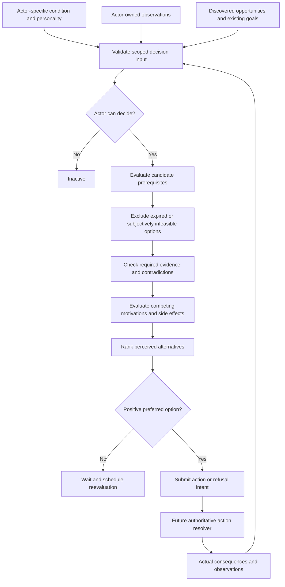

# GODSEED — NPC cognition and decision reference V1

Date: 2026-11-26. Status: delegated development design and synthetic reference implementation, not a production NPC engine or approved numerical balancing model. Extends [NPC_BLUEPRINT.md](NPC_BLUEPRINT.md), [NPC_MEMORY.md](NPC_MEMORY.md), [NPC_PERCEPTION.md](NPC_PERCEPTION.md) and [NPC_ARCHITECTURE.md](NPC_ARCHITECTURE.md). Preserve the single persistent world, shared paused fictional clock, independent NPCs, scoped knowledge, biological limitations, actual resources and owner decisions in GAMEPLAY.md.

## 1. Decision workflow



The reference receives a prepared actor-scoped opportunity list; it does not discover all possible actions, invent actions or generate multi-step plans. The selected intent is not a successful action. The authoritative resolver must recheck physical feasibility, current resources, revision, timing and conflicts before execution. It must not trust a subjective estimate as world truth.

## 2. Inputs and responsibilities

| Input | Responsibility |
|---|---|
| Actor profile | World/actor ID, revision, fictional tick, life status, trait and emotional condition, needs, values and goals |
| Knowledge | Actor-owned observation packet from the scoped perception service |
| Opportunities | Actor/world-scoped offered or discovered candidate actions and refusals, subjective effects, risk, effort, evidence requirements, validity and perceived feasibility |
| Output | Revision-bound intent, timed wait or inactive status; no resource or state mutation |

Production caller must supply actor-owned observations and subjectively available opportunities. It must not disclose hidden objective facts through estimated effects, availability, risk, candidate IDs or opportunity enumeration. The planner is not an authorization service and does not independently prove observation receipt authenticity. It checks scope and temporal consistency but relies on the existing trusted perception/knowledge boundary. No full world state is an input. The reference ignores unconsumed knowledge fields; it does not yet reason over free-text beliefs or memories.

## 3. Proposed motivation model

The six prototype dimensions are safety, resources, growth, connection, duty and rest. Each has independent current need pressure and personal value (0–10). Risk aversion is a persistent candidate trait; stress is a temporary candidate state (0–10). Goals have stable IDs, a dimension, status and urgency (0–10). Only active goals contribute extra pressure; deferred, blocked, achieved and abandoned goals are not removed or automatically reactivated by this reference.

An opportunity provides perceived positive or negative effects (-10 to +10 per dimension), risk and effort (0–10). Its score is the sum of each effect multiplied by the associated need, value and linked active goal pressure, minus risk times the sum of risk aversion and stress, minus effort. Goal pressure uses the maximum linked active urgency per dimension rather than adding duplicate motivations. These integers are abstract fixture weights, not character attributes, approved stats, calibrated emotion, HP or actual time. A trait is a preference rather than an absolute restriction: a cautious character may take a risk for a sufficiently important goal; a dutiful character may rest instead of obeying an obligation.

The reference selects the highest positive score; a zero/negative best score or no feasible candidate yields wait. An explicit refusal is a candidate intent, not a guaranteed consequence. Stable ID order resolves exact ties; this is a deterministic prototype convention, not a fairness or personality guarantee. Production should evaluate alternatives to repeated tie bias and consider actor-local persisted randomness where justified. No random seed is created here.

## 4. Evidence and uncertainty

Each candidate can require exact contextual claim keys/values and allowed acquisition channels. The reference checks matching actor-owned observations; unknown evidence does not satisfy a requirement. A report may satisfy a requirement when reports are explicitly allowed, but never becomes direct evidence. Any conflicting value for that contextual key prevents this exact-match requirement from being satisfied in the reference. This deliberately conservative rule is not a universal decision rule: production must support investigation, uncertain attempts, relevant confidence, supersession, source reliability, and temporal context. Claim keys must distinguish subject, predicate and time context so real changes are not misclassified as contradictions. Candidate actions that do not require certainty may still be offered; do not use missing knowledge to arbitrarily prohibit physically feasible exploration.

The reference does not generate beliefs or interpret natural-language memories. These remain separate services; a supplied packet's observation evidence is the only knowledge consumed here. No hidden rift objectives, financial provenance, or other NPC's evidence are consulted.

## 5. Execution boundary and lifecycle

An intent includes world ID, actor ID, actor revision, knowledge revision, decision tick, opportunity ID, action ID and disposition. It contains no authoritative effects, score or automatic reward. A wait contains a proposed review tick one abstract unit later, not a finalized duration. An incapacitated or deceased actor returns inactive; production must distinguish any remaining feasible limited responses or involuntary biological actions. No action is scheduled or executed by this module. Goal status, personality, observation state and actual time remain unchanged.

Reference limits: up to 64 goals and opportunities, 16 requirements per opportunity, 10,000 observations with 100 claims per observation. Inputs beyond these budgets fail explicitly rather than silently discarding options or evidence. These are development guards, not NPC cognitive limits; production needs relevance indexing, paged/fair opportunity review, bounded planning and durable scheduling. The reference uses no background execution.

## 6. Verification

Files:
- [npc_cognition_reference.mjs](../tools/npc_cognition_reference.mjs)
- [check_npc_cognition.mjs](../tools/check_npc_cognition.mjs)

Run from repository root:
```sh
node tools/check_npc_knowledge.mjs
node tools/check_npc_perception.mjs
node tools/check_npc_cognition.mjs
```

| Group | Executed result |
|---|---:|
| Knowledge regressions | 24/24 PASS |
| Perception and knowledge integration | 40/40 PASS |
| Cognition, scope, autonomy and perception integration | 48/48 PASS |
| Combined | 112/112 PASS |

Initial cognition run 40/40. Review strengthened the duplicate-goal test: the new case uses a competing option whose score would be overtaken if identical-dimension goal pressures were improperly added. Eight additional cases cover deferred goals, duty versus rest, extra private candidate fields, foreign worlds, maximum supported tick, unused private metadata, negative side effects and stale snapshot consistency. Final combined run used repository-loaded functions and test bodies executed in the development JavaScript isolate. It covered actor scope, no input mutation, refusal, timed wait, risk and stress, conflicting needs, goal state, report/direct distinctions, contradictory and absent evidence, malformed input, bounded work and actual perception-to-cognition integration. No standalone Node CLI invocation or production game runtime was tested.

Verified source blobs: cognition reference fa6fbada18f89efa10f013dccd66f49d226ae697; cognition checker 4925f6242159e987a7f22c8e43ef38125310a237. Existing perception and knowledge implementations were not modified in this increment.

## 7. Handoff

Next milestone: define the action catalog and actor-scoped opportunity generation contract, then implement a bounded multi-step goal planner with progress, interruption and replanning fixtures. Preserve the ability to decline, wait, explore under uncertainty and independently change goals. Require authoritative execution validation before any state mutation. Outstanding: personality development, emotional updates, actual biological needs, belief revision and memory retrieval, access authority and witness-specific perception, actor-local random state, time units, world scheduler, durable saves, engine/language and balancing. The 12 existing NPC reference records remain unactivated; no canonical biographies, stats, goals or game state were generated. No HTML implementation introduced.
