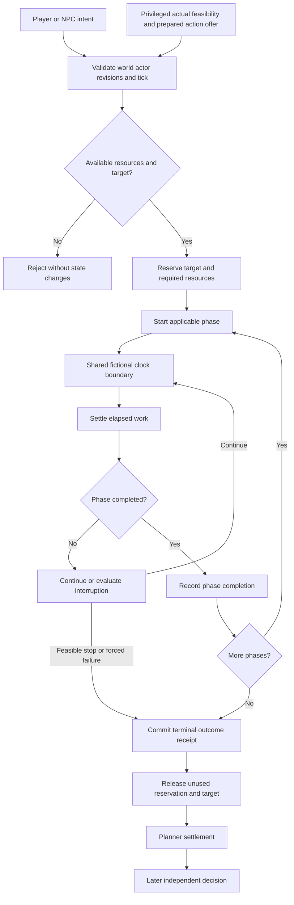

# GODSEED — Authoritative action execution reference V1

Date: 2026-11-26. Status: development reference, not the production game engine. Extends [NPC_PLANNING.md](NPC_PLANNING.md), [NPC_OPPORTUNITIES.md](NPC_OPPORTUNITIES.md), [NPC_COGNITION.md](NPC_COGNITION.md), [TIME_AND_ACTIVITY.md](TIME_AND_ACTIVITY.md) and [GAMEPLAY.md](GAMEPLAY.md). The latest owner decisions retain authority: one persistent world, concurrent actions, time paused during reading and selection, meaningful interruptions, actual partial progress, independent NPC decisions, contextual speed/distance/environment and conditional reflex-based reactions. No finalized combat formula or engine selection is introduced.

## 1. Authority and workflow



Cognition selects an intent, not its outcome. The executor validates against trusted actual action offers rather than relying on subjective opportunity estimates. The future world scheduler is the only caller that should advance fictional time. Neither status inspection nor action selection advances time. The reference exposes privileged methods and must not be provided directly to untrusted narrative or NPC decision code.

## 2. Implemented reference contract

The module creates one in-memory execution service for a supplied world ID and fictional tick. Actor records contain identity, actor revision, knowledge revision, life status and a generic integer resource pool. Offers bind actor/world, revisions, opportunity occurrence, action, disposition, validity, actual feasibility, optional exclusive target, work-credit cap and prepared phases. This generic resource pool is a test abstraction, not a new stamina attribute, universal currency or mana mechanic.

| Operation | Responsibility |
|---|---|
| publishOffer | Register an actor-scoped actual-feasibility offer, prepared by the privileged resolver |
| revokeOffer | Withdraw a currently matching offer when conditions change before admission |
| admit | Validate intent, prevent duplicate attempt, reserve applicable resources/target, start first phase |
| nextBoundary | Report earliest active phase-end tick |
| advanceTo | Advance all active actors over the same explicitly supplied fictional interval |
| stop | Terminate matching active attempt for interruption, cancellation or forced failure |
| state | Return detached diagnostic snapshot; no time advance |

Admission checks current world/actor, life status, actor and knowledge revision, decision tick, action/disposition, offer expiry, trusted actual feasibility, available resource budget and target exclusivity. One active exclusive activity per actor is supported. This is not a permanent prohibition on explicitly compatible concurrent activities. Rejected admissions do not consume resources, allocate target or advance time. A reused attempt ID is rejected. A new attempt requires current revisions and a current offer. A refusal is an ordinary independently chosen intent validated through the same timing authority.

The reference checks full required resource availability at admission, then charges each applicable phase's cost once at its start. With one active activity per actor and no external resource mutation API, the remaining reserved amount cannot be spent by a second activity in this fixture. Production requires an authoritative ledger and atomic reservations across all domains; no real Credits or assets are transferred. A terminal outcome releases the unused reservation, not the resources already spent. Exclusive targets are reserved for the full activity and released at termination; more precise target locking is a later design requirement.

## 3. Phase and timeline semantics

Applicable phases are preparation, movement, execution and recovery in that order. The reference permits omission of unnecessary phases except execution. Phase durations must be positive. Costs are nonnegative. Only the execution phase may accrue abstract work credit per elapsed tick, capped by the supplied work-credit limit. Actual distance, movement speed, relative motion, terrain, environment, physical injury, target reach, reflexes, action-specific preparation, contact and recovery must determine production timing and feasibility. The current phase duration inputs are synthetic resolved estimates; no geometry or physical capability formula is implemented.

The shared clock advances only through an explicit call to advanceTo. It rejects nonpositive time steps and attempts to skip the earliest active phase boundary. All active actions accrue elapsed work over the same interval. An actor's duration is not added to another actor's duration. At an exact boundary the reference settles elapsed work, records phase completion, emits an execution-boundary marker if applicable, then starts the next phase or terminates the action. Simultaneous due activities are processed in stable attempt-ID order. This is a provisional deterministic convention, not a final combat priority rule. The new phase cost is charged immediately on transition; production must define the tie policy for external interrupts that occur at precisely that boundary.

An external privileged resolver may stop an interruptible phase after the relevant time advances. A committed phase rejects voluntary cancellation/interruption; forced failure remains possible on actual external invalidation. Detection, reaction latency, feasible responses, environmental changes and whether a forced failure is justified are external trusted responsibilities. Reflexes alone does not grant cancellation or evade damage. Elapsed work, costs and execution markers remain recorded; canceling recovery cannot erase already released execution. The execution marker does not itself simulate damage, wages, movement or any other domain effect.

## 4. Outcomes and integration

Terminal receipts identify world, actor, attempt, event, optional plan, actual tick, outcome and credited work. Outcomes: completed, interrupted, cancelled, failed. All terminal receipts are detached copies; repeated terminal stops cannot generate another receipt. The existing planner accepts a matching admission and receives only actual credited units after a committed outcome. The trusted offer must cap credit at the plan's remaining work. Integration test demonstrates an opportunity generated from actor knowledge, cognition, plan review, executor admission and partial settlement. The reference does not yet provide an atomic transaction spanning planner and execution stores; a production coordinator must prevent stranded admissions and reconcile terminal receipts exactly once against a durable journal.

The event journal records phase starts, phase completions, execution boundary and terminal event summaries. It is a diagnostic in-memory record, not an authoritative world-history implementation. No actor-visible perception receipt is issued by this increment. Actual observable effects must be resolved and projected via the perception authority before becoming knowledge. Do not feed private diagnostic state to cognition or player narration.

## 5. Remaining boundaries

The reference uses trusted caller-provided feasibility, phase costs/durations, credit rate, target locks and interruption requests. It cannot verify the process that created those facts, re-evaluate moving targets during a phase, derive action effects from attributes, calculate reflex latency, model injuries or generate actual motion. Offer revocation provides an explicit pre-admission invalidation path; ongoing feasibility changes require an external resolver. Actor condition and knowledge revisions are initialized by fixtures; dynamic updates from other world services are pending. This reference uses short ASCII identifiers (maximum 50 characters) and a maximum of 256 initial actors; reconcile identifier constraints and scalable storage before production. The service has no persisted restore, journal compaction or fair scheduling. All time/resource/progress numbers are abstract fixtures. No canonical characters, seed, game saves, bank records or gameplay rules are changed.

## 6. Verification

Files:
- [npc_execution_reference.mjs](../tools/npc_execution_reference.mjs)
- [check_npc_execution.mjs](../tools/check_npc_execution.mjs)

Run from repository root with Node.js:
```sh
node tools/check_npc_knowledge.mjs
node tools/check_npc_perception.mjs
node tools/check_npc_cognition.mjs
node tools/check_npc_opportunity.mjs
node tools/check_npc_planning.mjs
node tools/check_npc_execution.mjs
```

| Group | Executed result |
|---|---:|
| Knowledge | 24/24 PASS |
| Perception and integration | 40/40 PASS |
| Cognition | 48/48 PASS |
| Opportunities | 53/53 PASS |
| Planning | 51/51 PASS |
| Execution and planner integration | 51/51 PASS |
| Combined | 267/267 PASS |

Initial execution run 39/39. Review added explicit offer revocation and action/refusal disposition matching, then 12 regressions for revocation scope, current revision, action/refusal handling, subsequent admission, unused reservations, split-time equivalence, detached receipts and invalid-admission isolation. Final combined run loaded repository source functions and test bodies and executed them in the development JavaScript isolate. All 267 passed. Saved contents were reread and verified. Standalone Node module loading and command-line invocation were not executed; no game runtime or save restoration was tested. Prior five modules and suites were unchanged.

Verified blobs: execution reference 4d6e9767bcce05daf6d35361dba526fa37b11d93; execution checker 90ddd8a0168e076ef13cc1aa3d03d7b1b77142f4.

## 7. Handoff

Next: shared world scheduler reference. Define event ordering and causal boundaries, explicit player-submitted time horizons, independent NPC reevaluation, fairness, interruption/pause policy, event budget and external condition changes. Integrate executor boundary selection and planner receipts without adding actor durations together or advancing on reading. Establish atomic cross-store dispatch and settlement, trusted actual world/action effects and perception projections before production. Durable world persistence, save/load scope, calendar/time unit, reaction and movement formulas, numerical balancing and engine selection remain pending. Do not activate the 12 reference NPCs until their blueprint requirements and actual initialization rules are satisfied.
