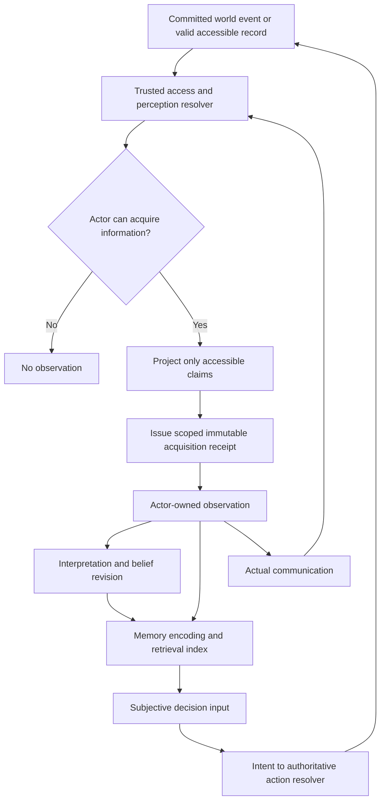
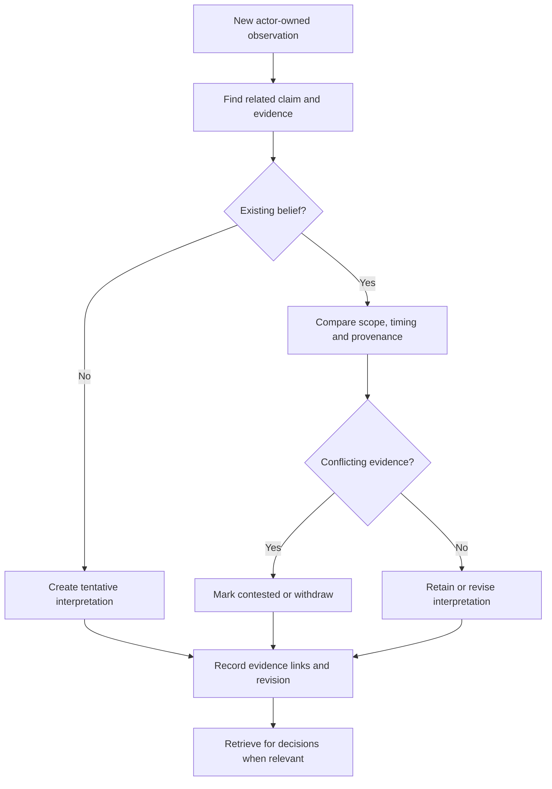

# GODSEED — NPC observation, knowledge and memory V1

Date: 2026-11-26. Status: proposed technical contract and executable design checks. This is not a perception engine, game runtime or finalized cognitive model. Preserves the approved single world, fictional clock, independent NPCs, private financial information and character knowledge boundaries. See [NPC_BLUEPRINT.md](NPC_BLUEPRINT.md), [NPC_ARCHITECTURE.md](NPC_ARCHITECTURE.md), [ECONOMY.md](ECONOMY.md), [GAMEPLAY.md](GAMEPLAY.md) and [TIME_AND_ACTIVITY.md](TIME_AND_ACTIVITY.md).

## 1. Authority boundary

World truth, observed content, interpretation and memory are different records. An NPC can act on an incorrect belief. The belief does not change world truth. The simulation must not provide secret information to NPCs, the player-facing narrative, or another character merely because it exists in a save file.

The trusted access authority evaluates actor location, distance, sensory capabilities, visibility, communication, access permission and timing where relevant. It creates a receipt containing only the allowed projection for the specific actor and world. Receipt IDs are opaque references; they must not permit unrestricted access to underlying events or other actors' receipts. The current reference checker assumes receipts are genuine trusted inputs. Runtime receipt issuance, storage and authorization are still pending.

## 2. Observation acquisition

| Channel | Basis |
|---|---|
| Direct | Actor perceives an accessible event or condition |
| Report | Actor actually receives a statement, possibly mistaken or deceptive |
| Record | Actor legitimately accesses the projected content of a document or record |
| Internal | Actor perceives their own condition, such as pain |

A report is evidence of the communicated content, not proof that the report is true. Forwarding a report does not convert it to direct evidence. Seeing a payment does not expose the payer's private balance or clean/dirty provenance. Seeing a rift does not disclose hidden objectives or difficulty. High perception cannot reveal information for which there is no valid access mechanism.

The proposed actor packet includes world ID, actor ID, snapshot tick, revision, observations, beliefs and memories. An observation contains ID, opaque acquisition receipt ID, acquired tick, channel, projected key/value claims and qualitative confidence. Confidence is an actor-side estimate, not a declaration of world truth. Each receipt may be consumed only once in the actor packet. Multiple different receipts may legitimately refer to the same underlying event; their independence must not be assumed automatically. Exact time units, perception formulas and receipt data schema remain open.

## 3. Belief and contradiction workflow

Proposed belief statuses: tentative, supported, contested, withdrawn. Supported means supported by the actor's accessible evidence under the prototype model, not objectively true. The reference contract requires support for supported claims and both support and contradiction for contested claims; more nuanced belief revision remains open. Evidence IDs belong to the same actor packet, relate to the same claim key and cannot appear on both sides of the same belief revision. Claim keys identify a subject/predicate/context in a future claim registry; a shared key is necessary in this prototype but not sufficient to prove logical support or contradiction. Interpretations may be false. Do not automatically prefer new, popular or high-confidence information. Preserve source times and earlier revisions in the future authoritative journal.

## 4. Memory and retrieval

Keep actor-owned memory records linked to observations. Candidate fields: stable ID, observation references, summary, routine/important/critical salience, acquisition and last-recalled ticks. A future cognitive service may retrieve context-relevant memories, interpret them, and revise recall metadata while fictional time advances. Reading a player menu is not an NPC memory event. Do not delete significant commitments, relationships, identity or history because an actor is distant. No automatic forgetting rate or memory capacity is approved.

Memory summaries and belief interpretations are subjective free text in the current schema. Shape and reference checks cannot prove their semantic fidelity or detect all secret information embedded in text. Treat them as untrusted derived content, not world truth. Generate them only from actor-scoped inputs; a future runtime must enforce isolation before and after generation. Do not expose hidden event IDs or unrestricted lookup through decision/narrative views. Avoid duplicating raw source records merely for memory recall.

## 5. Integration and persistence

| Component | Contract |
|---|---|
| Perception resolver | Receives actual event and access context; emits only trusted scoped receipts |
| Actor knowledge store | Validates receipt scope and projected content before storing observation |
| Belief service | Updates actor-owned interpretations and references; cannot mutate world truth |
| Memory service | Records/retrieves actor-owned experience; preserves evidence provenance |
| Cognition | Reads scoped knowledge and condition, returns an intent or wait |
| Narrative | Reads player-accessible observations and resolved outcomes only |
| Persistence | Saves coherent actor revision, evidence, beliefs, memories and committed event/receipt provenance |

A future restore must validate world/actor ownership, time and references together. Do not transfer memories to a new player character after death. The bank-code access exception remains governed by existing gameplay/economy decisions, not general knowledge inheritance. No independent seeds or new rewind policy are introduced. Promote simulation detail before consequential observations; lower detail cannot grant invented eyewitness knowledge. When no valid observation exists, do not create one solely to advance the story.

## 6. Machine-readable design artifacts

- [Actor knowledge JSON Schema](../schemas/npc_knowledge.schema.json): Draft 2020-12 vocabulary, proposal version 0.1; strict allowed fields for observations, beliefs, memories and packet envelope.
- [Synthetic fixtures](../tests/fixtures/npc_knowledge.json): four trusted example acquisition receipts, two fictional actors and 24 positive/negative cases. These are not canonical NPCs or events.
- [Development reference checker](../tools/check_npc_knowledge.mjs): dependency-free JavaScript design utility, not the chosen game language. Run from repository root with `node tools/check_npc_knowledge.mjs`.

The checker implements only the schema keywords used in this specific proposal and selected cross-record semantic invariants. It is not a general JSON Schema implementation. Its schema and receipts are trusted inputs. Use an independent standards-conforming validator and explicit authorization service when integrating a runtime. It checks evidence ownership through a packet-local observation index and validates receipt actor/world, acquisition time, channel and projected claim equality. It does not validate the process that issued receipts, actual sensory physics, report transmission, confidence calibration, logical truth, free-text secrecy, durable revisions, event replay or full game persistence.

## 7. Verification evidence

Executed the exact checker function logic in the development JavaScript isolate against the schema and synthetic fixtures. Initial run 21/21; review identified two issues: object property names inherited from prototypes could evade the unknown-field check, and key ordering could make equivalent projected claim objects compare unequal. Hardened both, added three regression cases, reran all 24 cases: 24/24 passed. The source and fixtures were saved and fetched back with matching content. The standalone Node command and an independent JSON Schema validator were not run. No NPC runtime or game save was created or tested.

| Group | Cases | Result |
|---|---:|---|
| Valid direct/contradictory evidence, report-only recipient, reordered claim keys | 3 | PASS |
| Hidden/extra fields, inherited and prototype-named keys, invalid confidence | 4 | PASS |
| Wrong actor/world, missing receipt, inserted hidden provenance, report upgraded to direct | 5 | PASS |
| Future observation, duplicate receipt and duplicate observation ID | 3 | PASS |
| Foreign belief/memory evidence, overlapping support, unsupported contested/supported status, unrelated claim evidence, belief predates evidence, invalid memory time, missing memory evidence | 9 | PASS |
| Total | 24 | PASS |

Verified artifact blob SHAs: schema 3b835d1caa5fe7a90bb64a7fa8e4f7d878a6f68f; fixtures 63c6e1dc5dc1b72c75942cce61b55945355090c3; checker ab1b397f6be1ab6b8496f40e4eaf710ffb72cdeb.

## 8. Next milestone

Define the trusted receipt-issuance contract and event/access fixtures (including absent witnesses, interrupted communication, inaccessible records, evidence provenance and explicit information transmission). Add tests proving a private world-state value cannot enter the cognition or narrative input through any route. Then design bounded decision inputs, personality, competing goals and intent generation. Establish engine/language before production runtime implementation. Retain the existing 12 NPC references; do not invent opening memories or activate them until their blueprint requirements are met.

## Later owner decision — questionnaire Q6, 2026-11-26

Owner rejected simulated forgetting, misremembering, misunderstanding and false-belief generation in normal memory mechanics. [OWNER_DECISIONS.md](OWNER_DECISIONS.md) supersedes earlier candidate memory behavior. Preserve exact acquired evidence, attribution, unknown/unverified status and actor information boundaries. Q34 permits news misinformation as attributed report content, not false recollection or automatic conversion into fact. Existing schema/reference functions are not changed by this documentation; future memory implementation must follow this decision.
