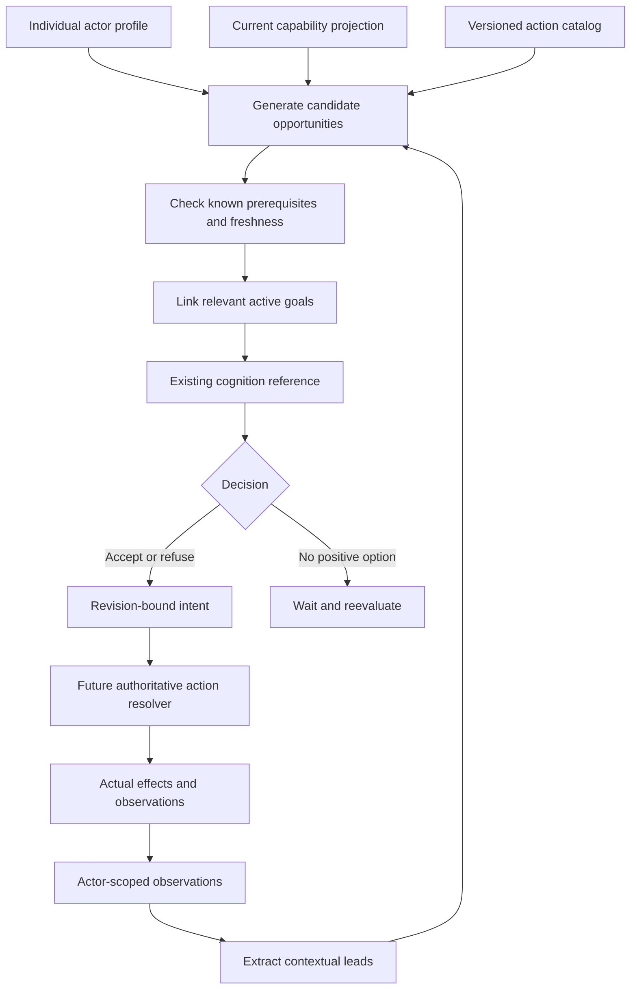

# GODSEED — Action catalog and opportunity generation V1

Date: 2026-11-26. Status: development reference implementation and synthetic validation, not production gameplay or finalized balancing. Builds on [NPC_COGNITION.md](NPC_COGNITION.md), [NPC_PERCEPTION.md](NPC_PERCEPTION.md), [NPC_BLUEPRINT.md](NPC_BLUEPRINT.md), [NPC_MEMORY.md](NPC_MEMORY.md) and [TIME_AND_ACTIVITY.md](TIME_AND_ACTIVITY.md). Owner-approved world, progression, autonomy, action timing and knowledge rules retain authority.

## 1. Pipeline and responsibilities



The generator accepts the same actor profile and knowledge packet used by the cognition reference, plus a trusted self-capability projection containing world ID, actor ID, actor revision, as-of tick and available capability identifiers. Scope, revision and time must agree. It receives no full world state or list of hidden targets. It returns candidate opportunities in the existing cognition contract, not actual changes to the world. Cognition and execution remain separate.

## 2. Initial catalog

| Action ID | Capability | Discovery source | Mode |
|---|---|---|---|
| rest | rest | Self | Local |
| look | observe | Self | Local |
| practice | practice | Self | Local |
| work | work | Shift lead | Confirmed |
| apply | communicate | Job lead | Confirmed |
| study | study | Lesson lead | Confirmed |
| talk | communicate | Person lead | Confirmed |
| travel | move | Route lead | Confirmed |
| inspect_rift | observe | Rift lead | Investigation |
| enter_rift | move | Rift lead | Confirmed |
| accept_offer | communicate | Offer lead | Confirmed |
| decline_offer | communicate | Offer lead | Refusal |
| inspect_job | observe | Job lead | Investigation |

These 13 templates are only the initial reference catalog. Capabilities are current coarse self-known possibilities, not proof that an actual task is physically feasible or permitted. Missing capabilities exclude the corresponding reference candidate; they are not permanent class locks. A local rest, observation or practice candidate is not a guarantee of a safe resting place, usable equipment or successful learning. Actual execution conditions must be validated separately. Catalog entries specify estimated effects across the existing six motivation dimensions, plus provisional risk and effort. These are illustrative cognitive weights, not actual prices, injury probabilities, rewards, stat gains or fictional action durations.

## 3. Information discovery

Recognized contextual observation keys use opp:<source>:<target>, with a short opaque reference target (1–32 ASCII letters, digits, underscore or hyphen). The target identifies a particular known opportunity or occurrence, not necessarily a permanent entity. The trusted observation producer must supply appropriately scoped contextual identities; a changed shift or new offer may need a new occurrence identity. An open claim from a direct observation, delivered report or accessible record supplies a lead. Internal perception alone cannot establish an external opportunity. Unknown source categories and malformed keys are not treated as actions.

Confirmed-mode candidates require an open claim without contradictory values for the same contextual key. Investigation-mode candidates can remain available for a disputed lead when a qualifying open claim exists. A closed-only claim does not create a new open lead in this reference. A report can be wrong; a candidate based on it is only a subjective possibility. No hidden objective, route, target, employer or private financial data is discovered through catalog enumeration.

Reference freshness expires ten abstract ticks after the most recent qualifying open observation; at the boundary the candidate remains eligible. A repeated matching report can refresh the reference lead window, but does not erase contradiction or establish truth. This is a provisional test convention, not an approved universal forgetting rate, time unit, shift schedule or expiration rule. Old and contradictory evidence remains in memory. Production must support source reliability, current context, supersession, investigation even after certain stale leads, and explicit observation of changed circumstances. Do not apply this conservative filter as a universal prohibition on uncertain but feasible attempts.

## 4. Candidate construction and limits

Local candidates use the template action ID as their opportunity ID and expire at the current decision tick. Discovered candidates use action ID plus two underscores plus target reference; the existing cognition intent retains both action ID and opportunity ID. Distinct target occurrences produce distinct candidates; repeated evidence does not duplicate candidates. Future execution must resolve the reference from an authoritative revision-bound opportunity registry, never trust a parsed ID as authorization.

Only relevant active goals with positive estimated effects are linked automatically. Negative side effects remain visible to cognition through the provisional vector. An actor can choose rest over work, investigation over entry, refuse an offer or wait. This is not a deterministic personality script. Inactive actors generate no ordinary candidates under the existing reference convention; production needs limited-response and involuntary-action rules.

Candidate order is stable. The reference accepts at most 64 generated candidates, 64 goals, 10,000 observations and 100 claims per observation, consistent with cognition limits. Overflow fails explicitly; it does not silently drop candidates. Production needs actor-local relevance indexing, fair bounded batches and a persisted review cursor to avoid starvation. The catalog and opportunity generator are pure development functions; they create no actual reservations, costs, job offers, routes, memory mutations, clock advancement or execution events.

## 5. Verification

Files:
- [npc_opportunity_reference.mjs](../tools/npc_opportunity_reference.mjs)
- [check_npc_opportunity.mjs](../tools/check_npc_opportunity.mjs)

Run from repository root with Node.js:
```sh
node tools/check_npc_knowledge.mjs
node tools/check_npc_perception.mjs
node tools/check_npc_cognition.mjs
node tools/check_npc_opportunity.mjs
```

| Group | Executed result |
|---|---:|
| Knowledge | 24/24 PASS |
| Perception and integration | 40/40 PASS |
| Cognition | 48/48 PASS |
| Opportunity generation and integration | 53/53 PASS |
| Combined | 165/165 PASS |

Initial opportunity run 45/45. Review added eight cases covering unrelated observations and freshness, repeated contradictory reports, distinct contextual occurrences and targets, delivered-report isolation, the exact candidate budget, observation overflow and capability loss with preserved evidence. Final combined run executed the repository-loaded function bodies and test logic in the development JavaScript isolate; all 165 passed. Files were reread and verified. Standalone Node module loading and CLI commands were not executed, and no production runtime or game save was tested. Existing knowledge, perception and cognition modules were not changed.

Verified source blobs: opportunity reference 2bb3402fe3f589d53604fd5d99c5c8657ef11ddf; opportunity checker 9c5bd421bfa7e6b7a9b112562f6da9e810695d50.

## 6. Next milestone

Design bounded multi-step planning with explicit goal progress, prerequisites, dependencies, alternative plans, blocked and deferred goals, interruption and replanning. The planner must generate only intents, retain completed work, account for changing evidence and capabilities, and avoid zero-time retry loops. Separate perceived prerequisites and authoritative validation. Before production integration, establish actual action definitions, spatial and sensory authority, opportunity lifecycle and expiry, actor-specific estimates, durable event and memory storage, scheduler and engine/language. The existing 12 NPCs remain unactivated reference records. No new canonical NPCs, histories, world seed or save data were generated.
