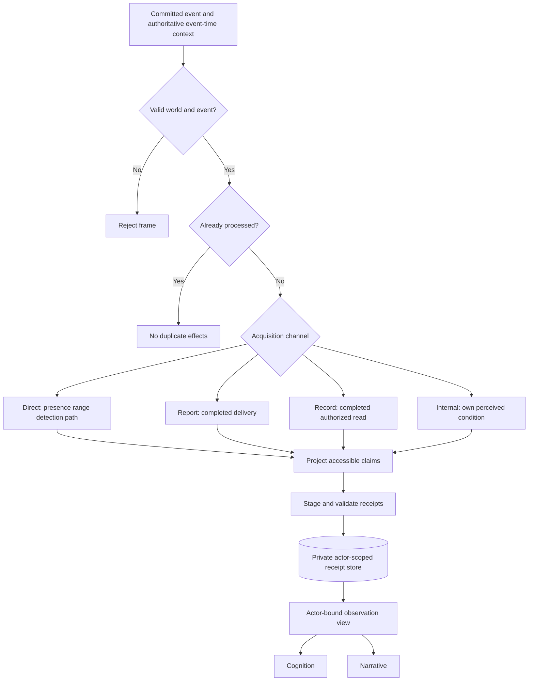

# GODSEED — Perception and information access V1

Date: 2026-11-26. Status: development reference implementation and verified synthetic checks. Not production gameplay, sensory physics, final engine selection, or proof of complete information security. Extends [NPC_MEMORY.md](NPC_MEMORY.md) and [NPC_BLUEPRINT.md](NPC_BLUEPRINT.md). Preserve the approved world seed, fictional clock, NPC autonomy, evidence boundaries and character succession rules.

## 1. Authority and workflow



Only the trusted world/action/access authority may supply frames to the reference service. Actor decision code and the narrative consumer receive bound read capabilities, not the service object, event records, diagnostic exports, or arbitrary actor selectors. A bound consumer cannot change the actor by supplying another ID. A receipt is evidence of acquisition, not proof of objective truth. Receipt IDs are scope-specific references, not authentication credentials.

## 2. Implemented development contract

The dependency-free module [npc_perception_reference.mjs](../tools/npc_perception_reference.mjs) creates an in-memory reference service for one world. Ingest accepts a committed event, event-time frame and trusted actor contexts. It checks world, tick, event identity and acquisition eligibility. It supports four channels:

| Channel | Reference admission requirements | Projected content |
|---|---|---|
| Direct | Actor present, in range, detected, clear path and eligible to acquire | Explicitly designated observable claims |
| Report | Completed communication and exactly one completed delivery to eligible recipient | Claims actually delivered to recipient |
| Record | Completed read and exactly one completed authorized grant for eligible actor | Granted projected claims |
| Internal | Eligible actor is the subject | Perceived condition claims |

The caller must resolve actual spatial context, sensory differences, access rights, delivered content and internally perceptible condition before ingestion. These are trusted inputs, not facts the reference derives from geometry or stats. Direct observations use the same designated observable claims for qualifying witnesses; fine-grained witness-specific detail is pending. Clear path is a simplified reference condition, not a universal rule for all sensory or supernatural channels. No finalized detection ranges or stat formulas are introduced.

All receipt projections are staged before commit. Invalid candidate projections and duplicate actor contexts reject the frame without partial receipt writes. Unknown admission flags fail closed. Repeated accepted event IDs do not duplicate evidence; old frames reject if behind the reference high-water tick. Conflicting content under a processed ID is ignored, not treated as new truth; production conflict auditing remains necessary. Private event metadata is not copied into receipts. Input claims and returned views are copied, so later mutation does not modify the stored evidence.

Reference world/actor IDs are restricted to short ASCII identifiers, with actor-local receipt numbering scoped to world and actor. The numbers are not global event counters. The reference uses an in-memory event set and event-time high-water mark, not the production world clock, journal or durable idempotency mechanism. Reading a view does not advance its tick or revision. Empty belief and memory arrays are placeholders for the next cognitive services, not a complete replacement for existing actor memory. Do not overwrite a real actor's knowledge packet with this observation-only projection.

## 3. Information boundaries and limitations

- NPCs cannot infer private financial balances or fund origin solely from observing payment. The trusted projection authority must exclude inaccessible data; explicitly granted records may legitimately reveal additional information.
- A received report remains a report. Deception and mistakes are possible; actual communication must occur before knowledge changes.
- No observation is issued for an absent or ineligible witness solely because an event is important to the player. No private event IDs are exposed by the returned view.
- Changing private event fields without changing authorized claims leaves consumer outputs unchanged in the tested scenarios.
- Actor binding and diagnostic export are privileged operations. The prototype is not a network authorization service, and the caller must not hand the full service to cognition or narrative.
- The prototype cannot detect secrets deliberately embedded in an otherwise authorized claim, validate trusted input truth, or prevent leaks through other future runtime services. Enforce trust boundaries and projection at event creation, communication, persistence and narrative generation. No universal security claim follows from the tests.
- No actual geometry, sensory capability calculations, communication timing, actor memory persistence, belief generation, save/load, or world scheduling are implemented here. Receipts currently exist only in memory; do not use the reference as a production save authority.

## 4. Validation and evidence

Run from repository root with Node.js:
```sh
node tools/check_npc_knowledge.mjs
node tools/check_npc_perception.mjs
```

The knowledge checker now exports its existing validator without automatically running its command-line suite when imported. The perception checker reuses that validator for integration, avoiding a second implementation of the knowledge contract.

| Verification group | Executed result |
|---|---:|
| Existing knowledge schema/reference regressions | 24/24 PASS |
| Perception admission, event replay, isolation and projection regressions | 36/36 PASS |
| Perception-to-knowledge integration: two actors, cognition and narrative views | 4/4 PASS |
| Combined | 64/64 PASS |

The perception tests cover absent witnesses, missing/false context flags, wrong world, uncommitted or mismatched-time events, stale frames, interrupted or undelivered reports, inaccessible records, private internal conditions, duplicate event/actor/claim handling, atomic failure, input/output mutation, private-field noninterference, local receipt numbering and bound actor isolation. Integration tests verify each consumer packet against the existing knowledge validator and expected channel sequence.

Execution method: the exact saved module functions and test bodies were loaded from verified repository content and executed in the development JavaScript isolate. The final 64 cases passed there. The standalone Node CLI entry points and module-loading behavior have not been executed in a Node shell, and no production game runtime was tested. The reference schema validator is not a general JSON Schema implementation.

Verified blob SHAs: perception module bc54719e9d544ef900e9b3d7021d8996983cc4ae; perception checker bc5ec3bcafd3869cd42cb941d9b27ed56d92e810; knowledge checker 9c739e32abe53ebb41536dc5494faff379b0e8af. Existing schema and fixtures were not modified.

## 5. Next milestone

Design the bounded NPC cognition and decision-input contract: personality, competing needs and goals, scoped evidence retrieval, perceived feasibility, alternative plans, refusal and wait states, and intent submission. Before production integration, also define authoritative receipt issuance and event-time geometry/access services, actor-specific claim projection, durable receipt/event persistence, and actual game engine/language. Retain the existing 12 NPCs as reference drafts until their initialization requirements are met. Do not silently finalize gameplay formulas or fabricate histories. No actual seed, live actor or saved game was created.
