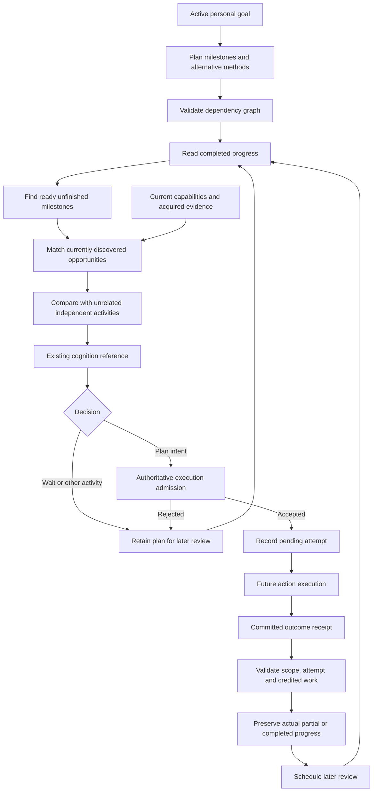

# GODSEED — NPC multi-step goal planning V1

Date: 2026-11-26. Status: development reference implementation; not a production planner, live NPC population, save system or finalized gameplay rule. Extends [NPC_OPPORTUNITIES.md](NPC_OPPORTUNITIES.md), [NPC_COGNITION.md](NPC_COGNITION.md), [NPC_BLUEPRINT.md](NPC_BLUEPRINT.md), [NPC_PERCEPTION.md](NPC_PERCEPTION.md) and [TIME_AND_ACTIVITY.md](TIME_AND_ACTIVITY.md). Existing owner-approved world, autonomy, evidence, progression, fictional time and succession rules take priority.

## 1. Goal planning workflow



A plan describes dependencies between milestones and alternative actions that can advance each milestone. The current reference handles a pre-authored bounded directed acyclic graph, not automatic synthesis of arbitrary plans or general pathfinding. The existing cognition reference chooses among available ready plan opportunities and unrelated opportunities. An NPC can postpone a plan, choose rest, pursue an unrelated activity or wait. The plan cannot force a successful action or change the authoritative world.

## 2. Plan and state contract

A trusted plan definition provides world ID, actor ID, plan ID, goal ID and 1–32 milestones. A milestone has a unique ID, positive required abstract work units (up to 10,000), prerequisite milestone IDs and 1–16 alternative option bindings. A binding identifies the exact opportunity occurrence and action ID. Cycles, unknown dependencies and shared exact opportunity IDs across milestones are rejected. Each alternative must represent legitimately comparable credited work toward the same milestone; the reference cannot establish semantic equivalence.

| Record | Purpose |
|---|---|
| Plan definition | Actor-owned goal, milestone dependencies, alternative option bindings |
| Plan revision | Detect stale plan admissions |
| Milestone progress | Credited units and required units, independently retained |
| Pending attempt | Stable attempt ID, step ID, opportunity, action and start tick |
| Outcome history | Committed event identity, attempt, result, credited units, step/action provenance |
| Review boundary | Last committed plan tick and earliest next review tick |

Snapshots are detached serializable copies of in-memory state. Status is open, in progress, or complete. Goal status remains the separate authority in the actor profile. The reference is one plan service per actor/goal instance, with no cross-plan dispatcher or durable snapshot restoration yet. Do not mistake serializable snapshots for a tested save/load implementation.

## 3. Review and autonomy

Review verifies world, actor, time and knowledge scope. A pending attempt returns busy rather than creating a duplicate plan dispatch. A non-active actor cannot propose normal living actions under the existing reference convention. A step is ready only if it is unfinished and all prerequisite steps have reached their required credit. The exact reserved plan opportunity IDs are eligible as plan candidates only while their goal is active and their milestone is ready. Unrelated opportunities remain available to cognition. A deferred, blocked, achieved or abandoned goal does not erase existing progress or force continuation.

This reference reserves exact occurrence IDs for the plan, so it does not distinguish an independent use of the same occurrence from a plan-directed use. Production should separate an action's general feasibility from its plan binding, permit independently motivated uses where valid, coordinate multiple competing plans, and support dynamic alternatives and new occurrence IDs. Do not make the plan graph a universal action restriction.

The existing cognition service handles subjective feasibility, evidence requirements, expiration, values, risk, needs and scoring. A plan cannot create an undiscovered opportunity or override contradictory evidence. If no candidate wins, return wait. If another activity wins, the plan remains unchanged and the returned intent has no step binding. Goal status changes and automatic discovery of new goals remain external responsibilities.

## 4. Dispatch and progress

Review is side-effect free. Admit recomputes the current preferred intent using the supplied profile, knowledge and opportunities, then checks an accepted dispatch record against actor, world, plan, plan revision, actor revision, knowledge revision, decision tick, opportunity ID and action ID. This input must come from the future authoritative action dispatcher. It is not proof that an execution engine exists or that a caller-provided flag is genuine. A matching admission records a pending attempt but grants no credit.

Settlement accepts a trusted committed outcome receipt scoped to world, actor, plan, attempt, event, fictional tick, outcome and credited units. Outcomes: completed, interrupted, failed or cancelled. Actual partial work may survive interruption, cancellation or failure when the authoritative resolver explicitly credits it. A successful individual action need not complete its milestone. No credit can exceed the milestone's remaining work. Invalid outcomes leave state unchanged. Exact event replay is idempotent; conflicting replay is rejected. Reusing a settled attempt with a new event cannot grant extra credit. History retains milestone, opportunity, action and start tick together with receipt data. One terminal outcome per attempt is the current reference convention; production may need separate phase events and partial-work settlements.

Settlement releases the pending attempt and schedules next plan review one abstract tick later, even if no work was credited. This provisional rule prevents immediate same-tick plan retry loops. It is not a fixed game duration or a universal delay on unrelated world activity. Actual time, resource costs, combat, injuries, motion, interruptions and progress calculation belong to the authoritative resolver. The reference neither advances time nor performs those effects.

## 5. Example (synthetic, not canon)

An actor wants professional development. A learning milestone needs three abstract work units, which can be advanced by a discovered lesson or practice. The application milestone depends on completing the learning milestone. An interrupted lesson grants one actual credited unit. The next review can choose practice for the remaining two units, or rest if other needs are more urgent. Once the learning milestone is complete, an available application opportunity can compete for selection. Applying does not guarantee being hired. This fixture does not establish real qualification criteria, course lengths or employment rules.

## 6. Bounds and known limitations

Maximum 32 steps, 16 alternatives per step, 64 currently supplied opportunities and 256 settled attempts per plan reference. Overflow is explicit; no silent history eviction. A production planner needs indexed evidence, fair batches, multi-goal coordination, real scheduler integration, persisted plan definitions/revisions and replayable admission/outcome records. The reference does not restore snapshots, verify receipts against a durable world journal, calculate partial work, synthesize arbitrary graph structures or execute actions. It has no background processing, actual world seed or canonical actor records.

## 7. Verification

Files:
- [npc_planning_reference.mjs](../tools/npc_planning_reference.mjs)
- [check_npc_planning.mjs](../tools/check_npc_planning.mjs)

Run from repository root with Node.js:
```sh
node tools/check_npc_knowledge.mjs
node tools/check_npc_perception.mjs
node tools/check_npc_cognition.mjs
node tools/check_npc_opportunity.mjs
node tools/check_npc_planning.mjs
```

| Group | Executed result |
|---|---:|
| Knowledge | 24/24 PASS |
| Perception and integration | 40/40 PASS |
| Cognition | 48/48 PASS |
| Opportunities | 53/53 PASS |
| Planning and integration | 51/51 PASS |
| Combined | 216/216 PASS |

Initial planning run 41/41. Review strengthened outcome provenance by retaining the settled step, action, opportunity and start tick. Ten new cases cover provenance, deferred reactivation, blocked goals, exact replay during a newer attempt, duplicate credit under a different event, wrong plan and revision, conflicting evidence, opportunity disappearance and detached history copies. All 216 checks were executed using repository-loaded function bodies and test logic in the development JavaScript isolate. Existing four suites were unchanged. Standalone Node CLI/module loading and production game runtime were not executed. No actual gameplay save or NPC activation was tested.

Verified blob SHAs: planning reference d3e40376b871d5d75f46bcc7c02859c6e28a4ba0; planning checker 2509ae75131c92ba6a575bec9e64699ebd284926.

## 8. Handoff

Next milestone: authoritative action admission and execution-phase reference. Define revision-bound actor/target validation, activity identity, resource reservations, preparation/travel/execution/recovery, elapsed-time boundaries, interruption and cancellation, partial progress and committed outcome receipts. Link those receipts to the planner and observations only after actual resolution. Preserve independent player/NPC intent, no duplicate effects, one shared fictional clock and known-information boundaries. Engine selection, numerical durations, actual character profiles, world simulation, durable persistence and runtime tests remain pending. No owner-approved mechanics were replaced.
