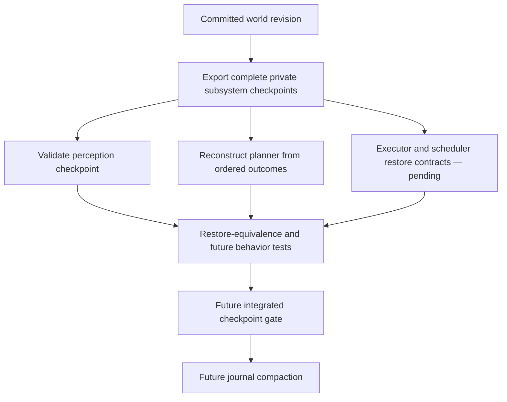

# GODSEED — Direct subsystem checkpoint restoration V1

Status: tested development prerequisite for world journal compaction. This increment does not compact, truncate or delete the world journal. It extends [WORLD_DURABLE_STORAGE.md](WORLD_DURABLE_STORAGE.md), [WORLD_TRANSACTIONS.md](WORLD_TRANSACTIONS.md), [NPC_PERCEPTION.md](NPC_PERCEPTION.md) and [NPC_PLANNING.md](NPC_PLANNING.md). Owner-approved time, identity, memory and save rules retain authority. Automated forced process termination is prohibited; Android force-stop testing remains reserved for the owner.

## 1. Architecture and decision



The existing diagnostic snapshots do not contain all internal state required for continuation. For example, perception has a processed-event set that includes events yielding no observation, and the planner has used attempt identities and temporal review boundaries. Replacing replay with diagnostic state alone would risk duplicate effects or lost history. The selected incremental approach introduces explicit versioned checkpoint exports and trusted restoration inputs before modifying the journal.

## 2. Implemented contracts

| Service | Checkpoint format | Required restored state |
|---|---|---|
| Perception | perception-checkpoint-v1 | World, high-water tick, processed event IDs, actor-grouped receipts |
| Planner | planning-checkpoint-v1 | Original plan definition, pending attempt, ordered outcome history, reconstructed progress and revisions |

The optional final checkpoint argument to each existing factory preserves existing two-argument/one-argument use. Exported checkpoints are detached private copies. Actor-bound views do not expose these exports.

Perception restoration validates format, world identity, exact receipt and claim fields, dense arrays, processed-event uniqueness, receipt ID sequence, chronological order within each actor and the high-water tick. Actor groups retain original export order. A previously processed event that yielded no receipt stays processed; restoration does not accidentally reveal it. The original reference does not retain a receipt-to-event mapping or event payload digest, so this contract cannot prove the historical authenticity of a receipt or reject every coherent alteration. It requires a trusted storage authority and separate integrated event provenance.

Planner restoration validates the original definition and reconstructs prior admissions and terminal outcomes in order, reusing the existing settlement checks. It rejects reused attempt/event IDs, wrong action bindings, invalid prerequisites, overcredit and inconsistent chronology. It restores pending work without granting credit, reconstructs the next-review boundary and compares the resulting snapshot against the supplied state. Definition and state comparison ignores object property ordering, not array ordering. This does not re-prove the original cognition decision or actual authority of a historical outcome. Authentication and cross-service reconciliation remain coordinator responsibilities.

## 3. Verification

Run from repository root with Node.js 22.16+:
```sh
node tools/check_world_checkpoints.mjs
node tools/check_durable_world_store.mjs
node tools/check_durable_world_recovery.mjs
node tools/check_integrated_world_recovery.mjs
```

| Current executed suite | Result |
|---|---:|
| Direct perception and planner checkpoint restoration | 33/33 PASS |
| SQLite adapter | 20/20 PASS |
| Scheduler/executor normal-exit recovery | 6/6 PASS |
| Integrated NPC normal-exit recovery | 9/9 PASS |
| Total | 68/68 PASS |

Actual Node.js v22.16.0 runs in the Linux development container used verified copies of the prior repository modules. Initial checkpoint suite passed 29/29; review added dense-array and grouping validation and four additional cases. The final run passed all 68 checks. Current source and test Git blob hashes matched the local files after repository readback:

- tools/npc_perception_reference.mjs: 4c88ddae030ef307f0a63c186756c13770762595
- tools/npc_planning_reference.mjs: 5cf56f164f6482a5929d4dc1bb8fd10a0bcba3b0
- tools/check_world_checkpoints.mjs: f8050a49f6654c9162225cacaf200cea38b4414a

The prior 396 JavaScript-isolate cases are historical; they were not rerun in this increment. The 35 existing storage checks test existing full-journal reconstruction, not direct integrated checkpoint restoration. The 33 new tests exercise direct subsystem restoration and continuation in memory. No Android force-stop, forced process termination, real save modification or canonical NPC activation occurred. Only synthetic test data was used.

## 4. Next gate

Executor must gain a complete private checkpoint including current offers, used attempt IDs, active phase state, reservations, target locks, outcomes, clock and actor revisions. Scheduler must retain queue order, event and submission identities, recurrence, session, pending pause and budget/fault state. Coordinator must restore these together with planner/perception, configuration and observation-frame identity/content history and reconcile all cross-service references. Only then design a new journal format that can retain exact transaction idempotency and history across verified checkpoint boundaries, with atomic migration and independently trusted identity/revision authority. Do not remove old journal entries, increase the 256-command limit as a substitute for compaction, or change the existing SQLite schema during this increment.

The reference remains bounded, static-fixture development infrastructure. Full belief/memory consolidation, domain consequences, canonical actor initialization, production scale and actual Android durability remain pending. No final engine or storage technology is selected.
