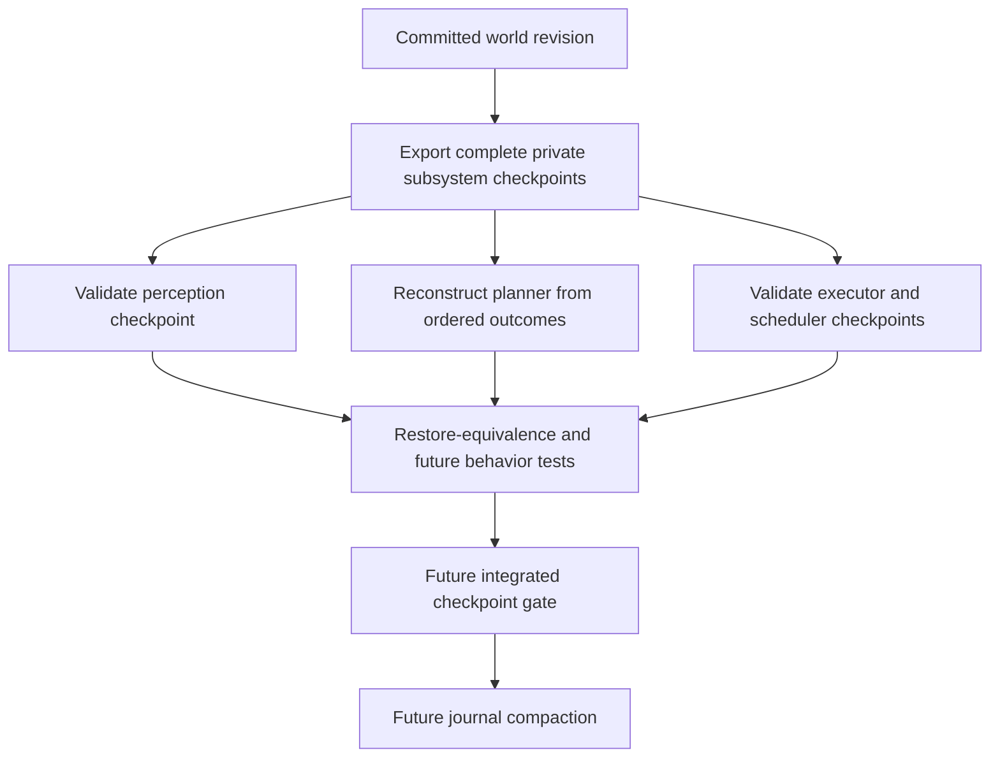
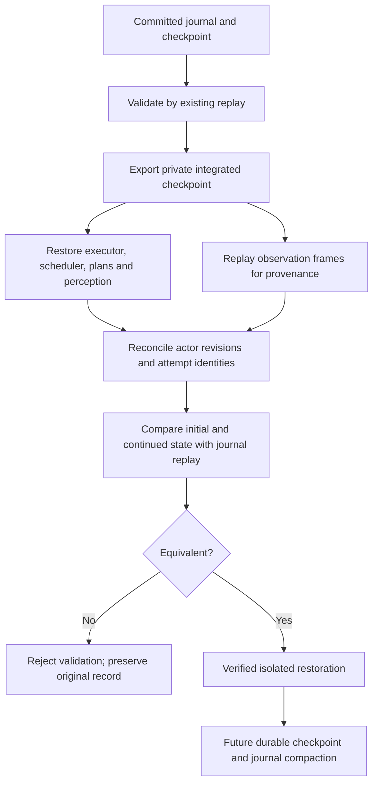

# GODSEED — Direct subsystem checkpoint restoration V1

Status: tested development prerequisite for world journal compaction. This increment does not compact, truncate or delete the world journal. It extends [WORLD_DURABLE_STORAGE.md](WORLD_DURABLE_STORAGE.md), [WORLD_TRANSACTIONS.md](WORLD_TRANSACTIONS.md), [NPC_PERCEPTION.md](NPC_PERCEPTION.md) and [NPC_PLANNING.md](NPC_PLANNING.md). Owner-approved time, identity, memory and save rules retain authority. Automated forced process termination is prohibited; Android force-stop testing remains reserved for the owner.

## 1. Architecture and decision



The existing diagnostic snapshots do not contain all internal state required for continuation. For example, perception has a processed-event set that includes events yielding no observation, and the planner has used attempt identities and temporal review boundaries. Replacing replay with diagnostic state alone would risk duplicate effects or lost history. The selected incremental approach introduces explicit versioned checkpoint exports and trusted restoration inputs before modifying the journal.

## 2. Implemented contracts

| Service | Checkpoint format | Required restored state |
|---|---|---|
| Perception | perception-checkpoint-v1 | World, high-water tick, processed event IDs, actor-grouped receipts |
| Planner | planning-checkpoint-v1 | Original plan definition, pending attempt, ordered outcome history, reconstructed progress and revisions |

The optional final checkpoint argument to each existing factory preserves existing two-argument/one-argument use. Exported checkpoints are detached private copies. Actor-bound views do not expose these exports.

Perception restoration validates format, world identity, exact receipt and claim fields, dense arrays, processed-event uniqueness, receipt ID sequence, chronological order within each actor and the high-water tick. Actor groups retain original export order. A previously processed event that yielded no receipt stays processed; restoration does not accidentally reveal it. The original reference does not retain a receipt-to-event mapping or event payload digest, so this contract cannot prove the historical authenticity of a receipt or reject every coherent alteration. It requires a trusted storage authority and separate integrated event provenance.

Planner restoration validates the original definition and reconstructs prior admissions and terminal outcomes in order, reusing the existing settlement checks. It rejects reused attempt/event IDs, wrong action bindings, invalid prerequisites, overcredit and inconsistent chronology. It restores pending work without granting credit, reconstructs the next-review boundary and compares the resulting snapshot against the supplied state. Definition and state comparison ignores object property ordering, not array ordering. This does not re-prove the original cognition decision or actual authority of a historical outcome. Authentication and cross-service reconciliation remain coordinator responsibilities.

## 3. Previous increment verification

Run from repository root with Node.js 22.16+:
```sh
node tools/check_world_checkpoints.mjs
node tools/check_durable_world_store.mjs
node tools/check_durable_world_recovery.mjs
node tools/check_integrated_world_recovery.mjs
```

| Current executed suite | Result |
|---|---:|
| Direct perception and planner checkpoint restoration | 33/33 PASS |
| SQLite adapter | 20/20 PASS |
| Scheduler/executor normal-exit recovery | 6/6 PASS |
| Integrated NPC normal-exit recovery | 9/9 PASS |
| Total | 68/68 PASS |

Actual Node.js v22.16.0 runs in the Linux development container used verified copies of the prior repository modules. Initial checkpoint suite passed 29/29; review added dense-array and grouping validation and four additional cases. The final run passed all 68 checks. Current source and test Git blob hashes matched the local files after repository readback:

- tools/npc_perception_reference.mjs: 4c88ddae030ef307f0a63c186756c13770762595
- tools/npc_planning_reference.mjs: 5cf56f164f6482a5929d4dc1bb8fd10a0bcba3b0
- tools/check_world_checkpoints.mjs: f8050a49f6654c9162225cacaf200cea38b4414a

For this previous increment, the 396 JavaScript-isolate cases were historical. The 35 existing storage checks test existing full-journal reconstruction, not direct integrated checkpoint restoration. The 33 new tests exercise direct subsystem restoration and continuation in memory. No Android force-stop, forced process termination, real save modification or canonical NPC activation occurred. Only synthetic test data was used.

## 4. Executor and scheduler checkpoint extension

The existing factories now accept an optional final private checkpoint input. Both expose a detached exportCheckpoint method. Existing state/diagnostics and ordinary factory use remain compatible.

| Service | Format | Preserved state |
|---|---|---|
| Executor | execution-checkpoint-v1 | Initial actor baseline, clock, actor state/revisions, offers (including stale and unadmitted), active phases, resource reservations, plan bindings, attempt identities, ordered terminal receipts and phase history |
| Scheduler | scheduler-checkpoint-v1 | World/player identity, insertion sequence, event and submission IDs, queue, journal, receipts, current submission, pause reason, budget and recoverable fault state |

The executor reconstructs attempt and resource accounting from the recorded phase events. It verifies terminal receipt order, actor identity, historical non-overlap, phase chronology, current phase duration, elapsed active credit, reservation totals and exclusive target ownership. Active phases are restored without charging their initial cost again. Target locks are derived from active attempts; previous attempt IDs remain consumed. Knowledge revisions are checked against the initial baseline and the possible number of revision updates. Offer restoration preserves stale offers without permitting stale admission. The same current admission and phase-advance rules remain in use after restoration.

The scheduler reconstructs its event queue using existing validation, restores exact insertion order and used identities, checks journal chronology and recurrence, verifies scheduler receipts against the matching executor outcomes, and validates current submission ownership, clock and pause state. A budget-limited session may continue, a paused action requires explicit resume, and an already processed event or submission identity remains unavailable for reuse. A fault-state restoration is a diagnostic reference and assumes a compatible, side-effect-free review adapter.

These are trusted private restoration contracts, not historical authenticity proofs. The executor's historical terminal events do not retain every completed attempt's original phase definition and credit rate; the validator cannot independently re-prove every past terminal credit or plan binding. Scheduler historical records do not retain every original recurrence configuration or submission body. The coordinator must bind these checkpoints to an authenticated committed record and reconcile receipt provenance, active plan identities, actor knowledge revisions and the exact world timeline. Current full-journal replay remains authoritative; no storage format, SQLite schema, save semantics, world seed, or canonical NPC was changed.

## 5. Previous executor/scheduler verification

| Suite | Executed result |
|---|---:|
| New executor/scheduler checkpoint restoration | 35/35 PASS |
| Existing action execution | 51/51 PASS |
| Existing scheduler | 46/46 PASS |
| Knowledge, perception, cognition, opportunities, planning, persistence and integrated transactions | 299/299 PASS |
| Total current development checks | 431/431 PASS |

Executed the new source function bodies and existing test logic in the development JavaScript isolate, then verified the saved source and test contents. Seven additional regression suites were executed from the saved repository source. Standalone Node module loading, direct integrated disk checkpoint restoration, the earlier 33 perception/planner checkpoint checks and the 35 SQLite checks were not rerun in this increment. Do not report the earlier 68 Node checks as current execution evidence. No forced process termination, Android force-stop or real save changes were performed.

New suite: node tools/check_execution_checkpoints.mjs (standalone invocation not executed in this increment).

Verified blobs:
- tools/npc_execution_reference.mjs: 835fcafba4fb566001b743e1c028c5cb689bcecb
- tools/world_scheduler_reference.mjs: 87827592c148078ccf8bed50f32b8d6ce4f2a909
- tools/check_execution_checkpoints.mjs: 25fa1ec51e8db909e2290cbb40243486a2ae898e

## 6. Integrated restoration gate

The existing transaction coordinator now exports a complete private checkpoint through the persistence reference after normal full-journal reconstruction and committed checkpoint validation. The versioned envelope retains world ID, seed, player ID, adapter version, initial configuration, committed revision and integrated runtime state. The integrated state includes all four private subsystem checkpoints and the original canonical observation frames, including frames that produced no actor-visible receipt.



The coordinator reconstructs perception from ordered historical frames, compares the result with the direct perception checkpoint, and restores the perception service independently. It checks matching world and registered actors, event identities, observation chronology, and every actor's knowledge revision. Private frame payloads remain privileged and must never be passed into actor cognition or narrative.

For each plan, restore verifies that its pending attempt matches the executor's actor, plan ID, plan revision, action, opportunity, start tick, and remaining-work credit limit. Historical plan receipts must match the corresponding terminal execution receipts, and every plan-bound active or settled attempt must have a corresponding plan entry. Scheduler receipts must exactly match the executor's terminal outcomes in integrated operation. The executor remains the only clock authority. Transient prepared NPC proposals are cleared at successful scheduler command boundaries; future reviews regenerate them from current state.

New privileged operations:
- exportPrivateCheckpoint(): verify and reconstruct the current committed record, then export a detached private checkpoint envelope.
- verifyCheckpointContinuation(checkpoint, commands): require exact agreement with the latest committed private checkpoint, restore a separate runtime directly, compare its initial diagnostic and private state with the replayed runtime, and execute up to 256 proposed commands in both isolated runtimes. Compare both representations after every successful command. Return the base revision and staged comparison results without writing to storage.

This gate is intentionally not a new save/load endpoint. An older checkpoint or one with any changed content is rejected against the authoritative current record. Verification of future commands is hypothetical and does not consume transaction IDs, advance committed time or grant real progress. Invalid commands reject the verification request; this does not prove equivalence of all possible failure paths. Trusted adapters must remain deterministic and side-effect free. Historical observation frames are reprocessed, so the reference does not yet provide bounded constant-cost restoration. No journal entries are removed. The existing world-reference-v1 payload, SQLite schema and 256-command commit limit are unchanged.

## 7. Current verification

| Suite | Executed result |
|---|---:|
| Integrated direct checkpoint restoration | 27/27 PASS |
| Component execution/scheduler restoration | 35/35 PASS |
| Existing integrated transactions | 36/36 PASS |
| Existing persistence | 47/47 PASS |
| Existing execution | 51/51 PASS |
| Existing scheduler | 46/46 PASS |
| Knowledge, perception, planning, opportunities and cognition | 216/216 PASS |
| Total current reference checks | 458/458 PASS |

The initial 110-case run passed before writing. All 458 cases were subsequently executed from the saved repository source function bodies and test logic at commit 8c9def45b2f0c020475da4fb865a97d22c4d241e in the development JavaScript isolate. The new suite verifies restoration at each of twelve successive command boundaries, full continuation from initialization, pending work, partial interruption, player pause/resume, original observation-frame identity, absence of information leakage in bound views, duplicate rejection, tampered checkpoints and injected component inconsistencies. The test fixture is synthetic and does not activate canonical NPCs. No real save data was modified.

New standalone checker: node tools/check_integrated_checkpoints.mjs. Standalone Node imports/CLI and the 35 SQLite normal-exit checks were not executed in this increment. The earlier 33 direct perception/planner checkpoint checks were also not rerun. Do not combine these historical results with the current 458. Direct integrated restoration on durable storage, actual Android behavior and production-scale recovery remain unverified. No forced process termination was performed.

Verified blobs:
- tools/world_persistence_reference.mjs: 351280acb8b1ff6bae5deec4133ce3bb658d3894
- tools/world_transaction_reference.mjs: d7e8c93fe9c98bb5550ba784a3c4962dde93c0d4
- tools/check_integrated_checkpoints.mjs: 76fa28295d3212476c4149f0b74a5988200ef5a1

## 8. Durable integrated checkpoint verification

The integrated validation gate has now been exercised on the existing SQLite backend with real Node.js module imports and normal subprocess exits. All nine runtime module copies matched the repository Git blob hashes at baseline commit 46d584febbc134b30baa544b7c6e5bbab0636923. The test fixture exports a private checkpoint in one process and verifies it in a separately opened process against the same committed record. Checkpoint comparison and staged continuation must leave the stored bytes unchanged. No persistent checkpoint installation or journal truncation is implemented.

| Suite executed in this increment | Result |
|---|---:|
| New durable integrated checkpoint validation | 8/8 PASS |
| Direct perception/planner checkpoint tests | 33/33 PASS |
| SQLite storage | 20/20 PASS |
| Scheduler/executor normal-exit recovery | 6/6 PASS |
| Integrated NPC normal-exit recovery | 9/9 PASS |
| Total current Node.js checks | 76/76 PASS |

Environment: Linux development container, Node.js v22.16.0, SQLite 3.49.1 (built-in experimental node:sqlite). The local source copies required four module updates; their hashes were checked before execution. An unsupported execution parameter and unavailable streaming interface prevented two attempted commands from starting; the supported non-streaming execution succeeded. No forced termination or Android force-stop testing was used. Temporary databases and checkpoint files contain synthetic fixtures only.

The eight new cases cover equivalent continuation at every committed boundary (initial revision zero through revision eleven), pending plan interruption with preserved resource costs, paused partial progress, private observation history excluded from actor views, stale checkpoint rejection, altered private frame rejection, controlled precommit error, and controlled postcommit error with exact transaction retry. All comparisons use the actual existing coordinator. The saved checker matches the locally executed blob eadb6c8dca4fed8cd59cf50f36982fb3be5d3ee0.

Run from repository root with Node.js 22.16+:
```sh
node tools/check_durable_checkpoints.mjs
node tools/check_world_checkpoints.mjs
node tools/check_durable_world_store.mjs
node tools/check_durable_world_recovery.mjs
node tools/check_integrated_world_recovery.mjs
```

The earlier 458 JavaScript-isolate checks remain historical results and were not rerun in this increment. The 27-case integrated checkpoint checker and 35-case execution checkpoint checker were not executed as standalone Node programs here. The current 76 tests establish the tested normal-exit validation behavior, not arbitrary abrupt shutdown, Android durability, or independently restorable compacted storage. Full-journal replay remains authoritative; no runtime module, production save, seed, canonical character, database schema or journal limit was changed.

## 9. Next gate

Design a versioned durable checkpoint and bounded active journal with retained historical evidence, exact old transaction retry detection, atomic migration, and independent identity/revision authority. Prefer lossless journal segmentation and verified archival over deleting history. Define the required trust boundary before allowing direct checkpoint restoration without full command replay. Test migration and continuation in synthetic databases before enabling compaction. Do not use a larger commit limit as a substitute for this design or truncate existing history. Keep Android force-stop testing reserved for the owner.

The reference remains bounded development infrastructure. Dynamic actor state, complete belief/memory services, actual domain consequences, canonical NPC initialization, production scaling and final engine/backend selection remain pending.
