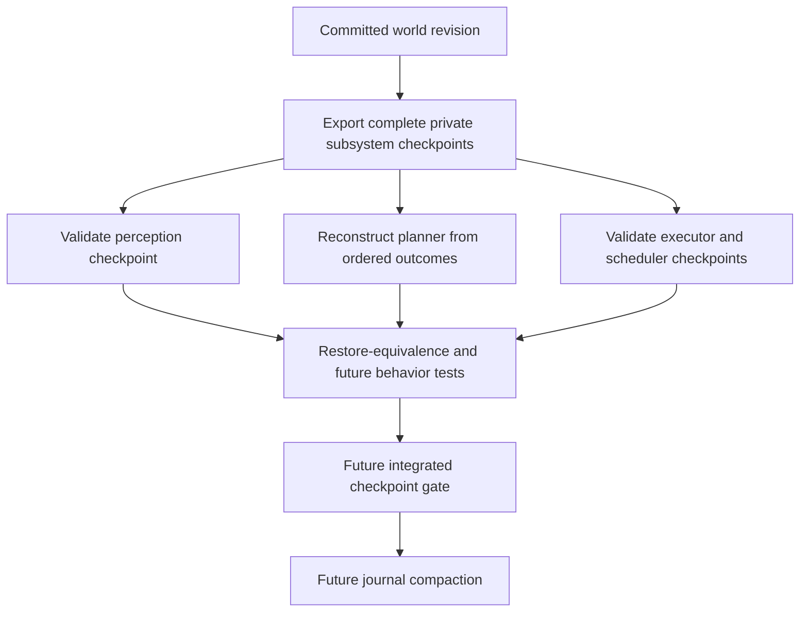

# GODSEED — Direct subsystem checkpoint restoration V1

Status: tested development prerequisite for world journal compaction. This increment does not compact, truncate or delete the world journal. It extends [WORLD_DURABLE_STORAGE.md](WORLD_DURABLE_STORAGE.md), [WORLD_TRANSACTIONS.md](WORLD_TRANSACTIONS.md), [NPC_PERCEPTION.md](NPC_PERCEPTION.md) and [NPC_PLANNING.md](NPC_PLANNING.md). Owner-approved time, identity, memory and save rules retain authority. Automated forced process termination is prohibited; Android force-stop testing remains reserved for the owner.

## 1. Architecture and decision



The existing diagnostic snapshots do not contain all internal state required for continuation. For example, perception has a processed-event set that includes events yielding no observation, and the planner has used attempt identities and temporal review boundaries. Replacing replay with diagnostic state alone would risk duplicate effects or lost history. The selected incremental approach introduces explicit versioned checkpoint exports and trusted restoration inputs before modifying the journal.

## 2. Implemented contracts

| Service | Checkpoint format | Required restored state |
|---|---|---|
| Perception | perception-checkpoint-v1 | World, high-water tick, processed event IDs, actor-grouped receipts |
| Planner | planning-checkpoint-v1 | Original plan definition, pending attempt, ordered outcome history, reconstructed progress and revisions |

The optional final checkpoint argument to each existing factory preserves existing two-argument/one-argument use. Exported checkpoints are detached private copies. Actor-bound views do not expose these exports.

Perception restoration validates format, world identity, exact receipt and claim fields, dense arrays, processed-event uniqueness, receipt ID sequence, chronological order within each actor and the high-water tick. Actor groups retain original export order. A previously processed event that yielded no receipt stays processed; restoration does not accidentally reveal it. The original reference does not retain a receipt-to-event mapping or event payload digest, so this contract cannot prove the historical authenticity of a receipt or reject every coherent alteration. It requires a trusted storage authority and separate integrated event provenance.

Planner restoration validates the original definition and reconstructs prior admissions and terminal outcomes in order, reusing the existing settlement checks. It rejects reused attempt/event IDs, wrong action bindings, invalid prerequisites, overcredit and inconsistent chronology. It restores pending work without granting credit, reconstructs the next-review boundary and compares the resulting snapshot against the supplied state. Definition and state comparison ignores object property ordering, not array ordering. This does not re-prove the original cognition decision or actual authority of a historical outcome. Authentication and cross-service reconciliation remain coordinator responsibilities.

## 3. Previous increment verification

Run from repository root with Node.js 22.16+:
```sh
node tools/check_world_checkpoints.mjs
node tools/check_durable_world_store.mjs
node tools/check_durable_world_recovery.mjs
node tools/check_integrated_world_recovery.mjs
```

| Current executed suite | Result |
|---|---:|
| Direct perception and planner checkpoint restoration | 33/33 PASS |
| SQLite adapter | 20/20 PASS |
| Scheduler/executor normal-exit recovery | 6/6 PASS |
| Integrated NPC normal-exit recovery | 9/9 PASS |
| Total | 68/68 PASS |

Actual Node.js v22.16.0 runs in the Linux development container used verified copies of the prior repository modules. Initial checkpoint suite passed 29/29; review added dense-array and grouping validation and four additional cases. The final run passed all 68 checks. Current source and test Git blob hashes matched the local files after repository readback:

- tools/npc_perception_reference.mjs: 4c88ddae030ef307f0a63c186756c13770762595
- tools/npc_planning_reference.mjs: 5cf56f164f6482a5929d4dc1bb8fd10a0bcba3b0
- tools/check_world_checkpoints.mjs: f8050a49f6654c9162225cacaf200cea38b4414a

For this previous increment, the 396 JavaScript-isolate cases were historical. The 35 existing storage checks test existing full-journal reconstruction, not direct integrated checkpoint restoration. The 33 new tests exercise direct subsystem restoration and continuation in memory. No Android force-stop, forced process termination, real save modification or canonical NPC activation occurred. Only synthetic test data was used.

## 4. Executor and scheduler checkpoint extension

The existing factories now accept an optional final private checkpoint input. Both expose a detached exportCheckpoint method. Existing state/diagnostics and ordinary factory use remain compatible.

| Service | Format | Preserved state |
|---|---|---|
| Executor | execution-checkpoint-v1 | Initial actor baseline, clock, actor state/revisions, offers (including stale and unadmitted), active phases, resource reservations, plan bindings, attempt identities, ordered terminal receipts and phase history |
| Scheduler | scheduler-checkpoint-v1 | World/player identity, insertion sequence, event and submission IDs, queue, journal, receipts, current submission, pause reason, budget and recoverable fault state |

The executor reconstructs attempt and resource accounting from the recorded phase events. It verifies terminal receipt order, actor identity, historical non-overlap, phase chronology, current phase duration, elapsed active credit, reservation totals and exclusive target ownership. Active phases are restored without charging their initial cost again. Target locks are derived from active attempts; previous attempt IDs remain consumed. Knowledge revisions are checked against the initial baseline and the possible number of revision updates. Offer restoration preserves stale offers without permitting stale admission. The same current admission and phase-advance rules remain in use after restoration.

The scheduler reconstructs its event queue using existing validation, restores exact insertion order and used identities, checks journal chronology and recurrence, verifies scheduler receipts against the matching executor outcomes, and validates current submission ownership, clock and pause state. A budget-limited session may continue, a paused action requires explicit resume, and an already processed event or submission identity remains unavailable for reuse. A fault-state restoration is a diagnostic reference and assumes a compatible, side-effect-free review adapter.

These are trusted private restoration contracts, not historical authenticity proofs. The executor's historical terminal events do not retain every completed attempt's original phase definition and credit rate; the validator cannot independently re-prove every past terminal credit or plan binding. Scheduler historical records do not retain every original recurrence configuration or submission body. The coordinator must bind these checkpoints to an authenticated committed record and reconcile receipt provenance, active plan identities, actor knowledge revisions and the exact world timeline. Current full-journal replay remains authoritative; no storage format, SQLite schema, save semantics, world seed, or canonical NPC was changed.

## 5. Current verification

| Suite | Executed result |
|---|---:|
| New executor/scheduler checkpoint restoration | 35/35 PASS |
| Existing action execution | 51/51 PASS |
| Existing scheduler | 46/46 PASS |
| Knowledge, perception, cognition, opportunities, planning, persistence and integrated transactions | 299/299 PASS |
| Total current development checks | 431/431 PASS |

Executed the new source function bodies and existing test logic in the development JavaScript isolate, then verified the saved source and test contents. Seven additional regression suites were executed from the saved repository source. Standalone Node module loading, direct integrated disk checkpoint restoration, the earlier 33 perception/planner checkpoint checks and the 35 SQLite checks were not rerun in this increment. Do not report the earlier 68 Node checks as current execution evidence. No forced process termination, Android force-stop or real save changes were performed.

New suite: node tools/check_execution_checkpoints.mjs (standalone invocation not executed in this increment).

Verified blobs:
- tools/npc_execution_reference.mjs: 835fcafba4fb566001b743e1c028c5cb689bcecb
- tools/world_scheduler_reference.mjs: 87827592c148078ccf8bed50f32b8d6ce4f2a909
- tools/check_execution_checkpoints.mjs: 25fa1ec51e8db909e2290cbb40243486a2ae898e

## 6. Next gate

All four component-level private checkpoint contracts are now available. Next implement coordinator-level export and restoration, retaining configuration, actor-local evidence, plan state, complete observation-frame identity/content history, and the execution/scheduler contracts. Reconcile cross-service identities and prove uninterrupted versus directly restored continuation, including partial admission, interruption, pending decisions and revision consistency. Verify the combined state in Node and normal-exit SQLite recovery before designing a new journal format. Preserve exact transaction idempotency, historical evidence, world identity and independently trusted revision authority. Do not truncate existing history or increase the current 256-command limit as a substitute for verified compaction.

The reference remains bounded, static-fixture development infrastructure. Full belief/memory consolidation, domain consequences, canonical actor initialization, production scale and Android durability remain pending. No final engine or storage technology is selected. Owner-only Android force-stop testing remains in effect.
