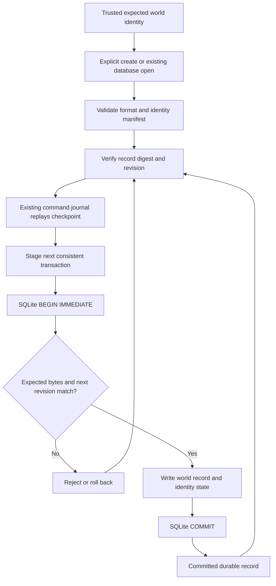

# GODSEED — Durable local storage reference V1

Date: 2026-11-26. Status: SQLite-backed development storage adapter; normal-exit Linux subprocess recovery tests passed for the scheduler/executor journal. This is not a final engine/backend selection, Android release, full integrated NPC recovery test, or production save system. Extends [WORLD_PERSISTENCE.md](WORLD_PERSISTENCE.md) and [WORLD_TRANSACTIONS.md](WORLD_TRANSACTIONS.md). Owner-approved single-world, time, succession and save-policy rules retain authority.

## 1. Architecture



The new adapter implements the existing synchronous read/compareAndSwap contract and explicit close. It does not replace the command journal, scheduler, executor, or integrated coordinator. The adapter is a privileged storage boundary; actors and narration must never receive database contents directly.

## 2. Storage contract

| Component | Reference decision |
|---|---|
| Runtime | Node.js 22.16+ with built-in node:sqlite |
| Backend | Local SQLite database, one world per file |
| Identity | Explicit trusted world_id and seed supplied on creation and opening |
| Format | SQLite application ID 0x474f4453, user_version 1; existing world-reference-v1 payload |
| Identity table | Separate singleton record containing world ID, seed and initialized flag |
| World table | Singleton record containing revision, complete serialized payload and SHA-256 digest |
| Writes | BEGIN IMMEDIATE; compare exact previous bytes; require next sequential revision; commit both tables atomically |
| Reads | Consistent read transaction, manifest and digest checks |
| Journal | Rollback journal DELETE mode; synchronous EXTRA; 5-second busy timeout |

Creation uses exclusive file creation, refusing an existing path. Opening requires an existing regular file and never creates a missing database as a recovery action. The initialized flag distinguishes an explicitly created empty store from missing data in an initialized store. An invalid format, mismatched identity, missing initialized record, corrupted payload or revision mismatch fails closed. A failed initial schema creation can leave an empty or incomplete file; this is not silently recreated. Recovery needs an explicit authorized repair procedure.

The identity table is separate from the payload but is in the same database; it is not an independent backup or protected external identity manifest. The caller must supply the trusted expected identity independently. The digest detects tested accidental payload changes, not a malicious coherent rewrite or restoration of a complete older valid database. No anti-rollback guarantee follows. No encryption or real account credential storage is provided.

The existing journal remains responsible for canonical serialization, detailed world-state validation, command replay, transaction-ID idempotency and checkpoint equivalence. The backend validates its envelope and storage revision; it does not interpret gameplay. Stale compare-and-swap returns false, while invalid next revisions and corrupted data raise errors. Only use with local filesystems that support SQLite locking and durability; do not delete, move, replace or externally edit open database files. The 256-command and 16-million-character world-reference budgets remain; compaction and scalable reads are pending.

## 3. Verification — revised owner-approved test boundary

The owner reserves force-stop testing for manual testing on a downloaded Android game. Automated development tests must not send process-termination signals, simulate force stops by terminating a process, use subprocess timeouts that forcibly terminate a child, or run Android force-stop commands. Use bounded test work, SQLite busy timeouts, explicit transaction rollback, controlled exceptions, normal process exits and database reopen tests. If a process hangs, report the blocker rather than forcing termination. This requirement applies to future automated test development for this project. Historical Git commits remain intact; do not run superseded forced-termination tests.

Run from repository root with Node 22.16+:
```sh
node tools/check_durable_world_store.mjs
node tools/check_durable_world_recovery.mjs
```

| Verification group | Current executed result |
|---|---:|
| SQLite storage, validation, normal subprocess exits, concurrent writers and explicit SQL rollback | 20/20 PASS |
| Scheduler/executor journal normal-exit recovery and controlled transaction errors | 6/6 PASS |
| Current durable-storage verification | 26/26 PASS |

Both revised suites ran under Node.js v22.16.0 in the Linux development container. Existing local copies of the adapter, persistence, executor and scheduler matched the repository Git blob hashes before testing. The two revised checker files matched the locally tested Git blob hashes after repository write/readback.

The storage tests now use a normal child process to execute a deliberate SQL ROLLBACK, then reopen the database and verify that committed bytes remain unchanged. A separate normal-exit test verifies that a committed write survives reopening. The journal tests use a caught exception before compare-and-swap and a caught exception after successful compare-and-swap to verify checkpoint preservation and idempotent retry. These are not abrupt shutdown, device force-stop, power-cut or operating-system crash tests.

Previous nine reference suites: 396/396 passed in the earlier JavaScript isolate run documented in WORLD_TRANSACTIONS.md. Those suites were not rerun in this correction; the current run is 26/26. The historical combined count is not a new full regression result.

Verified current blobs:
- durable_world_store.mjs: 057a415a153438e5860500787ae682baa6bc21f4 (unchanged)
- check_durable_world_store.mjs: 49dee6273c15579f80c4039915664e9c37087760
- check_durable_world_recovery.mjs: 89e90b52513a5b064c78f6f66208a963b76894b8
- world_persistence_reference.mjs: 078bf8b1e81bf2c9c213c8e95f7d862d5121721d
- npc_execution_reference.mjs: b4a719611e7d372edd6b87a8fab9b1194438b09d
- world_scheduler_reference.mjs: 5148b66d26c7fe0204f7937fa4daf8beb6a2effe

Only newly created synthetic test databases were used. No player data, real game save, canonical character, or world seed was modified.

## 4. Remaining requirements

No physical power-cut test, Android filesystem test, large-world benchmark, integrated perception/plan disk restart, full migration, protected external identity manifest or journal compaction has been verified. SQLite transaction settings and normal-exit recovery tests establish the tested reference behavior, not abrupt shutdown durability. Force-stop and other abrupt-shutdown tests remain deferred to the owner. Node is only the development runtime; final game engine and platform backend remain undecided. The existing three save slots, reload confirmations, Divine Judgement, stuck recovery and ordinary rewind questions remain outside this storage adapter.

## 5. Handoff

Next: run the complete integrated transaction coordinator on the SQLite backend across normal process exits and reopen operations, checking pending plan identity, partial settlement, observations, actor revision consistency, inaccessible information, deterministic replay and idempotent recovery. Add an independently protected expected identity/monotonic authority and a tested checkpoint/journal compaction strategy before scale testing. Then address dynamic actor state, actual world-domain effects and the canonical roster initialization gate. Preserve current user-facing save policies without inventing unresolved rollback semantics.
