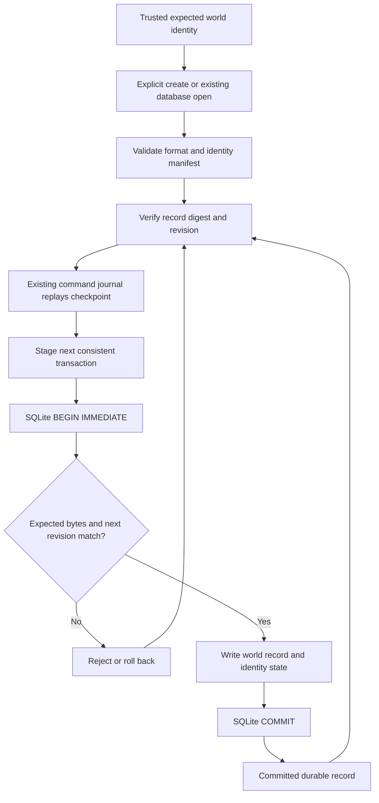

# GODSEED — Durable local storage reference V1

Date: 2026-11-26. Status: SQLite-backed development storage adapter; actual Linux subprocess recovery tests passed for the scheduler/executor journal. This is not a final engine/backend selection, Android release, full integrated NPC recovery test, or production save system. Extends [WORLD_PERSISTENCE.md](WORLD_PERSISTENCE.md) and [WORLD_TRANSACTIONS.md](WORLD_TRANSACTIONS.md). Owner-approved single-world, time, succession and save-policy rules retain authority.

## 1. Architecture



The new adapter implements the existing synchronous read/compareAndSwap contract and explicit close. It does not replace the command journal, scheduler, executor, or integrated coordinator. The adapter is a privileged storage boundary; actors and narration must never receive database contents directly.

## 2. Storage contract

| Component | Reference decision |
|---|---|
| Runtime | Node.js 22.16+ with built-in node:sqlite |
| Backend | Local SQLite database, one world per file |
| Identity | Explicit trusted world_id and seed supplied on creation and opening |
| Format | SQLite application ID 0x474f4453, user_version 1; existing world-reference-v1 payload |
| Identity table | Separate singleton record containing world ID, seed and initialized flag |
| World table | Singleton record containing revision, complete serialized payload and SHA-256 digest |
| Writes | BEGIN IMMEDIATE; compare exact previous bytes; require next sequential revision; commit both tables atomically |
| Reads | Consistent read transaction, manifest and digest checks |
| Journal | Rollback journal DELETE mode; synchronous EXTRA; 5-second busy timeout |

Creation uses exclusive file creation, refusing an existing path. Opening requires an existing regular file and never creates a missing database as a recovery action. The initialized flag distinguishes an explicitly created empty store from missing data in an initialized store. An invalid format, mismatched identity, missing initialized record, corrupted payload or revision mismatch fails closed. A failed initial schema creation can leave an empty or incomplete file; this is not silently recreated. Recovery needs an explicit authorized repair procedure.

The identity table is separate from the payload but is in the same database; it is not an independent backup or protected external identity manifest. The caller must supply the trusted expected identity independently. The digest detects tested accidental payload changes, not a malicious coherent rewrite or restoration of a complete older valid database. No anti-rollback guarantee follows. No encryption or real account credential storage is provided.

The existing journal remains responsible for canonical serialization, detailed world-state validation, command replay, transaction-ID idempotency and checkpoint equivalence. The backend validates its envelope and storage revision; it does not interpret gameplay. Stale compare-and-swap returns false, while invalid next revisions and corrupted data raise errors. Only use with local filesystems that support SQLite locking and durability; do not delete, move, replace or externally edit open database files. The 256-command and 16-million-character world-reference budgets remain; compaction and scalable reads are pending.

## 3. Actual verification

New files:
- [durable_world_store.mjs](../tools/durable_world_store.mjs)
- [check_durable_world_store.mjs](../tools/check_durable_world_store.mjs)
- [check_durable_world_recovery.mjs](../tools/check_durable_world_recovery.mjs)

Run from repository root with Node 22.16+:
```sh
node tools/check_durable_world_store.mjs
node tools/check_durable_world_recovery.mjs
```

The development test environment was Linux, Node.js v22.16.0, SQLite 3.49.1 (node:sqlite experimental feature). Direct GitHub cloning was blocked by DNS/network access. The actual persistence, execution and scheduler source files were transferred from repository reads into a temporary local directory; their git blob hashes matched the verified repository versions before execution. New module imports and command-line test files were executed with Node, rather than only extracted functions in the JavaScript isolate.

| Verification group | Executed result |
|---|---:|
| SQLite storage, validation, real concurrent processes and SIGKILL | 20/20 PASS |
| Actual scheduler/executor journal subprocess recovery | 6/6 PASS |
| Previous nine reference suites rerun in JavaScript isolate | 396/396 PASS |
| Combined across these two execution environments | 422/422 PASS |

Actual adapter tests cover explicit create/open, foreign identity, stale and skipped revisions, malformed records, separate processes, two concurrent writers competing for one revision, SIGKILL during an uncommitted database write, SIGKILL after commit, digest/record/revision corruption, incompatible schema and closed handles. The precommit kill test writes a large payload in an actual open SQLite transaction before termination; recovery retains the prior committed bytes. The postcommit kill test terminates after compare-and-swap returns successfully; the new revision remains.

The six actual journal tests use the existing scheduler, executor and persistence modules with a deterministic synthetic NPC review adapter. They check restart during an admitted submission, paused partial work, resumed completion, recurring NPC outcomes, termination before journal commit, termination after commit with idempotent retry, and equality between reopened disk state and uninterrupted memory state. They do not exercise the full integrated planner/perception coordinator in separate processes. Previous integrated transaction tests (36/36) passed in the JavaScript isolate as part of the 396 regression cases, not with SQLite.

Verified new blobs (match locally executed files):
- durable_world_store.mjs: 057a415a153438e5860500787ae682baa6bc21f4
- check_durable_world_store.mjs: 4e650276b3d8611a596508bfcdbbabeed3d7efc4
- check_durable_world_recovery.mjs: 262b281614a11805cc731916128803d5fd30052c

Verified existing local source blobs: persistence 078bf8b1e81bf2c9c213c8e95f7d862d5121721d; execution b4a719611e7d372edd6b87a8fab9b1194438b09d; scheduler 5148b66d26c7fe0204f7937fa4daf8beb6a2effe. Existing reference modules and nine test suites were unchanged. Only synthetic temporary databases were created and cleaned up. No actual world data, character, save slot or seed was changed.

## 4. Remaining requirements

No physical power-cut test, Android filesystem test, large-world benchmark, integrated perception/plan disk restart, full migration, protected external identity manifest or journal compaction has been verified. SQLite transaction settings and subprocess termination tests are evidence of reference recovery, not a universal guarantee against every filesystem, hardware or power failure. Node is only the development runtime; final game engine and platform backend remain undecided. The existing three save slots, reload confirmations, Divine Judgement, stuck recovery and ordinary rewind questions remain outside this storage adapter.

## 5. Handoff

Next: run the complete integrated transaction coordinator on the SQLite backend across real process restarts, checking pending plan identity, partial settlement, observations, actor revision consistency, inaccessible information, deterministic replay and idempotent recovery. Add an independently protected expected identity/monotonic authority and a tested checkpoint/journal compaction strategy before scale testing. Then address dynamic actor state, actual world-domain effects and the canonical roster initialization gate. Preserve current user-facing save policies without inventing unresolved rollback semantics.
