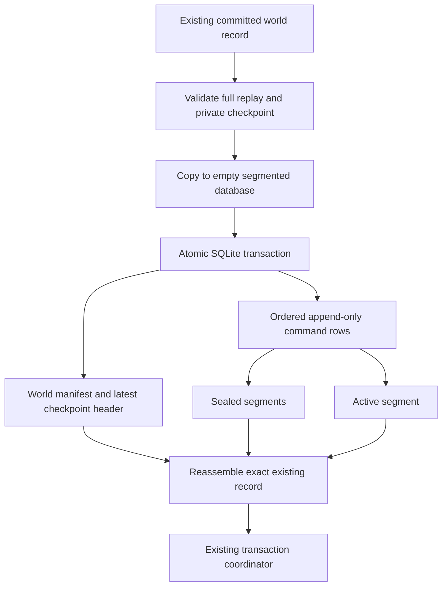

# GODSEED — Lossless journal segmentation V1

Status: experimental SQLite adapter with verified copy migration, not production cutover or bounded-replay compaction. Baseline: 5eff014b60b5be81a4ddfcd218bf58b8fcb1b489. Extends [WORLD_CHECKPOINTS.md](WORLD_CHECKPOINTS.md) and [WORLD_DURABLE_STORAGE.md](WORLD_DURABLE_STORAGE.md). Android force-stop testing remains reserved for the owner.

## 1. Design and trust boundary



The existing adapter and persistence reference remain unchanged. The new adapter has a distinct SQLite application ID and version. Its manifest binds the caller-supplied world ID, seed and segment size. A head row retains the existing canonical record fields except the journal, and a full-record SHA-256 digest plus the command-chain head. Each committed command occupies a unique revision/transaction-ID row, with its canonical content and chained SHA-256 digest. Segment index is derived from revision; completed groups are logically sealed. The default group size is 32 commands, configurable at creation/open from 1 to 256. The tests use three commands per group. Existing rows are never updated by ordinary adapter commits; triggers reject ordinary SQL updates and deletes. Head update and appended rows commit together. Reading validates chain, identity, sequence and full-record digest, then reconstructs exact world-reference-v1 bytes.

The existing coordinator's read/compareAndSwap contract remains compatible, including original transaction retries and conflict checks. Normal commit must append exactly one revision and preserve the initial configuration and entire previous journal prefix. No automatic migration, production activation, history deletion, user save-slot change or seed regeneration occurs.

## 2. Copy migration

The explicit importVerified operation reads one source snapshot, validates it with the trusted integrated coordinator (full recovery and direct-checkpoint equivalence), verifies the source still exposes those bytes, and imports into an empty destination with a single SQL transaction. The source remains intact. Migration is a point-in-time copy, not a live two-database atomic switch. A source writer may advance after the final source read. Production cutover requires a coordinated writer freeze or fencing and a separately trusted authoritative world pointer. Do not run both copies as independent authoritative worlds. The verifier factory is privileged and must use the existing real coordinator with compatible side-effect-free adapters. The hash chain and SQL triggers are corruption and accidental-rewrite checks, not authentication against a privileged database writer or independent anti-rollback protection.

## 3. Current limits

The active logical segment is bounded, but every historical command is still retained and read. This prevents rewriting old command rows on each adapter commit; physical storage/page-write reductions and recovery speed have not been benchmarked. Full journal replay still runs from initialization, and the existing 256-command and 16-million-character record limits remain. The checkpoint header contains existing diagnostic state, not a new independently authenticated private restore point. Neither the database nor the retained NPC history has a bounded lifetime size. This increment deliberately does not claim reduced replay time or complete journal compaction.

## 4. Verification

Actual Node.js v22.16.0 with node:sqlite (SQLite 3.49.1) in the Linux development container; source and checker copies matched the baseline Git blob hashes. The new adapter and checker were written to the repository and reread with hashes identical to the locally tested files.

| Executed suite | Result |
|---|---:|
| New segmented SQLite and copy migration | 21/21 PASS |
| Direct perception/planner checkpoints | 33/33 PASS |
| Existing SQLite adapter | 20/20 PASS |
| Existing scheduler/executor recovery | 6/6 PASS |
| Existing integrated NPC recovery | 9/9 PASS |
| Existing durable integrated checkpoint validation | 8/8 PASS |
| Current total | 97/97 PASS |

The initial segmented suite passed 17/17, then four additional cases were added for sealed-row equality, stale writer/conflicting retry, source changes during migration, and foreign identity/existing-path rejection. Tests include normal subprocess reopen, pending plan identity, partial progress, private observation boundaries, unchanged source bytes, source validation rejection, controlled SQL rollback of partially inserted rows, append-only triggers, damaged head rejection and exact archived transaction retry. All databases and corruptions were synthetic test fixtures. No forced process termination, Android force-stop, production save migration or canonical NPC activation was performed.

Run from repository root with Node.js 22.16+:
```sh
node tools/check_world_journal_segments.mjs
node tools/check_world_checkpoints.mjs
node tools/check_durable_world_store.mjs
node tools/check_durable_world_recovery.mjs
node tools/check_integrated_world_recovery.mjs
node tools/check_durable_checkpoints.mjs
```

Verified new blobs:
- tools/world_journal_segments.mjs: 3e0f9c75d3a605d17312f65d62c636f070c90a22
- tools/check_world_journal_segments.mjs: 6f988faed70d168a49c8e8b6f2f918e0311365d4

The initial repository transfer script failed because of an unbound template variable, before writing any file. The corrected transfer succeeded and both hashes matched. The prior 458 JavaScript-isolate cases were not rerun here.

## 5. Handoff

Next: introduce a separately trusted identity/revision/checkpoint authority and design a private checkpoint anchor at a sealed segment boundary. Verify a bounded active-tail replay against the full historical reference, retain exact transaction retry detection through the archived rows, and test corrupt or stale anchors, rollback, and migration without mutating original records. No direct checkpoint installation or history truncation until that gate is verified. Then evaluate journal size/recovery cost and address dynamic actor state, actual domain effects, full memory development and canonical NPC initialization.
