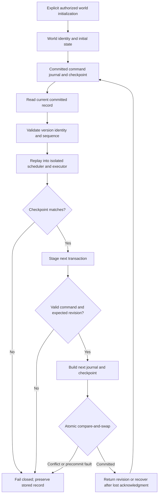

# GODSEED — World persistence and technical recovery V1

Date: 2026-11-26. Status: development reference with simulated atomic storage and tested scheduler/executor reconstruction. Not a disk save implementation, user-facing load policy, production world persistence or actual game save. Extends [WORLD_SCHEDULER.md](WORLD_SCHEDULER.md), [NPC_EXECUTION.md](NPC_EXECUTION.md), [NPC_PLANNING.md](NPC_PLANNING.md), [NPC_MEMORY.md](NPC_MEMORY.md), [GAMEPLAY.md](GAMEPLAY.md) and [INTERFACE.md](INTERFACE.md). Latest owner decisions take precedence.

## 1. Persistence workflow



The reference stores one logical world record. It reconstructs a fresh private executor and scheduler from the initial specification and ordered committed commands, compares the reconstructed diagnostic checkpoint against the stored checkpoint, and stages each new transaction in that isolated runtime. A failed command must not change committed bytes. No actor reads the private checkpoint or command journal directly.

## 2. Identity, version and transaction contract

| Record | Contents |
|---|---|
| Format | world-reference-v1 |
| Adapter version | Caller-supplied compatible deterministic adapter version |
| World identity | World ID, externally supplied seed, active fixture player ID |
| Initial state | Executor initialization specification |
| Revision | Number of committed commands |
| Journal | Ordered revision, unique transaction ID and command |
| Checkpoint | Executor state and scheduler diagnostics at latest committed revision |

Initialization is explicit, requires empty storage, and uses compare-and-swap. Recovery never calls initialization, never generates a new seed and fails closed if the record is missing, invalid or incompatible. Optional trusted expected identity binds recovery and initialization to the expected world ID and seed; the reference copies that binding rather than retaining a mutable caller object. Production must independently establish that a genuinely empty store means authorized first initialization or deliberate world-data deletion, rather than storage loss. It must retain an independent identity manifest or equivalent trusted authority. The seed is preserved metadata here; actual seed-driven world generation and actor-local random stream restoration are not implemented.

Supported privileged commands are publish (actual execution offer), schedule (world or NPC review event), submit (player start/resume), and run (bounded processing of an admitted session). Existing executor/scheduler invariants still apply. A command must be representable in the reference's strict canonical JSON subset (safe integer numbers, strings, booleans, null, dense arrays and plain objects). Unsafe prototype keys and unsupported values are rejected. Commands have no reseed or rewind operation. Reading a recovered checkpoint does not commit a transaction or advance the stored clock. A technical run with no admitted session leaves simulation time unchanged.

## 3. Commit, recovery and duplicate prevention

A transaction has a stable ID and expected precommit revision. A new transaction must match the latest revision. The reference builds its proposed state by replaying the currently committed journal, applies the command to that private runtime, and atomically replaces the complete record through the storage adapter's compare-and-swap operation. Compare-and-swap compares the original committed bytes, not only the revision. A competing writer's commit must not be overwritten.

An exact retry of a committed transaction ID, original expected revision and same canonical command is idempotent even after later transactions. Reusing an ID for different content or original revision is rejected. The existing scheduler rejects duplicate gameplay submission IDs independently. A scheduler processing fault rejects the staged transaction; its temporary changes are discarded.

Recovery reconstructs pending action phases, reserved resources and targets, previous outcome identities, offers, pending world events, review recurrence, admitted session and pause/budget state by replaying commands through the actual reference modules. The checkpoint is a comparison target, not an independent state authority or full direct-restore representation. The entire replay is isolated. A deterministic, side-effect-free trusted NPC review adapter is mandatory; replay must never send external messages, perform live transactions or regenerate uncertain outcomes from changed rules. Adapter version is checked but not cryptographically authenticated. Production must store or deterministically reproduce all decisions and random inputs under pinned implementations.

A simulated failure before compare-and-swap leaves original bytes unchanged. A simulated lost acknowledgment after compare-and-swap leaves the new committed record readable; retry does not duplicate effects. Recovery is technical recovery of the latest record, not permission to roll back to an old save. A missing or corrupt record is not silently replaced with a fresh world. No automatic background work is introduced.

## 4. Save policy boundary

Preserve three user-facing slots, explicit deletion before replacement when full, two-step Load confirmation, automatic recovery checkpoints for committed actions, one seed, persistent succession, and the owner's reload/stuck rules. These are distinct from this internal journal reference. The eight-reload warning, twenty additional repeats and optional reset after eighteen stuck rounds are documented in GAMEPLAY.md and INTERFACE.md. Ordinary rewind scope, qualifying reload identity, penalty persistence, stuck detection and technical recovery exemptions still need owner-compatible implementation decisions. This increment does not implement, count, trigger or test user reloads, slots, character death, stuck resets or Divine Judgement. No new seed, live NPC or canonical save was created.

## 5. Limitations and production contract

The supplied storage adapter is an in-memory string cell with atomic compare-and-swap behavior in the test environment. It does not demonstrate disk durability, filesystem flush behavior, OS crash recovery, multi-process locking or power-loss resistance. Production should use a transactional storage engine with durable atomic commits and a separately verified recovery policy. Select the actual backend after engine/platform decisions; do not infer that JavaScript or a particular database is the final game technology.

This reference is bounded to 256 commands and 16,000,000 serialized characters, and replays from initialization on each read/commit. It is deliberately simple and unsuitable for large-world performance. Production needs verified checkpoints, journal compaction with retained transaction identity, efficient reads, schema migration, integrity checks, protected identity and monotonic commit authority. Canonical serialization and replay comparison detect the tested structural and state mismatches, not every coherent alteration, malicious rewrite, or rollback of a complete record. The optional external identity binding catches mismatched world identity but is not a full anti-rollback system.

Only scheduler and executor are reconstructed. Planner progress, actor knowledge/belief/memory services, economy, ownership, biology, actual world event effects and random-state authorities are not yet included in the same atomic commit. Earlier planner/executor integration tests remain separate. The journal/checkpoint must be private; any actor-facing output requires existing knowledge boundaries. The reference uses privileged synchronous APIs and synthetic data, not a complete authorization service.

## 6. Verification

Files:
- [world_persistence_reference.mjs](../tools/world_persistence_reference.mjs)
- [check_world_persistence.mjs](../tools/check_world_persistence.mjs)

Run from repository root with Node.js:
```sh
node tools/check_world_persistence.mjs
```

| Group | Executed result |
|---|---:|
| Knowledge | 24/24 PASS |
| Perception and integration | 40/40 PASS |
| Cognition | 48/48 PASS |
| Opportunities | 53/53 PASS |
| Planning | 51/51 PASS |
| Execution | 51/51 PASS |
| Scheduler | 46/46 PASS |
| Persistence and recovery integration | 47/47 PASS |
| Combined | 360/360 PASS |

Initial persistence run 35/35. Review added optional trusted identity binding and twelve regressions for mismatched seed, initialization recovery, detached identity, journal truncation, unknown commands, queue and outcome corruption, lost initialization acknowledgment, duplicate resource charge, unsafe keys and missing storage. The complete 360-case regression run used repository-loaded function bodies and the updated reference/test logic in the development JavaScript isolate. The repository operation reached its per-call tool limit while writing/verifying the expanded checker; subsequent readback confirmed both final files and a separate run of their saved contents passed all 47 persistence checks. Standalone Node imports/CLI, real filesystem, power-loss, production save restoration and canonical gameplay were not tested.

Verified blobs: persistence reference cf0e2101858197cab792e5d022c9efdc6f9b5a6c; persistence checker d7ee44f7a72d0d4451a73b32b5123a9513d64eaa. Prior seven suites were not modified.

## 7. Handoff

Next milestone: cross-store transaction integration. Reconstruct and reconcile actor knowledge, plan admissions/outcomes and world event projections together with executor and scheduler; test recovery equivalence, partial dispatch failure, duplicate settlement and no hidden knowledge. Then add a durable storage adapter and test actual process restarts, choose engine/platform, define migrations and initialize the existing 12 canonical NPCs only after their blueprint requirements are met. Keep user-facing save policy separate until unresolved load behavior is settled. No actual world data was deleted or replaced.
