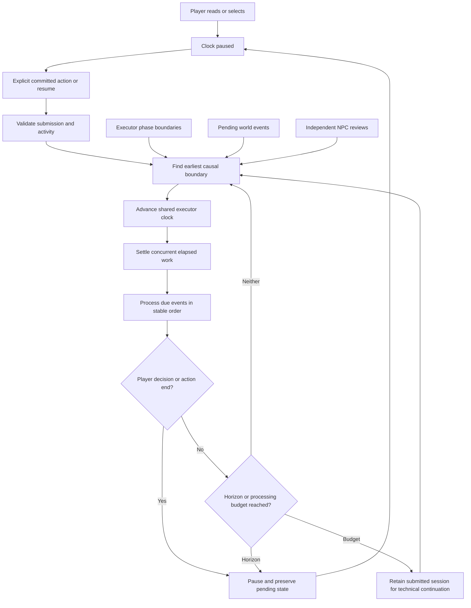

# GODSEED — Shared world scheduler V1

Date: 2026-11-26. Status: development reference implementation, not a production world simulation. Extends [NPC_EXECUTION.md](NPC_EXECUTION.md), [NPC_PLANNING.md](NPC_PLANNING.md), [NPC_OPPORTUNITIES.md](NPC_OPPORTUNITIES.md), [NPC_COGNITION.md](NPC_COGNITION.md), [NPC_PERCEPTION.md](NPC_PERCEPTION.md) and [TIME_AND_ACTIVITY.md](TIME_AND_ACTIVITY.md). Preserve latest owner decisions: one persistent world, fictional time linked to submitted player actions, independent NPC activities, no time advancement during reading, meaningful interruptions, and no automatic disclosure of distant events.

## 1. Workflow and time authority



The executor remains the sole clock authority. The scheduler does not create a second clock, add NPC durations to player duration, or advance real-time simulation while the player reads. The development interface uses abstract integer ticks, not an approved calendar or duration unit.

## 2. Submission and processing contract

A player submission has a unique ID, kind (start or resume), explicit future horizon and activity attempt ID. Start requires an actor-scoped intent already supported by a privileged actual-feasibility offer. Resume requires the matching existing player activity. Submission itself admits the action without advancing time. Ordinary game UI should use the established single Continue action, not introduce extra confirmations; the horizon and resume details are technical concepts for a future interface adapter.

The scheduler processes only an admitted submission. Calling run without an active submission or reading state does not advance time or process events. The horizon is an upper bound: actual player termination or a meaningful decision may stop the interval earlier. At a horizon with unfinished work, retain the existing activity. A later explicit resume may continue it without replaying admission costs or credited work. Duplicate submission IDs are rejected. No separate player wait command is implemented; a future wait activity must enter through the action authority.

## 3. Event ordering and NPC autonomy

The next boundary is the minimum of the current submission horizon, next executor phase boundary and earliest queued event. Advance all active actors over that same interval. At a new tick, the executor settles elapsed work and its phase transitions before the scheduler processes events due at that tick. Events use ascending tick and FIFO insertion sequence. Drain due events at the current boundary before finalizing a pause. This reference admits the player start before processing queued events at the initial current tick; production must explicitly reconcile same-tick admissions and contested resources without arbitrary player priority. An interruption at the exact tick an action has already terminated is stale and cannot undo that outcome. This is a provisional ordering convention, not a finalized combat tie policy.

| Event kind | Reference behavior |
|---|---|
| World | Record the event and evaluate whether a player decision is required; no domain effects |
| NPC review | If actor is active and idle, invoke trusted actor-scoped decision adapter; optional intent and actual offer |
| Interruption | Stop a matching active attempt if authorized by its phase; preserve terminal receipt and actual elapsed work |

Each recurring NPC review has a positive interval. Busy actors are reviewed without overlapping activities; inactive actors cease recurrence. Idle actors may wait or submit their own intent. Recurring reviews are reinserted with a new FIFO sequence. Different actors can complete multiple activities during a longer player activity. Chronological FIFO provides review opportunities under the tested bounded workloads; it is not a proven fairness guarantee for every possible population or workload. The reference does not implement priority classes, offscreen detail promotion, or a full world event generator.

The trusted review adapter must construct actor-owned inputs and actual-feasibility offers without exposing the executor or global world state to cognition. It must be side-effect free before returning a proposal. Wrong actor/world proposals cause a processing fault. Expected executor rejection is logged; a successfully published but rejected offer is revoked. The reference does not bind NPC proposals to multi-step plan instances; prior executor-to-planner integration remains independently verified. Production needs a transactional coordinator for dispatch and outcome settlement.

## 4. Interruptions and player information

A world event or successfully resolved interruption may request a player decision only when trusted context indicates that the player observed it and it is materially actionable. An interruption affecting another NPC may also require a player decision if both conditions hold. A hidden distant event does not pause solely for its importance. Ordinary observed events need not stop the clock. A stopped player activity ends its submission even when its cause is not yet known. No automatic reflex success, forced decision or secret disclosure is implied.

A decision boundary may retain an active player activity, or follow its terminal outcome. A paused session does not continue without a new admitted submission. The public scheduler view contains world ID, clock, status, active-submission flag and current player attempt ID; it excludes queue contents, NPC receipts, private event IDs and internal fault detail. This is a narrow diagnostic-facing projection, not the full game narration or an authorization service. Actual observations, meaning and consequences must be resolved by the domain and perception authorities.

## 5. Work budgets, faults and persistence

Each time-boundary advancement or due event consumes one work-budget unit. On exhaustion, the reference keeps the same submission, queue, pending stop reason and current clock. A technical continuation may process the already committed interval without a second player action. A drained stopping boundary finalizes even when the budget is exactly exhausted. This budget limits loop iterations, not CPU time or per-actor work. A review adapter exception retains the unprocessed event at the current boundary and reports a technical fault; a trusted retry can resume there after correcting the problem. No automatic background retry exists.

The reference limits initial queued events to 4,096, unique event series and submissions to 10,000, and per-run budget to 10,000. Recurring events have stable series identities and changing ticks. No silent history eviction. It uses array sorting, full executor snapshots and in-memory journals; production scaling requires indexed queues, efficient actor lookup, durable event identities, fair review policies and explicit lifecycle limits. Multiple review series per actor are not prohibited, but production should coordinate them. No durable restore is implemented.

Only the scheduler/coordinator should advance or mutate the executor during a session. Direct privileged mutation out of band, external callbacks with side effects, cross-service crash consistency and concurrent calls are outside the reference contract. Receipts and diagnostics are detached copies, not proof of persisted state. A production save must capture the shared clock, active activities, queue, recurrence state, sequence, admitted submission, pending pause, outcome journal and all actor/world revisions coherently. Reconcile unresolved save/rewind and Divine Judgement policies before implementing user-facing saves. Do not create a new seed on recovery.

## 6. Verification

Files:
- [world_scheduler_reference.mjs](../tools/world_scheduler_reference.mjs)
- [check_world_scheduler.mjs](../tools/check_world_scheduler.mjs)

Run from repository root with Node.js:
```sh
node tools/check_npc_knowledge.mjs
node tools/check_npc_perception.mjs
node tools/check_npc_cognition.mjs
node tools/check_npc_opportunity.mjs
node tools/check_npc_planning.mjs
node tools/check_npc_execution.mjs
node tools/check_world_scheduler.mjs
```

| Group | Executed result |
|---|---:|
| Knowledge | 24/24 PASS |
| Perception and integration | 40/40 PASS |
| Cognition | 48/48 PASS |
| Opportunities | 53/53 PASS |
| Planning | 51/51 PASS |
| Execution | 51/51 PASS |
| Scheduler and integration | 46/46 PASS |
| Combined | 313/313 PASS |

Initial scheduler run 36/36. Review corrected the policy for observed consequential NPC interruptions: they may pause when a player decision is required. Invalid event validation no longer consumes insertion sequence. Test continuation loops were bounded; ten cases added for consequential/hidden interruptions, fault retry, budget-preserved pauses, exact-boundary stale interruptions, committed phases, invalid-event ordering, rejected-offer cleanup, action completion with a decision and sequential player submissions. Final combined run executed the saved repository function bodies and test logic in the development JavaScript isolate. All 313 passed. Standalone Node CLI and import loading have not been executed; no production game runtime, save restoration or actual canonical NPC population was tested.

Verified blobs: scheduler reference 5148b66d26c7fe0204f7937fa4daf8beb6a2effe; scheduler checker 4413ab2ecc5dcbd1ae1996bf0116af2ff6125a27. Prior six reference suites unchanged.

## 7. Handoff

Next milestone: define durable world snapshot and event-journal contracts with atomic commit, replay protection, version checks and crash-recovery fixtures. Prioritize cross-store consistency among scheduler, executor, planner and actor knowledge. Add restoration and uninterrupted-versus-restored equivalence checks before integrating the actual 12 NPCs. Keep the approved one-world seed, character succession, bank access and reload/stuck rules separate from unresolved ordinary rewind mechanics. Engine, actual spatial/biological/economic effects, receipt projection, canonical actor initialization and production runtime remain pending. No canonical world seed, new NPC or save data was generated.
