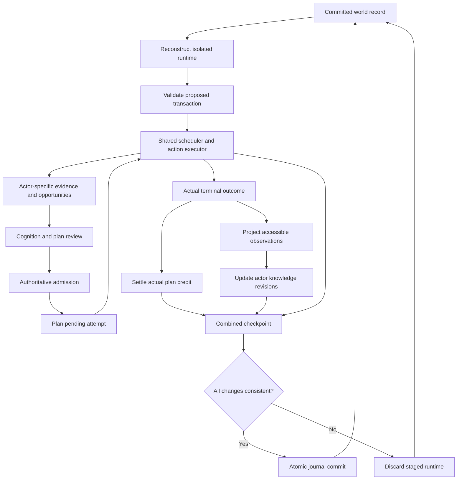

# GODSEED — Cross-system world transactions V1

Date: 2026-11-26. Status: integrated development reference, not production gameplay or durable device storage. Extends [WORLD_PERSISTENCE.md](WORLD_PERSISTENCE.md), [WORLD_SCHEDULER.md](WORLD_SCHEDULER.md), [NPC_EXECUTION.md](NPC_EXECUTION.md), [NPC_PLANNING.md](NPC_PLANNING.md), [NPC_OPPORTUNITIES.md](NPC_OPPORTUNITIES.md), [NPC_COGNITION.md](NPC_COGNITION.md) and [NPC_PERCEPTION.md](NPC_PERCEPTION.md). Existing owner-approved rules retain authority.

## 1. Transaction authority



The coordinator injects existing reference modules into the established command-journal persistence service. It does not create a second clock, parallel world, separate transaction journal or alternate NPC decision engine. Reconstruction and proposed command execution occur in an isolated runtime. Only the final successful compare-and-swap publishes the combined state. A failed cross-store integration must abort the entire proposed command, even if an executor change has already occurred inside the isolated runtime.

## 2. Initial configuration and actor boundaries

The integrated initial specification adds npc_configs to the executor's actor list. Each optional NPC configuration has actor ID, coarse capability identifiers, provisional motivation fields (risk aversion, stress, needs, values, goals) and either one plan definition or null. Configuration shape, capabilities and motivation inputs are validated before initialization. A plan must refer to its own actor, world and an existing goal. The player cannot be registered as an autonomous NPC in this reference. Unconfigured NPCs have no configured review proposal, rather than fabricated motivations. Initial knowledge revisions must be zero: this reference cannot import pre-existing nonempty knowledge without a migration.

The integrated profile derives world, actor, life status, actor revision and time from the actual executor. The perception service supplies only that actor's observations. Opportunity generation and cognition use the existing contracts. Static fixture motivations and capabilities are not a finished emotional, biological or learning simulation. Plan definitions are supplied, not synthesized. Multiple plans per actor, dynamic goal updates, actual history generation and actor lifecycle transitions remain pending.

## 3. Admission and settlement

On a scheduled independent review, the coordinator generates currently available subjective opportunities and asks the actor's existing planner/cognition to decide. Unrelated activities remain possible. Wait or inactive results produce no dispatch. A trusted actual-feasibility resolver prepares the selected action offer. It receives only the scoped context and selected intent; it does not return alternative hidden world facts to cognition. A missing or infeasible actual offer does not create plan credit.

The coordinator binds the selected plan step to its matching executor attempt, checks the selected intent again and caps possible work at the milestone's remaining units. The executor admits first, then the matching planner records the admission. Any post-admission planner exception marks the staged transaction invalid. A terminal executor receipt settles only the corresponding plan, if any. Unrelated action receipts do not credit a plan. An interrupted attempt retains only actual credited work. The existing planner and executor continue to enforce unique attempt and outcome identities.

The scheduler processes outcomes and their projected observations before the next due NPC review at the same clock boundary. An outcome-integration exception poisons the staged transaction even if the scheduler catches an interruption error. No partially admitted, partially settled or partially projected command is committed. This is transaction-level atomicity over a bounded command; it is not a claim of sub-command disk durability or real-world external side-effect rollback.

## 4. Evidence projection and revision synchronization

The integrated persistence service supports a privileged observe command only when the scheduler adapter implements observation ingestion. The frame must refer to the current fictional tick and world, a recognized event identity and registered actor contexts. It must represent an actual accessible committed occurrence within the staged authoritative transaction. This command is not a player menu action, public knowledge injection endpoint or automatic world-event generator. A trusted caller must establish the occurrence and access context; the reference cannot independently verify their truth.

A trusted outcome projection adapter may return a frame or null for an actual terminal receipt. A returned frame must retain the outcome's event identity and time. The existing perception reference determines admitted actor-specific receipts using supplied access flags and projected claims. Changing private metadata does not itself reveal that information. A duplicate current-tick frame with exactly matching canonical content does not create another observation; conflicting content under the same identity aborts. Older-tick explicit frames reject rather than retroactively changing history.

After observation ingestion, the executor synchronizes each changed knowledge revision and increments the affected actor's state revision. Stale offers and intents cannot be admitted under previous revisions. Already active attempts retain their identity and progress. The bound actor view exposes only that actor's observation packet, not private transaction data, another actor's receipts or diagnostic plan history. Binding and transaction methods are privileged, not a full access-control system. Belief interpretation and memory consolidation remain unimplemented: the knowledge packets still contain observation evidence and empty belief/memory arrays. Do not describe this as complete NPC memory persistence.

## 5. Compatibility, recovery and storage

Updated hooks:
- npc_execution_reference.mjs: syncKnowledge validates an expected current knowledge revision, prevents regression, and advances actor revision when knowledge changes.
- world_persistence_reference.mjs: observe commands require an adapter that supports them. Existing nonintegrated journals retain their previous command behavior.

The integrated coordinator uses an adapter-version namespace prefixed with integrated-. It stores the initial configuration, commands, and combined diagnostic checkpoint within the existing journal format. Recovery replays the commands in an isolated executor, scheduler, planner and perception runtime, and compares the full reconstructed checkpoint. NPC attempt IDs are deterministic reference identifiers derived from actor index, actor revision and tick. Identifier limits are constrained by the existing perception and execution modules. No random stream is introduced here.

Actual offer and outcome projection adapters must be deterministic and free of external side effects during replay. The reference uses synthetic witnessed outcome projections, not a complete world event or sensory resolver. It does not establish actual employment, education, injury, resource transfers or spatial consequences. It retains all previous storage limits, including in-memory compare-and-swap, replay from initialization, and the 256-command/16-million-character record budget. No backend, production performance target or anti-rollback implementation has been selected.

The three user-facing save slots, two-step Load, reload warning and Divine Judgement, stuck recovery, succession and single-seed policies remain as documented in GAMEPLAY.md and INTERFACE.md. No user-facing Load or rollback policy is implemented here. The twelve existing canonical NPC reference records remain unchanged and unactivated.

## 6. Verification

Files:
- [world_transaction_reference.mjs](../tools/world_transaction_reference.mjs)
- [check_world_transaction.mjs](../tools/check_world_transaction.mjs)

Run from repository root with Node.js:
```sh
node tools/check_world_transaction.mjs
```

| Group | Executed result |
|---|---:|
| Knowledge | 24/24 PASS |
| Perception and integration | 40/40 PASS |
| Cognition | 48/48 PASS |
| Opportunities | 53/53 PASS |
| Planning | 51/51 PASS |
| Execution | 51/51 PASS |
| Scheduler | 46/46 PASS |
| Persistence | 47/47 PASS |
| Cross-system transactions | 36/36 PASS |
| Combined | 396/396 PASS |

Initial transaction run 27/27. Review added strict initial motivation/configuration validation, own-goal binding and nine regression cases: invalid motivation, unsupported capability, unknown plan goal, private config fields, same-tick causal observation delivery, knowledge changes during active work, unrelated work without plan credit, invalid outcome identity and rejection of observation commands in the old adapter. Existing tests also cover no knowledge leakage to an absent witness, duplicate/conflicting observations, stale offers, partial progress, failed plan admission/settlement, failed projection after interruption, commit acknowledgment loss and deterministic reconstruction. All 396 checks were rerun from the saved source function bodies and test logic in the development JavaScript isolate. No standalone Node CLI/import loading, actual file-backed database, OS process restart or production game runtime was tested.

Verified blobs: transaction reference 427b5c7f5307107703984c461ea0b15a5056cc0e; transaction checker 2ff38b8247a00d94ac37fa51f60d2cf150dd0573; execution hook b4a719611e7d372edd6b87a8fab9b1194438b09d; persistence hook 078bf8b1e81bf2c9c213c8e95f7d862d5121721d. Existing eight test suites remain unchanged and passed.

## 7. Handoff

Next milestone: durable storage adapter and actual process-restart verification. Use a transactional local backend for the reference first, without selecting the final game engine. Test compare-and-swap conflicts, interrupted commits, lost acknowledgments, malformed storage, identity preservation and integrated recovery across separate processes. Establish an independent identity manifest and journal/checkpoint compaction before considering large worlds. Then implement dynamic actor state and actual domain consequences, memory/belief services, and canonical actor initialization. Keep user-facing save semantics separate until their unresolved behavior is decided. No canonical data or save files have been deleted, generated or replaced.
