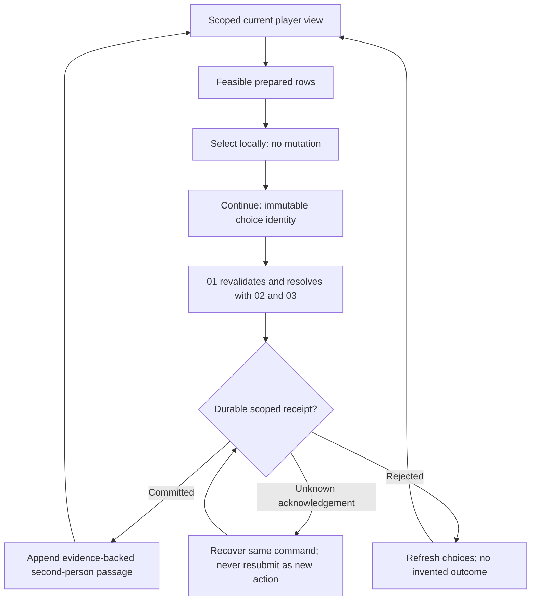

# Narrative and player interaction contract v0.1 — review proposal

Agent 04, cycle 001. DRAFT; not an implemented interface or canonical active content. Base f75bdd14827bd6ea8555f6ca428132e91cff97c3. Source authority: [owner decisions](../OWNER_DECISIONS.md), [gameplay](../GAMEPLAY.md), [narrative variation](../NARRATIVE_VARIATION.md), [interface](../INTERFACE.md), [creation](../CHARACTER_CREATION.md), [status](../CHARACTER_STATUS.md), [world](../WORLD.md), [local life](../LOCAL_LIFE.md), [platform](../PROTOTYPE_PLATFORM.md). Companion [inactive fixture](../../data/narrative/local_interaction_draft.json). Peer draft contracts: PRs #77 (world), #79 (NPC), #78 (abilities). Do not treat them as callable APIs.

## 1. Projection and authority

Reference implementation observed: tools/world_transaction_reference.mjs exposes initialize, commit, recover, bindActor, exportPrivateCheckpoint and verifyCheckpointContinuation; bindActor(actorId).forNarrative() returns detached scoped knowledge, not a complete scene. tools/world_scheduler_reference.mjs accepts start/resume and returns limited world_id, now, status, submission_active, player_activity; diagnostics includes private queue and receipts. tools/check_world_transaction.mjs exercises stale observation, rollback, lost acknowledgment and scoped knowledge. These are V1 development references, not domain-complete gameplay. Do not wire a UI to recover(), diagnostics(), private checkpoint, generic resource counters or client-authored offers. No hidden stats, NPC motives, future events, private balances or undiscovered techniques may enter renderable payloads.

Proposed ActorViewV1: version, world_id, epoch_id, world_revision, actor_id, actor_revision, knowledge_revision, fictional_tick, formatted_date, own_status, location_view (at location or in transit), observations, accessible_reports, known_capabilities, active_activity, choice_set. Explicit allowlist at trusted boundary. own_status separates general/superhuman/field/professional development and clean/dirty Credits; no stamina/mana. Unknown is explicit, not 0. Agent 01 owns tick and timeline, 02 owns lawful life facts/relationship/economy, 03 owns ability disclosure. Source facts have stable evidence IDs, event/claim IDs, acquisition tick and observation scope; do not infer private facts from presentation tokens.

Prepared choice: adopt Agent 01 PreparedChoiceV2 envelope; add presentation-only row_id/version, label, optional allowed target/known technique-level selector, preview and warnings. Choice ID binds actor, epoch, current world/actor/knowledge revisions, prepared tick and expiry. No arbitrary effect payload or free-text action. Server/trusted local simulation builds and revalidates choices; display projection has no private eligibility rationale. Exact preview means authorized cap-aware effective change across all still-feasible outcomes; conditional range when not fixed and safe. Use integer relationship units defined by 02; no default +5. If preview unavailable state that consequence is unresolved without suggesting a hidden motive. Reading, selecting, changing selection, opening status or submenu does not advance time or mutate domain state.

Continue: allocate command_id once per confirmed intent, bind immutable canonical bytes; debounce taps but rely on world deduplication, not UI. Technical continuation uses same admitted session; on uncertain acknowledgment recover same ID and current head, never fabricate failure/success. Stale epoch/revision -> invalidate selection and refresh, no action result. Rejected command does not consume time; committed failed action may consume actual time. Interrupted activity yields actual partial result and available resume/alternative choices. No player first-turn privilege. Do not treat budget/fault as end-of-action.

Proposed scoped receipt: command_id, resulting world/epoch/revision, outcome status, start/end tick, ordered visible_event_ids, authorized observed facts, own_effects (only actual deltas), interruption/remaining activity view and refreshed authorized choices. Distinguish event identity from report identity, and rejection from actual unsuccessful result. Require stable render segment ID (epoch + committed receipt + paragraph ordinal), content version and source evidence links. Append exactly once; if receipt committed but UI interrupted, reconstruct missing segment from same committed facts/version. Do not derive prose from proposed effects. An observed event during a pending action is not evidence that the action completed. Content variation uses deterministic presentation-only selection; never consume simulation RNG.

## 2. Interaction row and content preparation

Fixture contains 20 inactive rows, 4 voice proposals and 4 news families, not activated actors or complete predicates. Human-readable eligibility in this batch must become reviewed typed predicates, role/target bindings, actual effect handler refs, duration/units, risks and source references before use. Each final row includes stable ID/version, family, purpose, actor/target role, knowledge requirements, age/stage/access predicates, availability, domain request, allowable response IDs, consequence policy, observation and novelty signatures, narrative variants, validation status. Null context fields bind only to actual authorized entities. Reference location IDs follow WORLD.md; NPC IDs follow LOCAL_LIFE.md. Do not assume B2 is player's home, the reference NPCs active, or schedules guarantee presence. No fixed dialogue sequence or forced event. Refusal/defer/partial answer are valid responses, not failures to generate content.

Novelty: maintain per-actor, per-pair and scene history in rewindable state with source IDs. Semantic key = family + purpose + participants + relevant context/evidence/outcome class. Material context change means actual new evidence, availability, objective, decision or state effect, not wording or tick alone. Suppress recently resolved nonroutine duplicates from recommendations when no material change; explicit still-eligible repeat, necessary travel, study, purchase and routine opening/closing day remain available. Do not delete prior memory, force new goals, or generate fake tasks. Deterministic tie selection over eligible authored variants; if none, show honest valid alternatives or no current opportunity. Exact normalized prose duplicate audit separate from semantic diversity; no arbitrary cooldown/cap adopted yet. No reward solely for repeat or different wording. Use narrative length proportional to actual events; meaningful activity can span multiple paragraphs, brief exchanges remain brief.

Dialogue: contextual response rules and voice profiles must be preauthored and reviewed with 02. Use only target's accessible knowledge, established history and permitted traits at resolution. Responses may answer, partially answer, refuse or defer; selecting offer of help is not consent or completed labor. Numeric relationship preview is not a post-commit grant. Actual dialogue may produce new attributed claims and separate relationship receipt; preserve NPC autonomy. Four voice sketches in fixture are proposals, not canonical personalities or actual speech. Author multiple distinct intents per actor as full profiles become available; no generated private thoughts.

News: each report has stable report ID, original source ID, publication tick, source claim/evidence/event references, stage, audience/access and optional predecessor. Occurrence tick <= publication tick <= current tick. Corrections link prior report, do not erase accurate memory of earlier claim. Do not announce future event as fact, or assert omniscient truth because a report exists. Distant reports require reviewed prehistory or actual resolved events, distinguish nonplayable locations. Reading known report for UI browsing has no time effect; acquiring new information by in-game reading is a prepared action with world-defined duration and actual observation receipt. Do not fabricate date, hero or villain identity, or report source. No active news entries until approved source content and calendar.

## 3. Illustrative second-person scenes (synthetic; not game events)

A. Age 5, pre-phenomenon, fixture: authorized home, caregiver contact, actual food and school offer. Before selection: "The kitchen is quiet. On the table are the things set out for breakfast. Your caregiver has told you when school begins; there is still time to ask a question before you leave." Choices: prepare for school if eligible, ask the caregiver about the day, stay home if feasible with actual warnings. If a committed meal and departure occur: "You finish breakfast and put away what you used. The door closes behind you as you start along the route toward school. Breakfast has taken some of the morning; the next part of your day depends on the route ahead." No school arrival without arrival receipt. No invented caregiver in the actual roster.

B. Age 16, pre-phenomenon, fixture: admitted lesson and observed teacher response; actual interruption. "You work through the exercise in front of you, returning to the part that was difficult earlier. When you ask about it, the teacher points to the step you have missed and explains why it matters. Before you can finish the next example, the lesson is interrupted. The work you have already done remains yours, but the rest will have to wait." Present actual partial learning, remaining options and elapsed time; no permanent stat gain absent progression receipt. If teacher is absent or declines, use a different actual outcome and not this paragraph.

C. Age 18, post-phenomenon, fixture: unawakened player, repair workshop public approach, observed refusal and known available alternative. "At the workshop entrance you ask whether there is work you could do. The person you speak to explains that no vacancy is available today. The answer leaves the question of employment open rather than settling it for you. You can ask about the qualifications needed for future work, return toward the town junction, or pursue another available activity." Do not promise a job, infer hidden funds, or display locked intended power as acquired. If vacancy exists and application is accepted, use a separate receipt-backed passage. None of these sample details (weather, family, exact times, rewards) is a seeded fact.

## 4. Creation and native interaction flow

Title → approved main menu → identity (name, whole age 5–18, optional alias) → background method (random / selected / selected plus randomized details) → independent field mastery → intended alignment (Hero/Villain/Undefined) → intended ability locked → separate player/NPC optional biological settings → review → explicit initialization or successor creation. Proposed ordering of added panels is reviewable. Text entry for name/alias is creation metadata, not freestyle gameplay. Custom background text from older document remains review-needed; do not accept it as action or grant. No unreviewed class mechanic, stat allocation, household, job or power. Background selected/randomized through seed-bound validated records; no reroll via Back/technical recovery. A draft is reversible; final creation requires actual world authority. Initial age 17 event boundary, age 18 established cosmic history and once-only chance handled by 01/03. No successor reseed. NPCs never auto-awaken on UI command.

Header left date/time, center name/HP/Credits, right location; upper-left three-dot status bubble; single vertical reading history and prepared choices; separate Continue below. Native text/scroll, no HTML/WebView. On small screen preserve all fields via wrapping, not hidden state; readable contrast, scalable text, touch targets proposed >=48 dp; verify native screen reader labels and reduced motion. Status Return restores pending selection only if still valid. Combat Use ability replaces choice list with known technique/level rows, Back restores main options, optional target selector; no time until Continue. Preserve lower learned levels, hide unknown levels and predicates. Menu: current-head Continue distinct from intentional Load; Saved Characters/slots view exposes only safe summaries. Three slots, explicit erase before fourth, two-step Load with token validation; cancel no state change. Rewind replaces active narrative prefix/novelty/history with snapshot's valid timeline and discards stale UI pending choice; do not append abandoned future facts to active prose. External Judgement warning/penalty receipts from world only; 8/28/15 thresholds and verified stuck offer 18 not counted in UI. No UI force-stop.

Terminal first: same portable controller and prepared IDs, numbered select then separate Continue, status/back/save/load commands as navigation, no freestyle actions; no terminal-specific authoritative time or logic. Native React Native/Expo later with adapter parity, actual SDK/device verification; no release pin or dependency installed. Test normal exit/reopen; no forced termination.

## 5. Proposed multi-day acceptance routes

Synthetic scenario A: authorized child background, available school → lesson → known grocery → authorized home → next day; refusal/interrupt path remains valid and time reflects actual outcomes. Scenario B: age-18 background, no guaranteed awakening/job → vacancy inquiry/refusal or actual eligible work → available training or waterfront → later news update → next day. Both depend on validated routes (B2 to grocery 353m, school 453m, workshop 383m where B2 is authorized starting point), actual staffing, resources, age-specific permissions and committed events. Run at least several fictional days with independently resolved NPC action effects, inspect narrative manually. No fixed plot or script to force completion. No gameplay implementation in this cycle.

## 6. QA and peer gate

All runtime acceptance cases NOT RUN.
- N4-01 read, select, change selection, status, Back and submenu leave world bytes/time unchanged.
- N4-02 duplicate Continue/lost acknowledgment exactly once, stale revision and epoch rejected; replay does not duplicate passage.
- N4-03 partial interruption/resume retains actual time, resource and progress; failure versus rejection distinct.
- N4-04 hidden canaries (private knowledge, NPC motives, balances, ability conditions, future events, private errors) absent from entire serialized public view, prose, warnings and logs.
- N4-05 conditional/fixed cap-aware relationship preview matches authorized outcome; NPC can refuse; repeated dialogue cannot farm effect.
- N4-06 semantic diversity vs cosmetic rewording; preserve essential repeatable actions and known history; no forced event.
- N4-07 report occurrence/publication/access/stage gates and attributed correction; no invented historical or distant events.
- N4-08 ages 5/17/18, 3 background methods, optional settings independently, locked candidate, successor seed/timeline unchanged.
- N4-09 three slots, explicit erase, cancel/stale load, active prefix after rewind, external judgement independent; normal recovery not load.
- N4-10 multi-day alternatives and offscreen actual effects; source-based prose review, no fake completion.
- N4-11 native text-only readability/scroll/selection/status, known-level submenu, accessibility, terminal parity; real Android not yet tested.

Review requests to 01: scoped receipt, visible event access, epoch-aware prefix/content versions and technical continuation; to 02: exact public relationship preview contract, reviewed actor history/voice and service eligibility; to 03: safe known capability and technique selector projection. 03 reviews 04 under ring. First implementation only after owner documentation and peer interface gates: pure prepared-choice/view validation with synthetic data and negative tests, then receipt-driven renderer, then real services. Incomplete predicate/effect data and native tooling remain blockers. Do not count design fixtures as active gameplay.
