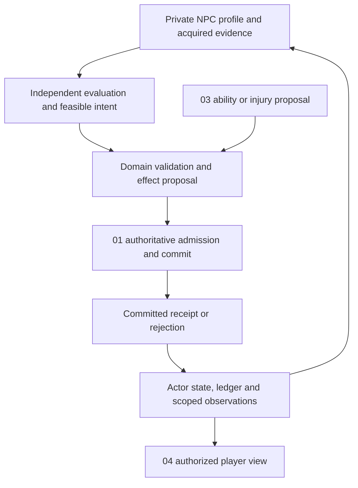

# NPC life and society — integration contract v0.1-proposal

Status: Agent 02 first-cycle specification; not accepted by peers, not runtime data, not owner-approved balance constants. Baseline f75bdd14827bd6ea8555f6ca428132e91cff97c3. Sources: [owner decisions](../OWNER_DECISIONS.md), [blueprint](../NPC_BLUEPRINT.md), [roster](../POPULATION_AND_EMPLOYMENT.md), [local life](../LOCAL_LIFE.md), [world](../WORLD.md), [memory](../NPC_MEMORY.md), [time](../TIME_AND_ACTIVITY.md). Preserve previous references. No activation until documentation review and complete authoritative initialization.

## 1. Roster audit

All entries remain draft. Age is a reference, not a birth date. Distance is shortest path through authored undirected links, not a resolved commute duration or access guarantee. Rent/cash and pay are scenario inputs, not live contracts or balances.

| Actor | Age | Household / home | Employer / work | Route m | Monthly rent / cash CR | Weekly hours / gross CR |
|---|---:|---|---|---:|---|---|
| NPC-0001 Mara Ellison | 44 | HH-0001 / LOC-0015 | ORG-0001 / LOC-0003 | 23 | 650 / 2600 | 40 / 720 |
| NPC-0002 Tessa Marin | 36 | HH-0002 / LOC-0016 | ORG-0002 / LOC-0008 | 280 | 720 / 3700 | 40 / 1000 |
| NPC-0003 Eli Mercer | 21 | HH-0003 / LOC-0017 | ORG-0002 / LOC-0008 | 280 | 550 / 1200 | 30 / 360 |
| NPC-0004 Dr. Leena Farrow | 42 | HH-0004 / LOC-0018 | ORG-0003 / LOC-0009 | 380 | 900 / 7000 | 35 / 1575 |
| NPC-0005 Adrian Bell | 28 | HH-0005 / LOC-0019 | ORG-0003 / LOC-0009 | 375 | 650 / 2800 | 40 / 800 |
| NPC-0006 Jonas Reed | 39 | HH-0006 / LOC-0020 | ORG-0004 / LOC-0010 | 115 | 720 / 4300 | 40 / 1000 |
| NPC-0007 Nia Solis | 23 | HH-0007 / LOC-0021 | ORG-0004 / LOC-0010 | 115 | 600 / 1800 | 40 / 720 |
| NPC-0008 Sera Hale | 33 | HH-0008 / LOC-0022 | ORG-0005 / LOC-0011 | 55 | 680 / 3500 | 40 / 960 |
| NPC-0009 Owen Voss | 46 | HH-0009 / LOC-0023 | ORG-0005 / LOC-0011 | 55 | 750 / 4800 | 40 / 1000 |
| NPC-0010 Cal Rivas | 38 | HH-0010 / LOC-0024 | ORG-0006 / LOC-0013 | 60 | 600 / 2300 | 40 / 800 |
| NPC-0011 Iris Dane | 31 | HH-0011 / LOC-0025 | ORG-0006 / LOC-0013 | 70 | 620 / 2500 | 40 / 720 |
| NPC-0012 Noel Vega | 19 | HH-0012 / LOC-0026 | — / None | N/A | 500 / 2400 | 0 / 0 |

Source blobs: population a679c453ab66cc7d98ab776bac3bfc3ef125d607; local life dd53a8762380708d9e8a209249bb1f90a1f3a101; world 31df1d9d01f2dba2acf9fa3d344f368c22bf6070. Parsed all 12 roster rows, 12 household rows, 6 employer rows, 12 work-window rows, 26 locations and 25 routes. Verified unique actor/household/home IDs, each roster actor has one household, valid home and employer/work references, no B2 assignment, 11 reachable work destinations, hours × rate = gross, organization payroll aggregation, four-week reserve arithmetic. Household reference cash 38,900 CR; aggregate monthly rent 7,940 CR; gross weekly payroll 9,655 CR; reserve 72,820 CR. All are separate time periods or accounts; do not aggregate rents into management revenue. Route access and travel modes still need authority.

## 2. Individual history inventory

The first two substantive columns reproduce documented motives and considerations. Last column identifies proposed history fields to resolve, not events that occurred. Preserve individual distinctions; a job title does not prove a credential or relationship.

| Actor | Reference goal | Reference preference / decision | History investigation or generation requirement |
|---|---|---|---|
| NPC-0001 | Maintain the building and manage family commitments | Values privacy; can decline nonurgent work | Maintenance experience; family commitments need identities and dates; confirm caretaker duties. |
| NPC-0002 | Keep the shop solvent and stocked | Balances costs and customer needs | Retail operations experience; confirm management authority and training, not assumed shop ownership. |
| NPC-0003 | Save for further education | May seek a better job or reduce hours | Prior basic education and entry-level retail experience; verify school history and intended study. |
| NPC-0004 | Provide reliable care within available resources | Protects confidentiality and takes time off | Clinical qualification and supervised practice history required; no inferred license or medical powers. |
| NPC-0005 | Build healthcare experience | May pursue training or change employers | Healthcare support training or supervised experience; confirm permitted duties. |
| NPC-0006 | Complete quality repairs and retain customers | Rejects unsafe or unprofitable work | Repair trade experience; verify lead authority, qualifications and ownership separately. |
| NPC-0007 | Develop diagnostics expertise | Wants increasingly challenging work | Entry trade training and diagnostics interest; verify supervised tasks and actual competence. |
| NPC-0008 | Support students and plan lessons | Has independent obligations outside school | Teacher education and supervised classroom experience; verify credential and assigned grades. |
| NPC-0009 | Keep school operations reliable | Must allocate limited resources | School operations experience; confirm financial approval authority and qualifications. |
| NPC-0010 | Earn stable income despite weather uncertainty | May refuse work in unsafe conditions | Fishing experience and safety training; verify vessel access, crew agreement and prior voyages. |
| NPC-0011 | Maintain safe dock operations and develop logistics skills | Coordinates work but does not control other actors | Dock safety and logistics experience; confirm work permissions and duties. |
| NPC-0012 | Find suitable paid work and continue learning | Can compete for jobs or reject unsuitable offers | School completion status and any previous work unknown; job-seeking is a goal, not a vacancy or benefit. |

For each of the 12 actors, maintain separate tagged fields (known, unknown, absent, not_applicable). Known reference values: name, reference age, proposed household/residence/occupation/workplace, stated goal, consideration, budget/shift references. Confirmed absence of employer reference only for Noel, not of all historical employment. All 12 require blocking resolution of birth date relative to initial calendar, origin, actual initial location, permissions, identity/definition references, life status/HP/injury state, optional need settings and values, individual traits and motivations, attributes/skills, education and qualifications, biography event records, relationship/household references, assets/accounts and obligations, knowledge packet, goal/plan/schedule, RNG and world revision. Unknown family membership is not an empty family or invented relatives. No superhuman status assigned from occupation or age. Resolve ability history with 03 and cosmic chronology with 01, including a pre-phenomenon start. Separate authored prehistory from simulated event receipts; generate once in seed-bound initialization and retain provenance; do not fabricate remembered events. Each proposed biography event must have ID, bounded date, participant IDs, location if known, actual outcome and origin; check chronological order, credential prerequisites and contradictions. A one-person accounting household does not prove no relatives. No NPC starts in B2 by default.

## 3. Shared boundary (proposal for peer review)

Agent 02 owns domain rules and scoped projections; Agent 01 owns calendar, registration, reservations, commit, event receipt and save/rewind. Do not implement a second clock or store. Agent 03 supplies damage/healing/progression proposals; Agent 04 supplies prepared interaction IDs and consumes scoped projections. Contract names are design labels, not existing callable APIs.

Common proposed envelope: contract_version, world_id, actor_id, intent_id, expected_world_revision, expected_actor_revision, target IDs and expected target revisions, action_definition_id/version, requested scope, evidence/consent references, and actual executor receipt reference when settling completed work. Time is 01's integer clock unit (no local ticks); CR amounts are integer smallest currency units with checked safe arithmetic; proposed 100 subunits per CR needs currency contract review. Every effect specifies before/precondition, delta or replacement, source ID, recipient/target, reason, dependency and event ID. Return proposed effects or typed rejection (unknown actor, stale revision, inaccessible target, invalid amount, insufficient funds/stock, missing authorization, ineligible, already settled, unresolved dependency); no mutation on rejection. One commit covers time/physical/financial/social consequences as applicable, including observation issuance. No client-generated proof, duplicate settlement, silent partial debit, or retries that reroll a resolved result. Idempotency binds world timeline + intent/receipt identity and canonical payload; divergent reuse rejects. No direct access by 04 to hidden ledgers or 03 to private cognition. Use synthetic fixtures before real actor initialization.

## 4. Condition, aging and health

Proposed inputs: actor identity, anatomy/condition revision, committed elapsed interval, world configuration reference, actual activity/exposure/damage/treatment receipt. Outputs: condition changes, injury records and functional impairment, recovery eligibility, observation candidates. Separate settings for player and NPC: individually toggle hunger, thirst, sleep, fatigue, hygiene and mental-health simulation, subject to review of default values and interaction rules. Disabling an optional system suppresses its decay, need-driven effects and related forced evaluation; it does not remove the option to eat, rest or socialize, retroactively heal injury, or disable illness/injury/aging/death. No new stamina/mana bar. Initial scales and time rates open; use synthetic integer fixtures only. Physical injuries are body-region/function-specific and carry cause, severity, laterality, onset, treatment, recovery and permanence. HP and tissue injury are separate; HP zero alone does not decide death. Death requires validated fatal biological condition (or separate authorized judgement policy); preserve identity, estate, causal history and observer knowledge. Deceased actors cease living activity; release reservations through 01, not by deleting records. Age derives from birth and world calendar; natural attribute development respects 20 ceiling and approximately age-40 plateau without automatic stat deletion. Healing must be elapsed or otherwise causally authorized, not an automatic full restoration.

## 5. Social and knowledge

Proposed directed relationship dimensions: trust, affinity, respect, familiarity; fear or obligation as separate contextual states rather than forced hostility. Candidate signed ranges -100..100 for trust/affinity/respect, 0..100 familiarity; not approved balance. Reputation scopes individual, community, organization, region, public/media; scope and subject keys separate. No global spillover without a witnessed/communicated event. Social action input includes participants, prepared option/version, evidence/access, consent where relevant, actor/context revisions and qualifying history. Exact preview only when fixed outcome is determinable and safely disclosable; otherwise conditional/range preview. Example synthetic Trust +5, cap-aware +2 if previous score 98 and cap 100; display actual possible effective delta, never private motive. No grant until commit; repeated same option without new context cannot farm rewards. NPC can decline, change objective or defer; refusal is not a forced penalty. Household formation, separation, parenthood and inheritance require actual event/consent/eligibility and 01 admission checks where new actors are involved; no automatic family generation beyond approved initialization.

Knowledge retains exact acquired evidence, source, observer, acquisition time, claim and verification status. Rumor is an accurate record of what was reported, not an established event. No forgetting, false memories or automatic mind-reading. Existing knowledge schema/perception/cognition reference is development-only; evaluate its older belief/confidence assumptions against latest owner decision before adapting. Internal plans and balances remain private. Only authorized projection may feed cognition or narrative. Contradictions retain source records; do not replace acquired facts with invented content.

## 6. Employment, shop, inventory and funded ledger

Records: employer, role/qualification, vacancy ID and status; agreement ID, mutually accepted terms/version, rate, compensable unit, shift window, settlement due, authorized workplace, status; work receipt ID, actual compensable duration, completed task units, partial progress, authorization and causal event. Presence/access, health and real task/material capacity must be validated. A missed shift does not grant wages; a worker may refuse, negotiate, resign or apply elsewhere. Opening balances are once-only endowments; no scenario revenue auto-post. No live vacancy until actual funding, need and supervisory capacity exist. Exact child labor and school eligibility rules require review; no adult assumptions for age 5–18 player creation.

Ledger record proposal: account ID, owner ID, asset/currency class, provenance lot, amount, revision; transfer ID, source, destination, amount, provenance split, cause, timestamp, committed receipt. Keep clean/dirty classes in authoritative ledger; do not expose class to uninformed observers. Preserve origin through transfers; a normal dirty-fund purchase does not automatically disclose illicit origin or fail. Monetary conservation per transaction by class unless separately authorized explicit boundary event. Reject negative quantities, overflow, self-duplicating transfers, unavailable lots, insufficient cash or stock, unlicensed authority. An obligation is not money. If verified work earns 60 CR and available employer balance is 40 CR, proposed settlement may pay 40 and record 20 payable only if partial-payment policy permits; otherwise record 60 payable and no transfer. Never invent remaining funds or discard earned entitlement. Payment and obligation reduction atomic, settled receipt unique. Rate × actual compensable elapsed time uses agreed rounding at settlement; no double rounding per tick. Numeric example is synthetic. Shop purchase: exact SKU/lot, quantity, price/version, stock and ownership, service capacity where applicable, source/destination accounts; atomic inventory and payment changes, no teleporting goods or empty stock sales. Stock acquisition/supplier and delivery require actual material sources. A closed service or unfunded seller may refuse.

Property/repair: stable item/structure/title or rental ID, owner/access rights, damage state, job specification, required material and actual labor; work consumes real resources via committed phases. Completion requires satisfied milestones; damage cannot be repaired by a text assertion. Ability-based repair requires 03 eligibility and 01 receipt. Bank storage: simple funded deposits/withdrawals, code-protected access policy separate from ownership, no automatic successor transfer, preserve estate and provenance. Exact code/beneficiary/authorization rules pending; never log raw access codes in public projections. Fictional law: case ID, alleged act, distinct offence definition, evidence source/witness/access, investigative state and authorized decision; suspicion not guilt, private evidence not automatically public, no universal response. Specific legal, employment, property, banking and repair rules are later slices.

## 7. Distant simulation

Detail is representation, not immunity from consequences. Promote actors for relevant interactions, material commitments, injury, evidence, changed conditions or proximity to a relevant scene; exact thresholds require 01 coordination and measurement. Reduce only routine output when actual resolved time and effects reconcile. Summary includes actor, interval, action category, count, net state/ledger changes, receipt/event range, provenance, commitment changes and evidence references. Significant events retain full identity, causal history, material changes and acquired evidence. No irreversible pruning of source receipts in this proposal. Never summarize hypothetical work as completed. Compare high/low detail on identical seeded scenario for elapsed time, inventory, obligations, relationship changes, injury, location and retained knowledge; stop promotion on mismatch. No background wall-clock execution.

## 8. Test and review gates

Synthetic fixtures requested for later implementation: stale revision and duplicate work receipt; interrupted shift and partial payable; insufficient stock rejects entire purchase; exact/conditional preview and repeated-dialogue refusal; two observers with differing access; attributed rumor retained without false fact; optional needs disabled independently of injury; zero HP without fatal criteria; treatment partial recovery; age plateau and retained learning; deceased actor estate and activity cessation; distant-summary conservation and promotion equivalence; creation cap/disable through 01; actual normal close/reopen and rewind consistency. These are acceptance cases, not executed tests. Review by 01: atomic effects, revisions, time, population, persistence; 03: injuries, powers and attribute boundaries; 04: projections, choices and privacy. No gameplay implementation until owner documentation review and affected interface review. Next: produce machine-readable draft roster/profile field records, then detailed condition/qualification/ledger fixtures with 01/03/04. No activation or world state created.
