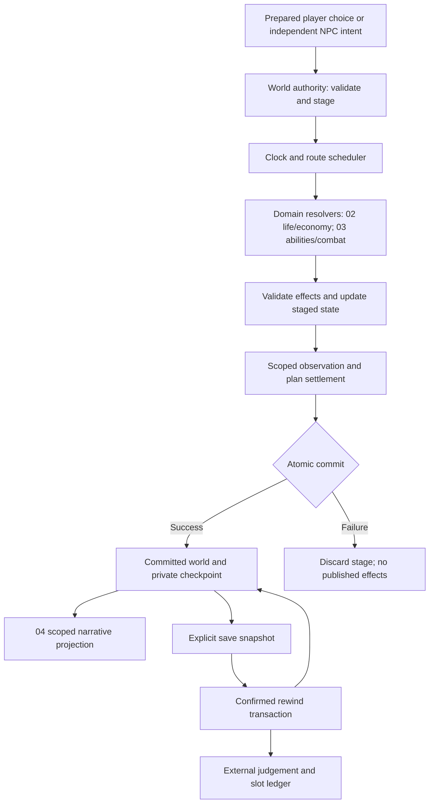

# World integration contract v2 — review proposal

Status: DRAFT, not an implemented API or owner approval. Agent 01, cycle 001, base f75bdd14827bd6ea8555f6ca428132e91cff97c3. Applies to the contemporary alternate-Earth text RPG only. Authority: ../OWNER_DECISIONS.md (latest sections), ../AGENT_COORDINATION.md, ../PROTOTYPE_PLATFORM.md. Preserve all V1 reference files and journal bytes. No canonical world, NPC or save is created by this document.

## 1. Architecture and ownership

01 owns orchestration and state envelope, not medical, financial, combat or dialogue rule definitions. 02/03 own their effect validators and state reducers, review this envelope before binding. 04 consumes scoped projections and submits prepared choice IDs, never private state or effect payloads. All domains share one transaction and clock. A domain resolver is deterministic, synchronous/pure from explicit inputs (or deterministic precomputed results), has no I/O, no external side effects, no wall-clock/random calls; no callbacks that independently persist. Existing V1 transaction stage-and-CAS is useful, but generic resource pools, execution markers, static actor list, diagnostic snapshots and replay-only journal are not sufficient for gameplay or intentional rewind.

## 2. Data envelope and concurrency

Proposed identifiers: stable opaque ASCII IDs, 1–40 characters to fit the current integrated coordinator; no semantic use of ID sorting for combat outcomes. A committed identifier is never reassigned to a different historical entity. Rewinding to a prefix may recover the same logical entity/milestone; new post-fork entities allocate from non-rewindable monotonic identity reservations or a collision-checked epoch namespace. Deterministic generation uses semantic origin keys, not sequential generation order. All data is canonical JSON compatible with canonicalWorldJson (safe integers, strings, booleans, null, plain objects, dense ordered arrays); reject extra keys at typed boundary, unsafe keys and unknown versions. All counters and additions checked for overflow before change.

| Envelope | Required fields (proposed) |
|---|---|
| WorldIdentityV2 | world_id, seed, generation_version, calendar_version, first_character_id, cosmic_tick |
| HeadV2 | world_id, epoch_id, world_revision, commit_seq, now_tick, active_player_id, state_digest |
| CommandV2 | version, world_id, epoch_id, expected_revision, command_id, actor_id, kind, issued_tick, payload |
| PreparedChoiceV2 | choice_id, actor_id, world_id, epoch_id, world_revision, actor_revision, knowledge_revision, prepared_tick, valid_until_tick, public_preview |
| EffectV2 | effect_id, domain, schema_version, subject_id, expected_subject_revision, kind, payload, causal_event_id |
| EventV2 | event_id, world_id, epoch_id, world_revision, tick, causal_ids, kind, effect_ids, outcome, source_actor_id (nullable) |
| ResultV2 | command_id, status, resulting_head (nullable for rejection), committed_event_ids, scoped_receipt (nullable), error_code (nullable) |

world_revision counts transactions within an epoch; commit_seq is monotonic over the whole universe, including external save/rewind operations. A normal technical retry is keyed by world+epoch+command_id and canonical original command bytes; exact repeat returns its original receipt without mutation even after later commits. A command from an abandoned epoch may retrieve its original committed diagnostic result only through privileged recovery; never return a stale narrative projection or execute it again. UI always refreshes current head. Same ID with changed content -> ID_CONFLICT. New wrong-world/epoch/revision command -> STALE_OR_FOREIGN. Rejected/infeasible/malformed commands change neither clock, RNG, ledger, resources, revision nor observations. A valid gameplay action with an unsuccessful actual outcome is a committed event, not a rejected command. Technical work-budget continuation is tied to the already admitted command/session, never a second player action. Public errors sanitized; private diagnostics excluded. Commands: submit_choice, continue_session (technical only), plus privileged register/admit, schedule, save_create, save_erase, rewind_prepare, rewind_confirm, recover; exact typed payloads/handlers per reviewed increment. No arbitrary effect command from UI.

## 3. Clock and calendar

Engineering proposal: nonnegative integer fictional seconds from 0001-01-01 00:00:00 in a proleptic Gregorian civil calendar; use deterministic arithmetic independent of OS timezone, locale or Date.now. One civil day = 86400 seconds; no DST/leap seconds in first slice. Valid civil years 1..9999, reject overflow and invalid dates; UTC-like fictional reference, local display initially same offset. Do not select a canonical starting date or town timezone yet: scenario config supplies a reviewed opening date, birth date/time and chronology. Birth time default only if reviewed; age measured at anniversary (Feb 29 in non-leap year -> Feb 28 proposed, peer/owner review if material). Calendar conversions are pure, round-trip exact.

First universe cosmic milestone fixed to first character's 17th birthday, persisted in identity. Age 5–16 opening is before milestone, age 17 can begin on boundary, age 18 includes event in verified prehistory. At 18th anniversary only one natural awakening evaluation per eligible actor, resolved by 03 with persistent milestone key and RNG evidence; 01 owns schedule, not probability. If start is exactly the 18th birthday process once as an explicit initialization transaction; after it require prehistory receipt. Successor character cannot move cosmic date or recreate universe. Rewind before milestone removes its active-timeline effects; replay same event origin and stable RNG draw, no new universe or redraw through technical retries. Hidden conditions remain private. Explicit initialization is not technical recovery.

One time authority (executor/clock); reading, selecting, UI navigation, real waiting, save/load and successor creation do not advance it. Resolve next boundary as minimum active phase end, due world/actor event and admitted horizon. Settle elapsed effects over common interval, then reconcile boundary events as a batch against staged state. Explicit causal prerequisites first; resolve resource conflicts using domain-specific reviewed policy and deterministic tie key, not player-first/ID-based combat advantage. Process actual effects/observations before next decision review; event at completed phase cannot retroactively erase released work. At an observed actionable interruption stop exactly at boundary, retain committed partial effects and remaining activity. Busy actor may decline or defer independent intent; one exclusive time budget unless compatibility rule is reviewed. Bounded technical processing persists same session, with no wall-time advancement. No arbitrary new time or effects when no admitted gameplay interval. Cap and fairness of review loop still require implementation/tests.

## 4. Geography and actual travel

Use ../WORLD.md's 26 location anchors and 25 explicit routes; do not build exhaustive geometry. Location {location_id,parent_region_id,type,name,description_ref,access_rule_id}; route {route_id,from_id,to_id,distance_m,direction,modes,access_rule_id}; mutable closure/condition and revision separate from immutable graph; unknown distance remains null and is not traversable as a timed leg until established. Validate unique IDs, non-conflicting pairs, acyclic containment, endpoints, allowed direction and positive integer authored meters. Graph topology not proof of geometric boundaries. Separate existence, discovery/knowledge and actual access. No shortcut from coordinates or narrative; no implicit access to private interiors. Travel uses explicit itinerary, mode, capacity and actual physical eligibility; actor state is either at location or in_transit {route_id,from_id,to_id,progress_mm,leg_length_mm,mode,started_tick,last_tick}, never both. Domain mobility supplies nonnegative integer mm/s or rational rate with saved remainder; duration derives from real remaining distance, not universal speed. Store actual progress and fractional remainder; closure/impairment may stop travel at current position, no teleport or automatic reroute. Reverse/return and route switching require explicit physically valid path. Arrival commits exact endpoint once, retains elapsed time; no fake completed distance. No detailed map or actual new authored locations in this cycle.

## 5. Population admission

Delegated prototype configuration: 128 living NPCs globally, 32 regional generation budget, 12 reference profiles inactive until validation. Count active, incapacitated and offscreen living NPC identities; exclude active player and deceased history. Region budget counts admissions charged to originating region (proposed cumulative generation budget for initial slice, not residency limit); travel and death do not refund that regional budget. Successor role transitions require explicit classification so no double count or unaccounted actor; old characters/death histories preserved. New admissions include births, immigration and procedural discovery; region/method and coherent profile/history supplied by 02. Reservation {reservation_id,world_id,epoch_id,origin_region_id,method,count,commitment_id,created_tick,status} accepted or rejected atomically with global and regional capacity; global living+reserved and regional spent+reserved cannot exceed configured limits at admission. Convert a reservation to living registration and budget charge once, or release only on documented valid cancellation; accepted birth commitments honored even after disable/lower cap, do not accept new over-cap reservations. Disable stops new creation, never existing activity/travel/death; no forced deletion/death. Reserve before establishing a binding birth/arrival commitment, avoid fictional pregnancy with impossible slot. Actor registry update must atomically add executor, scheduler, domain state, knowledge, provenance, and independent review series. Death preserves history, settles obligations/activities, removes live count and ends review; no ID recycling. V1 256 initial actor ceiling/static Set and absent registration API explicitly block direct production use; new interface must distinguish live registry and history.

## 6. Domain effect transaction

02 defines Credits in integer smallest accounting units and asset, need, injury, work, relationship, memory/education/legal effects; 03 defines ability, milestone, combat, creature/rift effects; 01 defines clock, route, population, identity, activity, reservations, event metadata. No generic universal currency/stamina. Each typed effect handler declares schema version, exact payload, authorized producer, affected subjects, preconditions, effect application, constraints and projection; registry jointly reviewed before use. No unknown kind accepted. Validate whole effect bundle in isolated stage, check revision and conservation (including transfers, sources/sinks, obligations), exclusive targets and capacity; deterministic canonical order respecting causal dependencies. Multiple effects on same subject refer to same pre-stage revision with composed validation; one resulting revision bump per changed subject per boundary. No negative inventory, unfunded cash payment, duplicated wages or repeated milestone. Actual earned but unfunded work records obligation; payment separate. If a physical action fails after some actual work, commit the real partial outcome; if technical validation fails, discard entire staged transaction. Plan credit only from actual committed effect/elapsed eligible work; release unused reservations, never refund consumed resources without explicit domain effect. Observation receipts from actual committed event and scoped access, including zero-recipient events; actor learns an attributed report, not hidden truth. Offscreen routine summaries preserve actual totals, time, identities, commitments, significant causal records and accessible knowledge; no fictional time skip or fabricated progress. No direct domain writes outside coordinator.

## 7. Seed and generation

World seed generated once only on authorized initialization of genuinely new world; durable identity independent of disposable cache, recover missing/corrupt data fail closed. No reseed on New Game, death, rewind or routine recovery. Proposed portable deterministic stream: SHA-256 over canonical JSON tuple [generation_version,seed,domain,stable_origin_key,draw_index], first unsigned 32 bits big-endian, rejection sampling for bounded integer uniformity (advance index per rejected draw); golden vectors must match Node/mobile, no platform Math.random. Specify a bounded max draw count and fail closed before acceptance on exhaustion. Never expose seed/private rolls to actor views. Domain-separated stable keys for region/entity generation and birthday milestones; no random coupling between unrelated NPCs. Persist counters and resolved draw evidence as part of active snapshot, no RNG consumption during preview or failed CAS. Epoch ID not RNG input for same logical encounter/milestone; intentional rewind restores counters; stable origin keys remain same when repeating causal path. Do not claim cryptographic anti-cheat. Seed alone cannot recover changed history. Generation algorithm version immutable unless explicit reviewed migration preserving established facts and state.

## 8. Three slots, epoch rewind and external ledger

Separate automatic durable current head from three user-addressable snapshot slots (1..3). No silent overwrite; create into empty slot only, explicit erase required when full. Snapshot immutable, complete private state plus world_id, seed identity, source epoch/revision, tick, schema/dependency versions, snapshot_id, canonical digest. Snapshot contains every domain (actors, histories, locations, economy/assets, knowledge, plans, activities, reservations, scheduler queues, clock, RNG counters, milestones, active character and decision context). No diagnostic-only snapshot. Save create/erase change external slot metadata, not fictional time. Erase removes slot reference, not audit history; pinned data retention and storage lifecycle separately reviewed. Snapshot identity for judgement stable across slot rename/recreation and identical restored checkpoint; preserve canonical origin + checkpoint identity, not slot number or newly generated snapshot label.

External envelope (never overwritten by snapshot): identity, monotonic commit_seq, current epoch pointer, slot manifest, operation-id receipts, epoch lineage, identity allocation history, judgement ledger and terminal judgement markers. Use one transactional local database boundary for both active-world pointer/state and external ledger/slots, not separate files with uncoordinated CAS. Distinct schema version and adapter; retain v1 read-only import path, verify complete replay and private checkpoint before conversion; never modify original file. Freeze/fence writers during migration, validate source unchanged and atomically publish trusted pointer; no automatic cutover. Separate epoch records and retained journal branches: old future diagnostic only, no effects on active history, no duplicate assets or observed memories from abandoned future. No deletion/compaction here. Current V1 max 256 commands and full replay are known limits; solve for actual slice needs, not arbitrary storage optimization.

Load two steps: (1) inspect slot and create confirmation token bound to slot generation, snapshot digest, current head/commit_seq and target; no mutation; (2) explicit confirmation consumes token exactly once, CAS validates both, stages restored entire snapshot into new epoch, preserves same seed, resets/invalidate old choices, increments external commit_seq and records rewind/judgement atomically. On stale token, corrupt/incompatible snapshot, foreign world or missing domain reject and preserve both envelopes. On failure rollback all. Exact retry returns original operation result, no new epoch/counter; lost acknowledgement recover committed head. Continue/normal recovery uses current committed head, not Load or new seed, no judgement increment. Snapshot may include interrupted activities; restore actual remaining work and decision without advancing time. Unresolved owner policy: voluntary character switching, terminal judgement consequence enforcement and archive retention; do not activate penalty until reviewed.

## 9. Divine Judgement and stuck detection

External per-character ledger holds stable checkpoint/encounter regression identity, consecutive qualifying reload count, forward meaningful action streak, warning status, pending/terminal judgement marker and deduplicated qualifying command/rewind IDs. Qualification proposal: actual backward load to same stable checkpoint/encounter after progress or repeated confirmed reload of that same checkpoint; compare causal identity not slot number; define different-checkpoint rotation/encounter classification with 04 before implementation, do not silently reset abuse by changing slot. A canceled load, stale command, normal recovery, exact retry or verified exempt stuck-reset is not counted. At 8 qualifying same-reload repetitions emit approved warning once; at 28 (8+20 working interpretation) record pending terminal judgement; reset count/warning after 15 successfully committed meaningful forward gameplay actions without regression. UI actions, reading, cancellation, technical retry, and no-progress spam excluded. Regression interrupts streak. Define one meaningful action per committed resolved player action, not per phase or NPC action, and classify from actual receipts. Terminal penalty must not be erasable by rewinding same character; 02/04 review biological death/character succession and disclosure, 01 persists non-rewindable marker. Pending design: exact penalty application when target snapshot active actor differs; fail closed on activating unreviewed penalty path rather than inventing death rule.

Stuck detection per active timeline: legitimate committed attempt at same obstruction/encounter with no meaningful progress, based on authoritative failure evidence. Count once per action round, exclude waiting/sleep/study/work/menu/technical retries. Reset on progress, obstruction clear or encounter change. At 18 offer optional previous-save reset; no automatic rewind. Proposed verified exemption requires recorded obstruction evidence and exact previous checkpoint, same two-step rewind protocol; no arbitrary client claim. Preserve evidence and operation ID externally so retry cannot double-count. Do not expose private ledger detail beyond authorized warnings and public recovery options.

## 10. Example fixture (synthetic, not canon)

World W1, epoch E1, tick T, actor A1, choice C1 for an authored 100 m walking leg, feasible test speed 1000 mm/s. NPC A2 concurrently performs 100 seconds of paid work using an agreed synthetic rule. Submit C1 at revision 7. At +40 seconds observable interruption, A1 is 40,000 mm along route, A2 has 40 seconds eligible work and no fictitious remaining pay. Commit actual travel and earned entitlement in one boundary transaction; stale C1 or duplicate command cannot double-charge time/pay. Save slot 1 at T+40. Resume, arrive at T+100; NPC total eligible time 100 seconds (not 160). Confirm load slot 1: both positions/work/knowledge/clock return to T+40, seed unchanged, new epoch and external load counter. Technical reopen does not increase counter. Replay suffix with same valid inputs produces same domain results (excluding epoch/operation metadata). None of these fixture numbers sets a canonical speed, wage or action rule.

## 11. Acceptance and smallest next increment

All cases below NOT RUN; specification gate only. Preserve V1 tests and compare original blobs before edits.
- W2-01 calendar round-trip, leap years, invalid input, age 5/17/18 boundaries, successor unchanged cosmic tick.
- W2-02 no time on preview/read/recovery; concurrent durations not additive; interruption at 40s retains progress, exact retry/technical continuation once.
- W2-03 graph data validation and path feasibility: B2 grocery 353m; missing shortcut, locked door, closure mid-route, reverse, actual arrival.
- W2-04 competing reservations at cap, disabled creation, grandfathered birth, death, travel not admission, history retained, atomic registry failure.
- W2-05 domain actual effects and conservation, partial outcome, two simultaneous claims, stale revision, bad schema/foreign identity, late failure rolls back all; no private knowledge leak.
- W2-06 deterministic domain-separated RNG vectors, save/resume and failed CAS no redraw, prehistory milestone exactly once.
- W2-07 three slots, fourth rejected until explicit erase, stale/canceled confirm, corrupt snapshot and wrong world, full restore of all domains and active activities, exact retry and old epoch rejection.
- W2-08 external warning 8 / pending penalty 28 / reset 15, slot recreation, technical retry and reopen, verified stuck 18 optional reset; no unreviewed penalty activation.
- W2-09 legacy v1 preserved, explicit migration on synthetic copies, stale writer and controlled transaction rollback, normal close/reopen; Android force-stop owner only.
- W2-10 integrated local days, multiple paths and independent NPC actual effects; scoped narrative. Not a claim of playable functionality.

First code increment after required review: pure calendar conversion/milestone schedule with synthetic fixtures, no canonical date or seed; then route registry data validation and atomic domain effect boundary (02/03 schema agreement); dynamic registration then full rewind adapter. Calendar is small and independent, but actual effects and playable paths outrank further journal optimization. No new gameplay code before documentation/data review and applicable owner gate. Request Agent 02 for effects/admissions, Agent 03 for milestones/combat, Agent 04 for choices/rewind/projections and ring review. Record concrete schema agreement before consumers implement; unresolved fields cannot be silently made canon.
