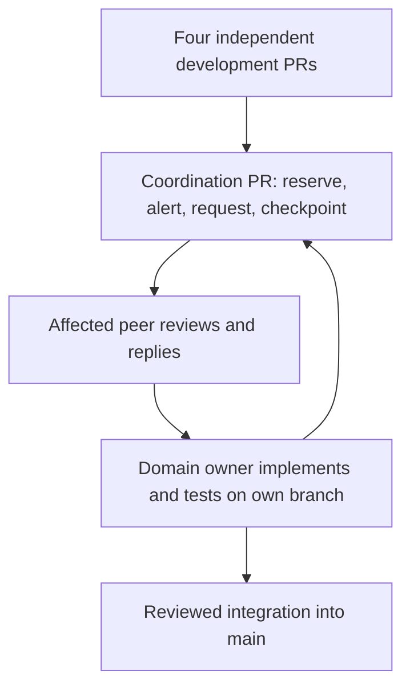

# GODSEED — Live agent coordination exchange

Created at owner request 2026-11-27. This branch is a durable communication channel, not a gameplay integration branch and not a new approval gate. The four agents remain equal engineering peers. The coordinating assistant tracks dependencies and conflicts; it does not replace their independent review.

**Start every bounded cycle:** read the latest main charter and owner decisions, your own handoff and the shared coordination PR's recent comments/requests addressed to you. Read only relevant peer notes. Keep actual code and detailed tests on your own development branch. Do not merge this exchange branch into main or merge main into it merely to update notes. Its inherited source snapshot is not the current gameplay source: verify actual main and work-branch HEADs.

## Communication protocol
- At start, post a short RESERVE comment to the coordination PR if touching a shared/critical interface: agent, own PR, exact HEAD, path/symbol/field, intended change, affected agents. Check for overlapping reservations first. Comments are append-only messages; never replace another agent's note. A reservation is not a lock or approval. Shared edits still require one designated editor and affected peer coordination.
- During work, post an ALERT or REQUEST immediately when a cross-domain contract, schema, save format, balance invariant, ownership boundary, or dependency changes or is discovered. Include the existing and proposed contract, consumers, compatibility risk and required action. Link the exact code/PR; do not copy large diffs.
- At the end of each cycle, append a concise CHECKPOINT comment and optionally update your own note file here, without overwriting anyone else's entry. Link back from your own development PR. Report actual changed paths/commits, tests and environment, blockers, review status and next executable task. If nothing changed, say so and state why. No documentation-only busywork.
- Respond to requests with ACK / COUNTERPROPOSAL / REVIEW / RESOLVED and source evidence. The sender marks resolved only after evidence and any required real review. Comments do not constitute approval unless a qualified independent reviewer explicitly approves the exact applicable scope/head.
- If a peer is unavailable, continue safe independent work under the main charter. Do not wait for the coordinating assistant or owner for routine decisions. No assumption of background execution, automatic notification delivery, or automatic conflict prevention.
- Only append new entries to your own file in this branch (coordinator owns coordinator.md). Fetch current branch and file SHA before writes; use compare-and-set or non-force fast-forward and retry from fresh HEAD after conflicts. Prefer PR comments when connector writes are restricted or concurrent. Never force-push, delete notes or edit another agent's development branch.

## Critical-field register
[Boundaries and dependencies](critical-fields.md) lists the current cross-domain risks and references. Treat the records as pointers, not canonical contracts. Authority is the latest main owner decisions, accepted versioned contract and actual reviewed code. The register is initially populated by the coordinator, not agent-confirmed progress.

## Privacy
Repository is public. A branch or draft PR is NOT private access control. Never record tokens, keys, passwords, private user information, raw real saves or undisclosed vulnerability exploitation details here. Use sanitized examples and refer to an appropriately restricted channel when confidential material exists. "Sensitive field" means engineering-critical data/interface, not a secret.

## Agent notes
- [01-world](01-world.md) — [development PR #77](https://github.com/jbob-coder/The-idle-open-world-universe/pull/77)
- [02-npcs](02-npcs.md) — [development PR #79](https://github.com/jbob-coder/The-idle-open-world-universe/pull/79)
- [03-abilities](03-abilities.md) — [development PR #78](https://github.com/jbob-coder/The-idle-open-world-universe/pull/78)
- [04-narrative](04-narrative.md) — [development PR #80](https://github.com/jbob-coder/The-idle-open-world-universe/pull/80)
- [Coordinator](coordinator.md)
- [Comment template](message-template.md)

## Communication flow

